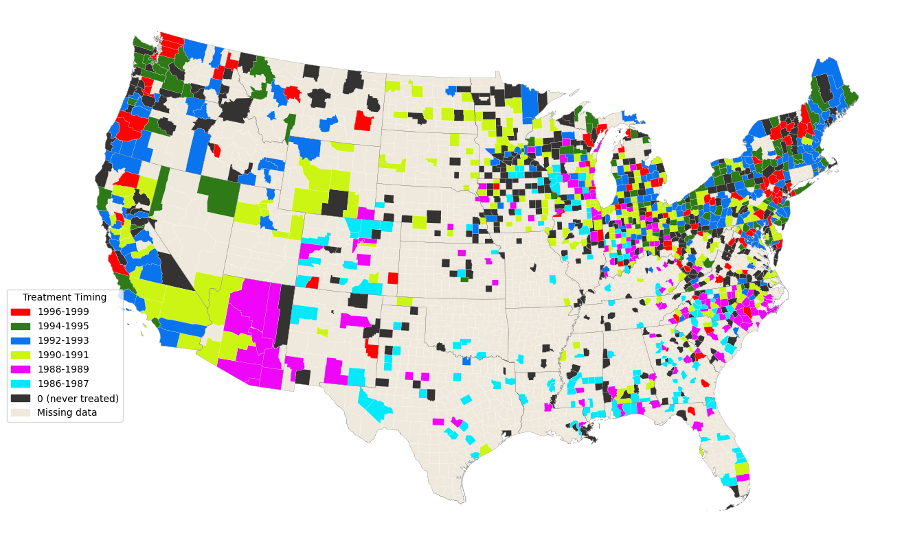

# Appendix for Chapter 22 {#sec-experiments-appendix}

```{r}
#| warning: false
#| message: false
# Load the necessary libraries
library(haven)
library(tidyverse)
library(did)
library(knitr)
library(labelled)
library(panelView)
library(modelsummary)
options("modelsummary_factory_default" = "gt") 
```

## Staggered treatment designs
### Introduction
In this section, we consider a staggered treatment design in which units receive treatment at different time periods. In this design, treatment timing varies across units, such that some units may receive treatment in the first period, while others may receive treatment in the second period, and so on. This design is particularly useful for evaluating the effects of policies or interventions implemented at different times across units, such as states or countries. This setting allows us to define distinct treatment groups (cohorts) based on treatment timing. For example, we can define one cohort consisting of units that receive treatment in the first period, another cohort consisting of units that receive treatment in the second period, and so on, and then compare these cohorts to a control group that never receives treatment.

We use $Y_{it}$ to denote the observed outcome for unit $i$ at time $t$, for $i=1, \ldots, n$ and $t = 1, \ldots, T$. We use $Y_{it}(\infty)$ to denote the never-treated potential outcome for unit $i$ at time $t$, and $Y_{it}(g)$ to denote the potential outcome for unit $i$ at time $t$ if it receives treatment in period $g$. Let $G_i$ denote the period in which unit $i$ receives treatment, with $G_i = \infty$ if unit $i$ never receives treatment, and let $\mathcal{G}$ denote the set of all possible treatment periods. Thus, the set $\mathcal{G}$ defines the cohorts of treated units and untreated units in the staggered treatment design. Each element of $\mathcal{G}$ corresponds to a specific treatment period, and the control group corresponds to the element $\infty$.

For example, suppose there are three time periods: 2020, 2021, and 2022. Further, suppose that some units receive treatment in 2020, some receive treatment in 2021, some receive treatment in 2022, and some never receive treatment. In this case, we can define three cohorts of treated units: the first cohort consists of units that receive treatment in 2020, the second cohort consists of units that receive treatment in 2021, and the third cohort consists of units that receive treatment in 2022. The never-treated group consists of units that never receive treatment (i.e., $G_i = \infty$). Thus, in this example, we have $\mathcal{G} = \{2020, 2021, 2022, \infty\}$.

Using this notation, for the $i$th unit that belongs to cohort $g$, we can express its observed outcome as 
$$
Y_{it} =
\begin{cases}
Y_{it}(g) & \text{if } t \geq g,\\
Y_{it}(\infty) & \text{if } t < g.
\end{cases}
$$

In our example, where $\mathcal{G} = \{2020, 2021, 2022, \infty\}$, the observed outcome for unit $i$ at time $t$ can be expressed as follows:
$$
Y_{it} =
\begin{cases}
Y_{it}(2020) & \text{if } t \geq 2020 \text{ and } G_i = 2020,\\
Y_{it}(2021) & \text{if } t \geq 2021 \text{ and } G_i = 2021,\\
Y_{it}(2022) & \text{if } t \geq 2022 \text{ and } G_i = 2022,\\
Y_{it}(\infty) & \text{if } t < G_i.
\end{cases}
$$

In the staggered treatment design, the parameter of interest is often the group-time average treatment effect, which is defined as the average treatment effect for units in cohort $g$ at time $t$, and is given by
$$
ATT(g,t) = \mathbb{E}[Y_{it}(g) - Y_{it}(\infty) | G_i = g].
$$
This parameter captures the average effect of treatment for units in cohort $g$ at time $t$, relative to the never-treated potential outcome. 

### Identification and estimation without covariates
To identify and estimate the group-time average treatment effect $ATT(g,t)$, we assume the following assumptions.

:::{.callout-important icon=false title="No anticipation"}
For all $i$ and $t < g$, we have $\E[Y_{it}(g)|G_i = g] = \E[Y_{it}(\infty)|G_i = g]$ for all $g \in \mathcal{G}$.
:::

:::{.callout-important icon=false title="Parallel trends assumptions"}
1. **Parallel Trends based on the never-treated group**: For all treated groups $g \in \mathcal{G}$ and $t \geq g$, we have 
$$
\E[Y_{it}(\infty) - Y_{i,t-1}(\infty)|G_i = g] = \E[Y_{it}(\infty) - Y_{i,t-1}(\infty)|G_i = \infty].
$$

2. **Parallel Trends based on the not-yet-treated groups**: For all treated groups $g \in \mathcal{G}$, not-yet-treated groups $g' \in \mathcal{G}$ such that $g' > t$ and $t \geq g$, we have
$$
\E[Y_{it}(\infty) - Y_{i,t-1}(\infty)|G_i = g] = \E[Y_{it}(\infty) - Y_{i,t-1}(\infty)|G_i = g'].
$$

3. **Parallel Trends for every period and group**: For all treated groups $g, g' \in \mathcal{G}$ and time periods $t$, we have
$$
\E[Y_{it}(\infty) - Y_{i,t-1}(\infty)|G_i = g] = \E[Y_{it}(\infty) - Y_{i,t-1}(\infty)|G_i = g'].
$$
:::

The no anticipation assumption states that units do not anticipate future treatment and thus their potential outcomes before treatment are the same as if they were never treated. As in the case of common treatment timing, this assumption suggests that $ATT(g,t)=0$ for all $t < g$. Due to the staggered nature of the treatment, we can have different comparison groups at each time period, yielding different parallel trends assumptions. 

The first assumption, based on the never-treated group, states that in the post-treatment period, the average change in the never-treated potential outcome from period $t-1$ to period $t$ is the same for units in cohort $g$ and units in the never-treated group. The second assumption, based on the not-yet-treated groups, states that the average change in the never-treated potential outcome from period $t-1$ to period $t$ is the same for units in cohort $g$ and units in the not-yet-treated cohorts. Finally, the parallel trends assumption for every period and group states that the average change in the never-treated potential outcome from period $t-1$ to period $t$ is the same for units in cohort $g$ and units in any other cohort.

:::{#thm-identification-staggered}
## Identification of the group-time average treatment effects
1. Under the no anticipation assumption and the parallel trends assumption based on the never-treated group, for all $g \in \mathcal{G}$ and $t \geq g$, we have
$$
ATT(g,t) = \E[Y_{it} - Y_{i,g-1}|G_i = g] - \E[Y_{it} - Y_{i,g-1}|G_i = \infty].
$$
2. Under the no anticipation assumption and the parallel trends assumption based on the not-yet-treated groups, for all $g \in \mathcal{G}$ and $t \geq g$, we have
$$
ATT(g,t) = \E[Y_{it} - Y_{i,g-1}|G_i = g] - \E[Y_{it} - Y_{i,g-1}|G_i > \max\{g,t\}].
$$
3. Under the no anticipation assumption and the parallel trends assumption for every period and group, for all $g, g' \in \mathcal{G}$ and time periods $t$ such that $g'> t$ and $t \geq g$, we have
$$
ATT(g,t) = \E[Y_{it} - Y_{i,t_0}|G_i = g] - \E[Y_{it} - Y_{i,t_0}|G_i = g'],
$$
where $t_0$ is any time period such that $t_0 < g$.
:::

:::{.proof}
## Proof of Theorem @thm-identification-staggered
This theorem can be proved as in the case of common treatment timing, by adding and subtracting the appropriate never-treated potential outcomes, and then applying the no anticipation and the appropriate parallel trends assumption. We provide the proof of the first result, and the proofs of the second and third results are similar.

For the first result, we assume that the no anticipation assumption and the parallel trends assumption based on the never-treated group hold. Then, for all $g \in \mathcal{G}$ and $t \geq g$, we have
\begin{align*}
ATT(g,t) &= \E[Y_{it}(g) - Y_{it}(\infty)|G_i = g]\\
&= \E[Y_{it}(g) - Y_{i,g-1}(\infty)|G_i = g] - \E[Y_{it}(\infty) - Y_{i,g-1}(\infty)|G_i = g]\\
&= \E[Y_{it}(g) - Y_{i,g-1}(\infty)|G_i = g] - \E[Y_{it}(\infty) - Y_{i,g-1}(\infty)|G_i = \infty]\\
&= \E[Y_{it} - Y_{i,g-1}|G_i = g] - \E[Y_{it} - Y_{i,g-1}|G_i = \infty],
\end{align*}
where the second equality follows from adding and subtracting $Y_{i,g-1}(\infty)$, the third equality follows from the parallel trends assumption based on the never-treated group, and the last equality follows from the no anticipation assumption and the definition of the observed outcome.
:::

Given a random sample of $n$ units, we can estimate the group-time average treatment effect $ATT(g,t)$ using the sample analog of the identification results in Theorem @thm-identification-staggered. Under the no anticipation assumption and the parallel trends assumption based on the never-treated group, for all $g \in \mathcal{G}$ and $t \geq g$, we can estimate $ATT(g,t)$ as
$$
\begin{align}
\widehat{ATT}(g,t) &= \frac{1}{n_g}\sum_{i=1}^n (Y_{it} - Y_{i,g-1})\mathbf{1}\{G_i = g\} \\
&- \frac{1}{n_\infty}\sum_{i=1}^n (Y_{it} - Y_{i,g-1})\mathbf{1}\{G_i = \infty\},
\end{align}
$$
where $n_g = \sum_{i=1}^n \mathbf{1}\{G_i = g\}$ and $n_\infty = \sum_{i=1}^n \mathbf{1}\{G_i = \infty\}$ are the number of units in cohort $g$ and the never-treated group, respectively. Under the no anticipation assumption and the parallel trends assumption based on the not-yet-treated groups, for all $g \in \mathcal{G}$ and $t \geq g$, we can estimate $ATT(g,t)$ as
$$
\begin{align}
\widehat{ATT}(g,t) &= \frac{1}{n_g}\sum_{i=1}^n (Y_{it} - Y_{i,g-1})\mathbf{1}\{G_i = g\} \\
&- \frac{1}{n_{\max\{g,t\}}}\sum_{i=1}^n (Y_{it} - Y_{i,g-1})\mathbf{1}\{G_i > \max\{g,t\}\},
\end{align}
$$
where $n_{\max\{g,t\}} = \sum_{i=1}^n \mathbf{1}\{G_i > \max\{g,t\}\}=\sum_{i=1}^n \mathbf{1}\{G_i > t\}$ is the number of units in the not-yet-treated cohorts. Finally, under the no anticipation assumption and the parallel trends assumption for every period and group, for all $g, g' \in \mathcal{G}$ and time periods $t$ such that $g'> t$ and $t \geq g$, we can estimate $ATT(g,t)$ as
$$
\begin{align}
\widehat{ATT}(g,t) &= \frac{1}{n_g}\sum_{i=1}^n (Y_{it} - Y_{i,t_0})\mathbf{1}\{G_i = g\} \\
&- \frac{1}{n_{g'}}\sum_{i=1}^n (Y_{it} - Y_{i,t_0})\mathbf{1}\{G_i = g'\},
\end{align}
$$
where $n_{g'} = \sum_{i=1}^n \mathbf{1}\{G_i = g'\}$ is the number of units in cohort $g'$, and $t_0$ is any time period such that $t_0 < g$. An alternative estimator of $ATT(g,t)$ under the parallel trends assumption for every period and group is given by (@baker2026difference)
$$
\begin{align}
\widehat{ATT}(g,t) &= \frac{1}{n_g}\sum_{i=1}^n (Y_{it} - \bar{Y}_{i,t\leq g-1})\mathbf{1}\{G_i = g\} \\
&- \frac{1}{n_{g'}}\sum_{i=1}^n (Y_{it} - \bar{Y}_{i,t\leq g-1})\mathbf{1}\{G_i>t\},
\end{align}
$$
where $\bar{Y}_{i,t\leq g-1} = \frac{1}{g-1}\sum_{t=1}^{g-1} Y_{it}$ is the average observed outcome for unit $i$ in the pre-treatment periods.

For statistical inference, @Callaway2021 suggest using the multiplier bootstrap method to compute standard errors for $\widehat{ATT}(g,t)$. We will use the `did` package to implement these estimation and inference procedures in the application below.

### Aggregating group-time average treatment effects
In the staggered treatment design, for a cohort $g \in \mathcal{G}$, we can have different group-time average treatment effects across time periods. For example, for cohort $g$, we can have $ATT(g,g)$, which is the average treatment effect for units in cohort $g$ in the first period after they receive treatment; $ATT(g,g+1)$, which is the average treatment effect for units in cohort $g$ in the second period after they receive treatment; and so on. Across all cohorts and time periods, there may be a large number of group-time average treatment effects, which can be difficult to summarize and interpret. There are several ways to aggregate the group-time average treatment effects into summary measures. See Table 1 in @Callaway2021 for a summary of the different aggregation methods proposed in the literature. One popular summary measure is an event-study parameter showing the average effect of treatment by the length of exposure to the treatment:
$$
\begin{align}
\widehat{ATT}(e) &= \sum_{g \in \mathcal{G}} w_{g,e} \widehat{ATT}(g, g+ e),
\end{align}
$$
where $e$ is the length of exposure to the treatment, and $w_{g,e}$ is a weight that depends on the number of units in cohort $g$ and the number of time periods in which we can observe the effect of treatment for cohort $g$ at length of exposure $e$. It is given by
$$
w_{g,e} = \mathbf{1}\{g + e \leq T\} P(G=g|G+e \leq T, G\leq T).
$$

### Application: The effect of Walmart entry on local labor markets
In this section, we study the effect of Walmart's opening on local labor markets using the dataset collected by @Butts2025dynamic. The dataset contains information on the opening dates of Walmart stores across different counties in the United States, as well as information on local labor market conditions. The dataset is a balanced panel of 1277 counties over the period 1977--1999. The dataset is contained in the lw_walmart.dta file and includes the following variables:

- `fips`: County FIPS code.
- `year`: Year of observation.
- `cid` : County identifier (numeric).
- `first_year`: Year of the first Walmart opening in the county.
- `log_wholesale_emp`: Log of wholesale employment level in the county.
- `log_retail_emp`: Log of retail employment level in the county.
- `x1`, `x2`, `x3`: Share of population above poverty line, share of employment in manufacturing, and share of population with high school degree or higher, respectively.

```{r}
# Load the dataset
walmart_data <- read_dta("data/lw_walmart.dta")
colnames(walmart_data)
```

In the following, we provide a table of summary statistics using the `datasummary_skim` function from the `modelsummary` package. We also add variable labels to the dataset using the `set_variable_labels` function from the `labelled` package, so that the summary statistics table has more informative variable names.
```{r}
#| tbl-cap: "Summary statistics for the variables in the dataset"
#| label: tbl-walmart-summary-stats
#| warning: false
#| message: false
# Add variable labels
walmart_data <- set_variable_labels(
    walmart_data,
    year = "Year",
    cid = "County ID",
    first_year = "First opening",
    log_wholesale_emp = "log(WholesaleEmp)",
    log_retail_emp = "log(RetailEmp)",
    x1 = "x1",
    x2 = "x2",
    x3 = "x3"
)

# Summary statistics
datasummary_skim(
    walmart_data,
    fmt = 2,
    type = "numeric"
)
```

@tbl-walmart-summary-stats shows that the first Walmart opening in the dataset occurred in 1989, and the last Walmart opening occurred in 1999. Thus, there are 14 cohorts of treated units, corresponding to the years 1989--1999, and a never-treated group consisting of counties that never had a Walmart opening during the sample period. @tbl-walmart-openings shows the number of counties that had their first Walmart opening in each year from 1989 to 1999, as well as the number of counties that never had a Walmart opening (never-treated counties) during the sample period. The table shows that the never-treated group consists of 391 counties. The number of counties in the treated cohorts ranges from 21 to 118, with the largest number of counties having their first Walmart opening in 1990 (110 counties) and the smallest number of counties having their first Walmart opening in 1999 (12 counties). In @fig-AppendixA1-1, we show the distribution of the year of the first Walmart opening across counties.

```{r}
#| tbl-cap: "Number of counties with first Walmart opening by year"
#| label: tbl-walmart-openings
# Number of counties with first Walmart opening by year
walmart_openings <- walmart_data %>%
  group_by(first_year) %>%
  summarise(num_counties = n_distinct(cid)) %>%
  arrange(first_year)
cnames <- c("Year of first opening", "Number of counties")
kable(walmart_openings, col.names = cnames)
```

{#fig-AppendixA1-1 width=800px}

In the following, we generate the indicator `D`, which takes the value 1 if the county has a Walmart store in that year and in all subsequent periods, and 0 otherwise. We use this variable in the `panelview` function from the `panelView` package to visualize the treatment timing across counties and over time, as shown in @fig-AppendixA1-2. This figure shows the timing of Walmart openings across counties over time, with treated units shown in red and untreated units shown in gray. The height of the red bars indicates the number of treated units in each year, and the width of the red bars indicates the duration of treatment for each cohort. The figure shows that there is a staggered pattern of treatment timing, where the first Walmart openings occur in 1986 and the last Walmart openings occur in 1999. The figure also shows that there are some counties that never receive treatment (i.e., never have a Walmart opening during the sample period), which are shown in gray. Finally, in @fig-AppendixA1-3, we show the time series of the outcome variable `log_retail_emp` across counties and over time using the `panelview` function with `type = "outcome"`.

```{r}
# Generate D variable
walmart_data$D <- ifelse(walmart_data$first_year > 0 & walmart_data$year >= walmart_data$first_year, 1, 0)
```

```{r}
#| fig-cap: "Panel view plot showing the timing of Walmart openings across counties and over time."
#| label: fig-AppendixA1-2
#| fig-width: 7
#| fig-height: 6
#| warning: false
#| message: false
# Create a panel view plot to visualize the timing of Walmart openings
panelview(
  data = walmart_data,
  formula = log_retail_emp ~ D,          
  index = c("cid", "year"), 
  main = "",       
  xlab = "Year",
  ylab = "Counties",
  display.all = FALSE,
  by.timing = TRUE,
  pre.post = FALSE,
  theme = "red",
  gridOff = FALSE
)
```

```{r}
#| fig-cap: "Time series plot of outcome variable"
#| label: fig-AppendixA1-3
#| fig-width: 6
#| fig-height: 6
#| warning: false
#| message: false
# Create a panel view plot to visualize the timing of Walmart openings
panelview(
  data = walmart_data,
  formula = log_retail_emp ~ D,          
  index = c("cid", "year"),
  type = "outcome",        
  xlab = "Year",
  ylab = "Counties",
  main = "",
  display.all = TRUE,
  by.timing = TRUE,
  pre.post = FALSE
)
```

We only consider the effects of Walmart openings on retail employment without including any covariates in the estimation. To estimate the group-time average treatment effects, we use the `att_gt` function from the `did` package. This function implements the estimation procedure described in the previous section, and it allows us to compute standard errors using the multiplier bootstrap method. In our estimation, we use the never-treated group as the control group.

```{r}
model_no_x <- att_gt(
  yname = "log_retail_emp",
  tname = "year",
  idname = "cid",
  gname = "first_year",
  xformla =  NULL,
  data = walmart_data,
  panel = TRUE,
  control_group = "notyettreated",
  bstrap = TRUE,
  biters = 25000,
  cband = TRUE,
  base_period = "universal"
)
```

All estimated group-time average treatment effects are contained in the `model_no_x` object. We can summarize these estimates using the `summary` function. However, since there are 14 cohorts and multiple time periods, there are many group-time average treatment effects, which can be difficult to summarize and interpret. Therefore, we will focus on summarizing these estimates using event-study parameters $ATT(e)$ introduced in the previous section. To that end, we use the `aggte` function from the `did` package with `type = "dynamic"`. This function takes the estimated group-time average treatment effects $ATT(g,t)$ from the `model_no_x` object and aggregates them into event-study parameters showing the average effect of treatment by the length of exposure to the treatment.

```{r}
event_study_no_x <- aggte(model_no_x, type = "dynamic")
summary(event_study_no_x)
```

Finally, we plot the event-study parameters using the `ggdid` function from the `did` package. This function creates a plot of the estimated event-study parameters along with their confidence intervals. @fig-AppendixA1-4 shows the plot of the estimated event-study parameters. The figure indicates there are statistically significant pre-treatment effects, which suggests that the parallel trends assumption based on the never-treated group may not hold in this application. The post-treatment effects show a positive and statistically significant effect of Walmart openings on retail employment, suggesting that Walmart openings may have led to an increase in retail employment in the treated counties. However, given the presence of pre-treatment effects, these post-treatment effects should be interpreted with caution, as they may be driven by factors other than the treatment effect of Walmart openings.
```{r}
#| fig-cap: "Effects of Walmart Opening on log(Retail Employment)"
#| label: fig-AppendixA1-4
#| fig-width: 8
#| fig-height: 6
# Event-study plot of the estimated event-study parameters
ggdid(event_study_no_x) +
  labs(x = "Length of exposure to treatment", y = "Event-study parameter")
```

###  Identification and estimation with covariates
The event-study plot in @fig-AppendixA1-4 suggests that the parallel trends assumption based on the never-treated group may not hold in our application. If we have covariates that are unbalanced across cohorts and if we beileve that these covariates are determinants of the unterated potential outcomes, then we should update our unconditional parallel trends assumptions to conditional parallel trends assumptions. In our application, we have three covariates: `x1`, `x2`, and `x3`. In the following table, we compare the average values of these covariates across treated cohorts and the not-yet-treated group at each time period. 
```{r}
#| tbl-cap: "Normalized differences in covariate means across treated cohorts and the not-yet-treated groups at each time period"
#| label: tbl-covariate-balance
covariate_balance <- walmart_data %>%
  group_by(year) %>%
  summarise(
    meanx1_treated = mean(x1[D == 1], na.rm = TRUE),
    stdx1_treated = sd(x1[D == 1], na.rm = TRUE),
    meanx1_notyettreated = mean(x1[D == 0], na.rm = TRUE),
    sdx1_notyettreated = sd(x1[D == 0], na.rm = TRUE),
    normalized_diffx1 = (meanx1_treated - meanx1_notyettreated) / sqrt((stdx1_treated^2 + sdx1_notyettreated^2)/2),
    meanx2_treated = mean(x2[D == 1], na.rm = TRUE),
    stdx2_treated = sd(x2[D == 1], na.rm = TRUE),
    meanx2_notyettreated = mean(x2[D == 0], na.rm = TRUE),
    sdx2_notyettreated = sd(x2[D == 0], na.rm = TRUE),
    normalized_diffx2 = (meanx2_treated - meanx2_notyettreated) / sqrt((stdx2_treated^2 + sdx2_notyettreated^2)/2),
    meanx3_treated = mean(x3[D == 1], na.rm = TRUE),
    stdx3_treated = sd(x3[D == 1], na.rm = TRUE),
    meanx3_notyettreated = mean(x3[D == 0], na.rm = TRUE),
    sdx3_notyettreated = sd(x3[D == 0], na.rm = TRUE),
    normalized_diffx3 = (meanx3_treated - meanx3_notyettreated) / sqrt((stdx3_treated^2 + sdx3_notyettreated^2)/2)
  ) %>%
  filter(year >= 1986) %>%
  select(year, normalized_diffx1, normalized_diffx2, normalized_diffx3)
cnames <- c("Year", "x1 (Normalized Diff.)", "x2 (Normalized Diff.)", "x3 (Normalized Diff.)")
kable(covariate_balance, col.names = cnames, digits = 2)
```

@tbl-covariate-balance shows that there are some normalized differences that are larger than 0.25 in absolute value, which suggests that there may be some imbalance in the covariates across treated cohorts and the not-yet-treated group at some time periods. Therefore, we consider the conditional parallel trends assumptions for the identification of the group-time average treatment effects. Let $X$ be the vector of time invariant covariates. In our example on the effect of Walmart openings on retail employment, we can take `X = (x1, x2, x3)` to be the vector of covariates. As in the case of unconditional parallel trends assumptions, we can have different versions of conditional parallel trends assumptions depending on the choice of the comparison group. We state these assumptions below.

:::{.callout-important icon=false title="Conditional parallel trends assumptions"}
1. **Conditional Parallel Trends based on the never-treated group**: For all treated groups $g \in \mathcal{G}$ and $t \geq g$, we have
$$
\E[Y_{it}(\infty) - Y_{i,t-1}(\infty)|G_i = g, X_i] = \E[Y_{it}(\infty) - Y_{i,t-1}(\infty)|G_i = \infty, X_i].
$$
2. **Conditional Parallel Trends based on the not-yet-treated groups**: For all treated groups $g \in \mathcal{G}$, not-yet-treated groups $g' \in \mathcal{G}$ such that $g' > t$ and $t \geq g$, we have
$$
\E[Y_{it}(\infty) - Y_{i,t-1}(\infty)|G_i = g, X_i] = \E[Y_{it}(\infty) - Y_{i,t-1}(\infty)|G_i = g', X_i].
$$
3. **Conditional Parallel Trends for every period and group**: For all treated groups $g, g' \in \mathcal{G}$ and time periods $t$, we have
$$
\E[Y_{it}(\infty) - Y_{i,t-1}(\infty)|G_i = g, X_i] = \E[Y_{it}(\infty) - Y_{i,t-1}(\infty)|G_i = g', X_i].
$$
:::

The next assumption is the conditional version of the strong overlap assumptionthat we adapter for the common treatment timing case. 

:::{.callout-important icon=false title="Strong overlap with staggered adoption"}
For all $g \in \mathcal{G}$ and $X_i$, we have $\epsilon<P(G_i = g|X_i)<1-\epsilon$ for some $\epsilon > 0$. 
:::

In the next theorem, we show that under the no anticipation assumption, the conditional parallel trends assumptions, and the strong overlap assumption, we can identify the group-time average treatment effects $ATT(g,t)$ for all $g \in \mathcal{G}$ and $t \geq g$.

:::{#thm-identification-staggered-covariates}
## Identification of the group-time average treatment effects with covariates
Assume that the no anticipation and the strong overlap assumptions hold.

1. Under the conditional parallel trends assumption based on the never-treated group, for all $g \in \mathcal{G}$ and $t \geq g$, we have
$$
ATT(g,t) = \E[Y_{it} - Y_{i,g-1}|G_i = g, X_i] - \E[\E[Y_{it} - Y_{i,g-1}|G_i = \infty, X_i]|G_i = g].
$$
2. Under the conditional parallel trends assumption based on the not-yet-treated groups, for all $g \in \mathcal{G}$ and $t \geq g$, we have
$$
ATT(g,t) = \E[Y_{it} - Y_{i,g-1}|G_i = g, X_i] - \E[\E[Y_{it} - Y_{i,g-1}|G_i > \max\{g,t\}, X_i]|G_i = g].
$$
3. Under the conditional parallel trends assumption for every period and group, for all $g, g' \in \mathcal{G}$ and time periods $t$ such that $g'> t$ and $t \geq g$, we have
$$
ATT(g,t) = \E[Y_{it} - Y_{i,t_0}|G_i = g, X_i] - \E[\E[Y_{it} - Y_{i,t_0}|G_i = g', X_i]|G_i = g],
$$
where $t_0$ is any time period such that $t_0 < g$.
:::

:::{.proof}
## Proof of Theorem @thm-identification-staggered-covariates
The proof of this theorem is similar to the proof of Theorem @thm-identification-conditional-att, by adding and subtracting the appropriate never-treated potential outcomes, and then applying the no anticipation and the appropriate conditional parallel trends assumption. We provide the proof of the first result, and the proofs of the second and third results are similar.
$$
\begin{align}
&ATT(g,t) = \E[Y_{it}(g) - Y_{it}(\infty)|G_i = g]\\
&= \E[Y_{it}(g) - Y_{i,g-1}(\infty)|G_i = g] - \E[Y_{it}(\infty) - Y_{i,g-1}(\infty)|G_i = g]\\
&= \E[Y_{it}(g) - Y_{i,g-1}(\infty)|G_i = g] - \E\left[\E[Y_{it}(\infty) - Y_{i,g-1}(\infty)|G_i = g, X_i]|G_i = g\right]\\
&= \E[Y_{it}(g) - Y_{i,g-1}(\infty)|G_i = g] - \E\left[\E[Y_{it}(\infty) - Y_{i,g-1}(\infty)|G_i = \infty, X_i]|G_i = g\right]\\
&= \E[Y_{it} - Y_{i,g-1}|G_i = g] - \E\left[\E[Y_{it} - Y_{i,g-1}|G_i = \infty, X_i]|G_i = g\right]
\end{align}
$$
where the second equality follows from adding and subtracting $Y_{i,g-1}(\infty)$, the third equality follows from the law of iterated expectations, the fourth equality follows from the conditional parallel trends assumption based on the never-treated group, and the last equality follows from the no anticipation assumption and the definition of the observed outcome.
:::

As in the case of common treatment timing dicussed in Chapter 22, we can estimate the group-time average treatment effects $ATT(g,t)$ using the sample analog of the identification results in Theorem @thm-identification-staggered-covariates.  The first term in these identification results $\E[Y_{it} - Y_{i,g-1}|G_i = g]$ can be estimated using the sample average of $Y_{it} - Y_{i,g-1}$ for units in cohort $g$. The second term in these identification results can be estimated using a regression adjustment method, the inverse probability weighting method, or the doubly robust method discussed in Chapter 22. The `att_gt` function from the `did` package allows us to implement these estimation methods in the staggered treatment design with covariates.

In our application on the effect of Walmart openings on retail employment, we can estimate the group-time average treatment effects using the `att_gt` function with `xformla = ~ x1 + x2 + x3` to include the covariates in the estimation. We can then summarize these estimates using event-study parameters and plot them as we did in the case without covariates.
```{r}
model_with_x <- att_gt(
  yname = "log_retail_emp",
  tname = "year",
  idname = "cid",
  gname = "first_year",
  xformla = ~ x1 + x2 + x3,
  data = walmart_data,
  panel = TRUE,
  control_group = "notyettreated",
  bstrap = TRUE,
  biters = 25000,
  cband = TRUE,
  base_period = "universal"
)
event_study_with_x <- aggte(model_with_x, type = "dynamic")
summary(event_study_with_x)
```

The event-study plot in @fig-AppendixA1-5 is similar to the event-study plot in @fig-AppendixA1-4. The figure indicates that there are still some statistically significant pre-treatment effects, suggesting that the conditional parallel trends assumption based on the never-treated group may not hold in this application. Therefore, given the presence of these pre-treatment effects, the positive post-treatment effects should be interpreted with caution.

```{r}
#| fig-cap: "Effects of Walmart Opening on log(Retail Employment) with covariates"
#| label: fig-AppendixA1-5
#| fig-width: 8
#| fig-height: 6
# Event-study plot of the estimated event-study parameters with covariates
ggdid(event_study_with_x) +
  labs(x = "Length of exposure to treatment", y = "Event-study parameter")
```