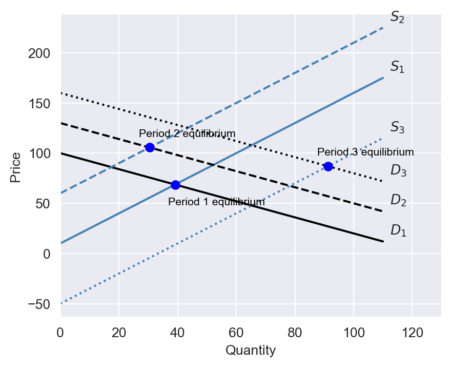
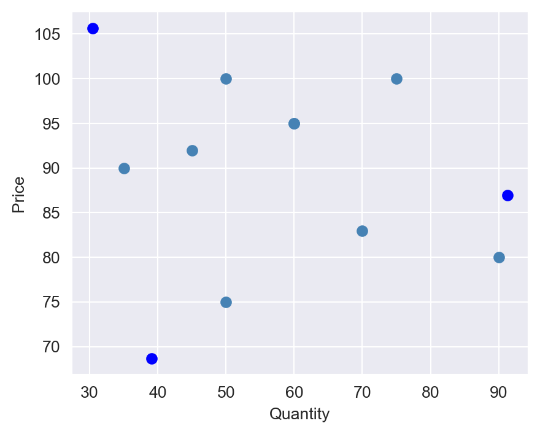
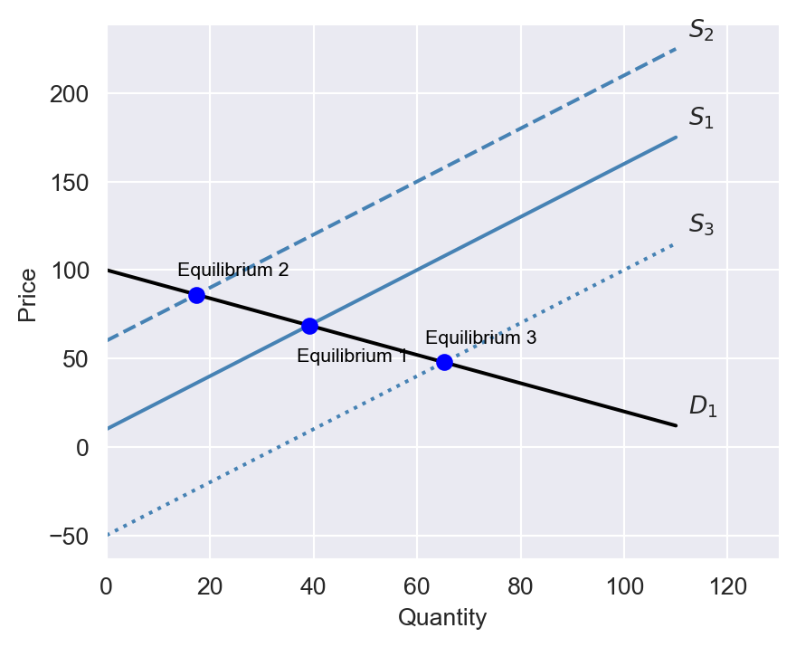

# Instrumental Variables Regression {#sec-chapter19}


```{r}
#| warning: false
#| message: false
# Loading necessary libraries
library(AER)
library(readxl)
library(stargazer)
library(sandwich)
library(modelsummary)
library(lmtest)
library(car)
library(haven)
library(knitr)
library(tidyverse)
```

## Introduction

In this chapter, we will discuss **instrumental variables (IV) regression**. IV regression is a method that provides a way to obtain a consistent estimate of the coefficient of the variable of interest when it is correlated with the error term. In this method, we use **instrumental variables** or simply **instruments** for isolating the part of the variable of interest that is correlated with the error term. The method addresses omitted variable bias, simultaneous causality bias, and errors-in-variables bias.

## The IV estimator with a single regressor and a single instrument
We consider the following simple linear regression model:
$$
Y_i=\beta_0+\beta_1X_i+u_i.
$$

To introduce the IV approach, we first determine when there is endogeneity in the model.

:::{#def-def19-1}
## Endogeneity and exogeneity
We call a variable that is correlated with the error term an **endogenous variable** and a variable that is uncorrelated with the error term an **exogenous variable**.
:::

Recall that $\text{Cov}(X_i,u_i)\neq 0$ implies $\E(u_i|X_i)\neq 0$. Thus, if $X_i$ is endogenous, then the OLS estimator is biased and inconsistent.

:::{#def-def19-2}
## Instrumental variable
We call a variable that is correlated with the endogenous variable but uncorrelated with the error term an **instrumental variable** or simply an **instrument**. 
:::

Let $Z_i$ be an instrumental variable for $X_i$. Then, $Z$ satisfies the following two conditions:

1. **Instrument relevance**: The instrumental variable is correlated with the endogenous variable, i.e., $\text{Cov}(Z_i,X_i)\neq 0$.
2. **Instrument exogeneity**: The instrumental variable is uncorrelated with the error term, i.e., $\text{Cov}(Z_i,u_i)=0$.

::: {#exm-chapter21-1}
## Philip Wright and Sewall Wright
The IV method was developed by Philip Wright and his son Sewall Wright in the 1920s. The key idea first appeared in an appendix to a book written by Philip Wright in 1928 (@Stock2003). The author was interested in estimating the elasticities of demand and supply for products such as vegetable oils, butter, and soy oil. Consider the following demand equation for butter:
$$
\begin{align}
\ln(Q^{demand}_i)=\beta_0+\beta_1P_i+u_i,
\end{align}
$$

where $Q^{demand}_i$ is the butter consumption in the $i$th period, $P_i$ is the price of butter, and $u_i$ includes all other factors that affect butter consumption, such as income and consumer preferences. In this equation, $\beta_1$ represents the demand elasticity for butter. Philip Wright collected data on annual butter consumption and the average annual butter price in the U.S. over the period 1912–1922. He realized that these data could not be used to estimate the demand elasticity because the price is determined by the intersection of supply and demand.

In @fig-chapter21-1, we plot the supply and demand curves for three periods. At each period, the equilibrium price and quantity are determined by the intersection of the supply and demand curves. In @fig-chapter21-2, we plot the equilibrium price and quantity for 11 periods, where the supply and demand curves are hidden. Philip Wright recognized that fitting a linear regression model to the data would yield neither the demand curve nor the supply curve. The reason is that the price is endogenous; it is determined by the intersection of the supply and demand curves.

{#fig-chapter21-1 width=500px}

{#fig-chapter21-2 width=500px}

Formally, this can be shown by solving the market equilibrium equations for price and quantity. Assume that the supply of butter is given by $Q^{supply}_i = \gamma_0 + \gamma_1P_i + v_i$, where $v_i$ is an error term independent of $u_i$. The equilibrium price and quantity are determined by the intersection of the supply and demand curves, i.e., $Q^{demand}_i = Q^{supply}_i$. The equilibrium condition gives 
$$
\begin{align}
P_i=\frac{\beta_0-\gamma_0}{\gamma_1-\beta_1}+ \frac{u_i-v_i}{\gamma_1-\beta_1}.
\end{align}
$$

Thus, $\text{Cov}(P_i, u_i)=\sigma^2_u/(\gamma_1-\beta_1)$, where $\sigma^2_u$ is the variance of $u_i$. This implies that the price is correlated with the error term, i.e., the price is endogenous.


Philip Wright suggested identifying another variable that shifts the supply curve but does not affect the demand curve. In @fig-chapter21-3, we illustrate the equilibrium price and quantity when this variable shifts the supply curve over three periods. Using this approach, the demand curve can be identified, allowing us to determine the demand elasticity for butter (the slope of the demand curve).

The variable that shifts the supply curve is referred to as an instrumental variable. Since the instrumental variable shifts the supply curve, it is correlated with the price. However, it is uncorrelated with the error term because it does not influence the demand curve. Philip Wright proposed several potential instrumental variables. One such variable he suggested was below-average rainfall in a dairy region, which could affect the supply of butter but is unlikely to influence the demand for butter.

{#fig-chapter21-3 width=500px}

:::

In @exm-chapter21-1, the price of butter is endogenous because it is determined by the intersection of the supply and demand curves. In general, if the dependent variable and the regressor of interest are determined simultaneously, then the regressor of interest is endogenous. 

:::{#exm-chapter21-2}
## Wage and education
Assume that $Y_i$ is the wage of individual $i$ and $X_i$ is the years of education of individual $i$. In this classical wage equation, the error term $u_i$ captures unobserved factors that affect wages, such as ability or family background. Since ability and family background are likely to be correlated with education, the education level becomes endogenous.
:::

In @exm-chapter21-2, the education level is endogenous because it is correlated with the error term. In general, if the dependent variable and the regressor of interest are choice variables of the same individual, then the regressor of interest is endogenous (@Hansen2022).

### The two stage least squares estimator
Using the instrumental variable $Z_i$, we can use the **two-stage least squares (TSLS)** estimator to consistently estimate $\beta_1$. The TSLS method involves two stages:

* **First stage**: To isolate the part of $X$ that is uncorrelated with $u$, we regress $X$ on $Z$ using the OLS estimator:
$$
\begin{align}
X_i=\pi_0+\pi_1Z_i+v_i,
\end{align}
$$
where $\pi_0$ and $\pi_1$ are the unknown parameters and $v_i$ is an error term.  Then, we compute the predicted values $\hat{X}_i=\hat{\pi}_0+\hat{\pi}_1Z_i$, where $\hat{\pi}_0$ and $\hat{\pi}_1$ are the OLS estimators of $\pi_0$ and $\pi_1$, respectively.

* **Second stage**: We replace $X_i$ by $\hat{X}_i$ in $Y_i=\beta_0+\beta_1X_i+u_i$, and use the OLS estimator to estimate $\beta_1$ in the following regression:
$$
\begin{align}
Y_i=\beta_0+\beta_1\hat{X}_i+u_i.
\end{align}
$$

:::{#def-chapter21-3}
## Two-stage least squares (TSLS) estimator
The OLS estimators $\hat{\beta}^{TSLS}_0$ and $\hat{\beta}^{TSLS}_1$ obtained from the second stage are called the TSLS estimators.
:::

Recall that the OLS estimator of $\beta_1$ in the model $Y_i=\beta_0+\beta_1X_i+u_i$ is given by $\hat{\beta}_1=\frac{s_{XY}}{s^2_X}$, where $s_{XY}$ is the sample covariance between $Y$ and $X$ and $s^2_X$ is the sample variance of $X$. Applying this formula to the second stage, we obtain  
$$
\begin{align}
\hat{\beta}^{TSLS}_1=\frac{s_{\hat{X}Y}}{s^2_{\hat{X}}}.
\end{align}
$${#eq-chapter21-1}

To determine $s_{\hat{X}Y}$ and $s^2_{\hat{X}}$, we use the predicted equation $\hat{X}=\hat{\pi}_0+\hat{\pi}_1Z$ from the first stage:
$$
\begin{align*}
&s_{\hat{X}Y}=\text{Cov}(\hat{X},Y)=\text{Cov}(\hat{\pi}_0+\hat{\pi}_1Z,Y)=\hat{\pi}_1\text{Cov}(Z,Y)=\hat{\pi}_1s_{ZY},\\
&s^2_{\hat{X}}=\text{Var}(\hat{X})=\text{Var}(\hat{\pi}_0+\hat{\pi}_1Z)=\hat{\pi}^2_1s^2_{Z}.
\end{align*}
$$

Also, from the first stage, we have $\hat{\pi}_1=\frac{s_{ZX}}{s^2_Z}\implies s^2_Z=s_{ZX}/\hat{\pi}_1$. Then, using $s_{\hat{X}Y}=\hat{\pi}_1s_{ZY}$ and $s^2_{\hat{X}}=\hat{\pi}^2_1s_{ZX}/\hat{\pi}_1=\hat{\pi}_1s_{ZX}$ in @eq-chapter21-1, we derive $\hat{\beta}^{TSLS}_1$ as
$$
\begin{align}\label{eq4}
\hat{\beta}^{TSLS}_1=\frac{s_{ZY}}{s_{ZX}}.
\end{align}
$${#eq-chapter21-2}

That is, $\hat{\beta}^{TSLS}_1$ is given by the ratio of the sample covariance between $Z$ and $Y$ and the sample covariance between $Z$ and $X$.

### The sampling distribution of the TSLS estimator
We first establish the consistency of the TSLS estimator and then show the asymptotic distribution of the TSLS estimator. The population covariance between $Z$ and $X$ is given by
$$
\begin{align*}
\text{Cov}(Z,Y)&=\text{Cov}(Z,\beta_0+\beta_1X+u)\\
&=\beta_1\text{Cov}(Z,X)+\text{Cov}(Z,u)=\beta_1\text{Cov}(Z,X)\\
&\implies\beta_1=\frac{\text{Cov}(Z,Y)}{\text{Cov}(Z,X)}=\frac{\sigma_{ZY}}{\sigma_{ZX}},
\end{align*}
$$

where $\sigma_{ZY}$ and $\sigma_{ZX}$ are the population covariance between $Z$ and $Y$ and between $Z$ and $X$, respectively. Then, using @eq-chapter21-2, we have
$$
\begin{align}
\hat{\beta}^{TSLS}_1=\frac{s_{ZY}}{s_{ZX}}\xrightarrow{p}\frac{\sigma_{ZY}}{\sigma_{ZX}}=\beta_1,
\end{align}
$${#eq-chapter21-3}

because $s_{ZY}\xrightarrow{p}\sigma_{ZY}$ and $s_{ZX}\xrightarrow{p}\sigma_{ZX}$ as $n\to\infty$ by the law of large numbers. Thus, the TSLS estimator is a consistent estimator of $\beta_1$.

Next, using $Y_i-\bar{Y}=\beta_1(X_i-\bar{X})+(u_i-\bar{u})$, we can show that
$$
\begin{align}
s_{ZY}&=\frac{1}{n-1}\sum^n_{i=1}(Z_i-\bar{Z})(Y_i-\bar{Y})\\
&=\beta_1\frac{1}{n-1}\sum^n_{i=1}(Z_i-\bar{Z})(X_i-\bar{X})+\frac{1}{n-1}\sum^n_{i=1}(Z_i-\bar{Z})(u_i-\bar{u})\\
&= \beta_1s_{ZX}+\frac{1}{n-1}\sum^n_{i=1}(Z_i-\bar{Z})u_i.
\end{align}
$$

Then, the TSLS estimator can be written as (for large $n$)
$$
\begin{align}
&\hat{\beta}^{TSLS}_1=\frac{\beta_1s_{ZX}+\frac{1}{n}\sum^n_{i=1}(Z_i-\bar{Z})u_i}{s_{ZX}}=\beta_1+\frac{1}{n}\frac{\sum^n_{i=1}(Z_i-\bar{Z})u_i}{s_{ZX}}\\
&\implies\sqrt{n}(\hat{\beta}^{TSLS}_1-\beta_1)=\frac{\frac{1}{\sqrt{n}}\sum^n_{i=1}(Z_i-\bar{Z})u_i}{s_{ZX}}\approx \frac{\frac{1}{\sqrt{n}}\sum^n_{i=1}q_i}{\sigma_{ZX}},
\end{align}
$$
where $q_i=(Z_i-\mu_Z)u_i$. Then, we can extend the argument for the distribution of the OLS estimator to show that the sampling distribution of $\hat{\beta}^{TSLS}_1$ is approximated by $N(\beta_1, \sigma^2_{\hat{\beta}^{TSLS}_1})$, where
$$
\sigma^2_{\hat{\beta}^{TSLS}_1}=\frac{1}{n}\frac{\text{Var}\left((Z_i-\mu_Z)u_i\right)}{\left(\text{Cov}(Z_i,X_i)\right)^2}.
$$

This variance can be consistently estimated by using the sample counterparts:
$$
\begin{align}
\hat{\sigma}^2_{\hat{\beta}^{TSLS}_1}=\frac{1}{n}\frac{\frac{1}{n-1}\sum^n_{i=1}(\hat{q}_i-\bar{\hat{q}})^2}{s^2_{ZX}},
\end{align}
$$

where $\hat{q}_i=(Z_i-\bar{Z})\hat{u}_i$ and $\hat{u}_i=Y_i-\hat{\beta}^{TSLS}_0-\hat{\beta}^{TSLS}_1X_i$ is the residual from the TSLS regression. We can use this variance to construct confidence intervals and perform hypothesis tests, similar to the procedure used in multiple linear regression models.

### Application to the demand for cigarettes
We estimate the price elasticity of demand for cigarettes using the instrumental variable method. The data set consists of annual data for the 48 continental U.S. states from 1985 to 1995. Cigarette consumption is measured by annual per capita cigarette sales in packs per year. The price is the average retail cigarette price per pack during the fiscal year, including taxes. The data set is included in the `cig_ch12.xlsx` file. The variables are as follows:

::: {style="font-size: 85%"}
| Variable | Description |
|:------|:------------------------------|
| `state`   | State |
| `year`    | Year |
| `cpi`     | Consumer price index |
| `pop`     | State population |
| `packpc`  | Number of packs per capita |
| `income`  | State personal income (total, nominal) |
| `tax`     | Average state, federal, and average local excise taxes for fiscal year |
| `avgprs`  | Average price during fiscal year, including sales taxes |
| `taxs`    | Average excise taxes for fiscal year, including sales taxes |
: The cigarette consumption dataset {#tbl-chapter21-1 .striped .hover}
:::

We use real variables by deflating the nominal variables by the consumer price index. We consider the following demand equation for cigarette consumption:
$$
\begin{align}
\ln(Q^{cigarettes}_i)=\beta_0+\beta_1\ln(P^{cigarettes}_i)+u_i,
\end{align}
$${#eq-chapter21-4}

where $Q^{cigarettes}_i$ is the number of packs of cigarettes sold per capita in the $i$th state and $P^{cigarettes}_i$ is the average real price per pack of cigarettes including all taxes. The price is endogenous because it is determined by the intersection of the supply and demand curves, as we illustrated in @exm-chapter21-1. We can use the general sales tax as an instrumental variable for the price. The general sales tax is a tax applied to all consumption goods, including cigarettes. We need to ensure that the general sales tax is correlated with the price but uncorrelated with the error term. 

* **Instrument relevance**: An increase in general sales tax should increase the price of cigarettes, suggesting that $\text{Cov}(\text{SalesTax}_i, P^{cigarettes}_i)\neq 0$. Thus, the general sales tax is a relevant instrument.

* **Instrument exogeneity**: We need to show that the general sales tax affects the demand for cigarettes only through its effect on the price. This assumption is plausible because general sales tax rates vary across states and are usually set based on the state's fiscal policies. Therefore, the general sales tax is likely to be uncorrelated with the factors that affect cigarette consumption.

We use the following code chunk to import data and generate (i) the real cigarettes prices, (ii) the real sales taxes, and (iii) the real per-capita income.The summary statistics of variables are shown in @tbl-chapter21-2.


```{r}
#| warning: false
#| message: false

# Import data
mydata <- read_excel("data/cig_ch12.xlsx")

# Column names
colnames(mydata)

# Generate real cigarette prices
mydata$rprice <- mydata$avgprs / mydata$cpi

# Generate real sales tax
mydata$salestax <- (mydata$taxs - mydata$tax) / mydata$cpi

# Generate real cigarette tax
mydata$cigtax <- mydata$tax / mydata$cpi

# Generate real per capita income
mydata$rincome <- (mydata$income / mydata$pop) / mydata$cpi
```

```{r}
#| tbl-cap: "Summary statistics"
#| label: tbl-chapter21-2
# Variables of interest
variables <- c("rprice", "salestax", "cigtax", "rincome", "packpc")

# Summary statistics
datasummary_skim(
    mydata[, variables],
    stats = c("n", "mean", "sd", "min", "max"),
    fmt = 2
)
```

To estimate @eq-chapter21-4, we only use data from the year 1995. We use the `ivreg` function from the `AER` package to perform the IV regression. 

```{r}
# Subset for year 1995
mydata1995 <- mydata[mydata$year == 1995, ]

# IV regression (2SLS)
iv_model <- ivreg(
    log(packpc) ~ log(rprice) | salestax,
    data = mydata1995
)
```

According to estimation results in @tbl-chapter21-3, the estimated model is 
$$
\begin{align}
\widehat{\ln(Q^{cigarettes}_i)}=9.720-1.084\ln(P^{cigarettes}_i).
\end{align}
$$

The TSLS estimate $\hat{\beta}^{TSLS}_1=-1.084$ suggests that a one percent increase in cigarette prices reduces cigarette consumption by approximately 1.08 percent, indicating that demand is fairly elastic.

```{r}
#| tbl-cap: "Estimation Results"
#| label: tbl-chapter21-3
# Display results
modelsummary(
    models = list("Model" = iv_model),
    vcov = "HC1",
    stars = TRUE,
    fmt = 3,
    gof_omit = "AIC|BIC|Log.Lik"
)
```

## The general IV regression model

In this section, we extend the IV regression model to include multiple endogenous variables and multiple instruments. Consider the following multiple linear regression model:
$$
\begin{align}
Y_i = \beta_0 + \beta_1X_{1i}+\ldots+\beta_kX_{ki}+\beta_{k+1}W_{1i} +\ldots + \beta_{k+r}W_{ri} + u_i,
\end{align}
$${#eq-chapter21-5}

where $Y_i$ is the dependent variable, $X_{1i},\ldots,X_{ki}$ are the endogenous variables, and $W_{1i},\ldots,W_{ri}$ are either exogenous variables or the control variables. The endogenous variables are correlated with the error term, i.e., $\text{Cov}(X_{ji},u_i)\neq 0$ for $j=1,\ldots,k$. We use the instrumental variables $Z_{1i},\ldots,Z_{mi}$ for the endogenous variables. In this model, the coefficients $\beta_1,\ldots,\beta_k$ are said to be:

* **exactly identified** if $m = k$. There are just enough instruments to estimate $\beta_1,\ldots,\beta_k$. 
* **overidentified** if $m > k$. There are more than enough instruments to estimate $\beta_1,\ldots,\beta_k$. In this case, we can also test whether the instruments are valid (a test of the overidentifying restrictions), which we will discuss later.
* **underidentified** if $m < k$. There are too few instruments to estimate $\beta_1,\ldots,\beta_k$.

In order to use the IV method to estimate the coefficients in @eq-chapter21-5, the coefficients must either be exactly identified or overidentified. The IV method is not applicable when the coefficients are underidentified.

::: {.callout-note icon=false}
## Key Concept 21.1: The general instrumental variables regression model and terminology
The general IV regression model is given by
$$
\begin{align}\label{eq8}
Y_i = \beta_0 + \beta_1X_{1i}+\ldots+\beta_kX_{ki}+\beta_{k+1}W_{1i} +\ldots + \beta_{k+r}W_{ri} + u_i,
\end{align}
$$
for $i=1,\ldots,n$, where

* $Y$ is the dependent variable,
* $X_{1},\ldots, X_{k}$ are the endogenous regressors (potentially correlated with $u$),
* $W_{1},\ldots,W_{r}$ are the included exogenous regressors (uncorrelated with $u$) or control variables (included so that $Z$'s become uncorrelated with $u$, once the $W$'s are included),
* $\beta_0,\beta_1,\ldots,\beta_{k+r}$ are the unknown regression coefficients,
* $Z_{1},\ldots,Z_{m}$ are the $m$ instrumental variables (the excluded exogenous variables),

In this model, the coefficients $\beta_1,\ldots,\beta_k$ are said to be:

* **exactly identified** if $m = k$,
* **overidentified** if $m > k$,
* **underidentified** if $m < k$.

The IV method is not applicable when the coefficients are underidentified.
:::

### TSLS in the general IV model
There are two stages to compute the TSLS estimator for the general IV regression model:

* **First-stage regression(s)**: For the $j$-th endogenous regressor, estimate the following regression by the OLS estimator:
$$
\begin{align}
X_{ji}=\pi_{0j}+\pi_{1j}Z_{1i}+\ldots+\pi_{mj}Z_{mi}+\gamma_{1j}W_{1i}+\ldots+\gamma_{rj}W_{ri}+v_{ji},
\end{align}
$$
where $\pi_{0j},\ldots,\pi_{mj}$ and $\gamma_{1j},\ldots,\gamma_{rj}$ are the unknown parameters, and $v_{ji}$ is the error term. This model is sometimes called the **reduced form** equation. Then, compute the predicted values 
$$
\hat{X}_{ji}=\hat{\pi}_{0j}+\hat{\pi}_{1j}Z_{1i}+\ldots+\hat{\pi}_{mj}Z_{mi}+ \hat{\gamma}_{1j}W_{1i}+\ldots+\hat{\gamma}_{rj}W_{ri}.
$$ 

Repeat this for all the endogenous regressors $X_{2i},\ldots,X_{ki}$, thereby computing the predicted values $\hat{X}_{1i},\ldots,\hat{X}_{ki}$.

* **Second-stage regression**: Estimate the following regression by the OLS estimator:
$$
\begin{align}
Y_i=\beta_0+\beta_1\hat{X}_{1i}+\ldots+\beta_k\hat{X}_{ki}+\beta_{k+1}W_{1i}+\ldots+\beta_{k+r}W_{ri}+u_i.
\end{align}
$$

:::{#def-chapter21-4}
## The TSLS estimator in the general IV model
The TSLS estimators $\hat{\beta}^{TSLS}_0,\hat{\beta}^{TSLS}_1,\ldots,\hat{\beta}^{TSLS}_{k+r}$ in the general IV regression model are the OLS estimators obtained from the second-stage regression.
:::

### Instrument relevance and exogeneity in the general IV model
Valid instruments should be relevant and exogenous. In the general IV regression model with instruments $Z_1,\ldots,Z_m$, these conditions take the following form:

* **Instrument relevance**: Consider the following $n\times (k+r+1)$ matrix:
$$
\begin{align}
\begin{pmatrix}
1 & \hat{X}_{11} & \ldots & \hat{X}_{k1} & W_{11} & \ldots & W_{r1}\\
\vdots & \ddots & \vdots & \vdots & \ddots & \vdots \\
1 & \hat{X}_{1n} & \ldots & \hat{X}_{kn} & W_{1n} & \ldots & W_{rn}
\end{pmatrix}.
\end{align}
$${#eq-chapter21-6}

This matrix should have full column rank, i.e., the columns of the matrix are linearly independent. This condition corresponds to the no-perfect multicollinearity assumption and ensures that we can use the OLS estimator to estimate the second stage regression. If there is only one endogenous regressor, then at least one of the instrumental variables must be relevant for the endogenous regressor in the reduced form equation.

* **Instrument exogeneity**: The instrumental variables must be uncorrelated with the error term: $\text{Cov}(Z_{l},u)=0$ for $l=1,\ldots,m$.

### The sampling distribution of the TSLS estimator in the general IV model
The IV regression assumptions are the extension of those for the multiple linear regression model and ensure that the TSLS estimator is consistent and has an asymptotic normal distribution. In the following callout block, we state the IV regression assumptions for the general IV model.

::: {.callout-important icon=false title="The IV regression assumptions"}
1. The zero-conditional mean assumption for included exogenous variables: $\E\left(u_i|W_{1i},\ldots,W_{ri}\right)=0$. 
2. The random sampling assumption:$\left(X_{1i},\ldots, X_{ki},W_{1i},\ldots,W_{ri},Z_{1i},\ldots,Z_{mi},Y_i\right)$ are i.i.d. draws from their joint distribution.
3. The no large outliers assumption: The $X$'s, $W$'s, $Z$'s, and $Y$ have nonzero finite fourth moments.
4. The two instrumental variable conditions stated in Section 19.3.2 hold.
:::

Under these four assumptions, the TSLS estimator is consistent and has an asymptotic normal distribution. In @sec-chapter26, we will use the IV regression assumptions to derive the asymptotic distribution of the TSLS estimator in the general IV model.

In Assumption 1, we assume that $W_1,\ldots,W_r$ are exogenous variables that are uncorrelated with the error term. We can adjust this assumption if these variables are control variables that are included into the model to ensure that the instrumental variables become uncorrelated with the error term. In that case, the first assumption is replaced by the following conditional mean independence assumption:
$$
\begin{align}
\E\left(u_i|W_{1i},\ldots,W_{ri},Z_{1i},\ldots,Z_{mi}\right)=\E(u_i|W_{1i},\ldots,W_{ri}).
\end{align}
$$

Because the control variables can be correlated with the error term, the coefficients on these variables do not have a causal interpretation. 

Let us assume that there is only one endogenous and one control variable such that
$$
\begin{align}
Y_i = \beta_0 + \beta_1X_i + \beta_2W_i + u_i.
\end{align}
$${#eq-chapter21-7}

In this case, we can replace Assumption 1 with the following conditional mean independence assumption:
$$
\begin{align}
\E\left(u_i|W_i,Z_i\right)=\E(u_i|W_i).
\end{align}
$${#eq-chapter21-8}

Under the assumption that $\E(u_i|W_i)=\gamma_0+\gamma_1W_i$, we can rewrite @eq-chapter21-7 as
$$
\begin{align}
Y_i &= \beta_0 + \beta_1X_i + \beta_2W_i +u_i-\E(u_i|W_i,Z_i)+\E(u_i|W_i,Z_i)\\
&= \beta_0 + \beta_1X_i + \beta_2W_i + \gamma_0 + \gamma_1W_i + \varepsilon_i\\
&= \delta_0 + \beta_1X_i + \delta_1W_i + \varepsilon_i,
\end{align}
$${#eq-chapter21-9}

where $\delta_0=(\beta_0+\gamma_0)$, $\delta_1=(\beta_2+\gamma_1)$, and $\varepsilon_i=u_i-\E(u_i|W_i,Z_i)$ is the error term in the model. Note that 
$$
\begin{align}
\E(\varepsilon_i|W_i,Z_i)&=\E(u_i-\E(u_i|W_i,Z_i)|W_i,Z_i)\\
&=\E(u_i|W_i,Z_i)-\E(u_i|W_i,Z_i)=0,
\end{align}
$$

which implies that $\text{Cov}(\varepsilon_i,Z_i)=0$. Thus, if we replace Assumption 1 with the conditional mean independence assumption in @eq-chapter21-8, the IV regression assumptions are satisfied and we can use the TSLS estimator to estimate the coefficients in @eq-chapter21-9. Note that the TSLS estimator only consistently estimates $\delta_0$, $\beta_1$, and $\delta_1=(\beta_2+\gamma_1)$ in @eq-chapter21-9. In particular, we do not have a consistent estimator for $\beta_2$.

### Application to the demand for cigarettes
We extend the cigarette demand model to include real per capita income as an additional regressor. Recall that we use the sales tax as an instrument for the average real price in the demand equation stated in @eq-chapter21-4. However, if real income is correlated with the sales tax, then the sales tax is not a valid instrument for real prices in @eq-chapter21-4. Therefore, we need to extend the demand equation to include real per capita income as an additional regressor:
$$
\begin{align}
\ln(Q^{cigarettes}_i)=\beta_0+\beta_1\ln(P^{cigarettes}_i)+\beta_2\ln(\text{Income}_i)+u_i.
\end{align}
$${#eq-chapter21-10}

where $\text{Income}_i$ is the real per capita income in state $i$. We use the `ivreg` function to estimate the extended demand equation, where we use the sales tax as an instrument for the real price and include real per capita income as a control variable. Note that in the formula for the `ivreg` function, we specify the control variable `log(rincome)` in both the first stage and the second stage.

```{r}
# IV regression using salestax as instrument
iv_model2 <- ivreg(
    log(packpc) ~ log(rincome) + log(rprice) | log(rincome) + salestax,
    data = mydata1995
)
```

The estimation results are shown in @tbl-chapter21-4. The estimated model is 
$$
\begin{align}
\widehat{\ln(Q^{cigarettes}_i)}=9.43-1.143\ln(P^{cigarettes}_i)+0.215\ln(\text{Income}_i).
\end{align}
$$

The TSLS estimate $\hat{\beta}^{TSLS}_1=-1.143$ suggests that a one percent increase in cigarette prices reduces cigarette consumption by approximately $1.14$ percent, holding real income constant. 


```{r}
#| tbl-cap: "Estimation results for the extended cigarette demand model"
#| label: tbl-chapter21-4
# Display results
modelsummary(
    models = list("Model" = iv_model2),
    vcov = "HC1",
    stars = TRUE,
    fmt = 3,
    gof_omit = "AIC|BIC|Log.Lik"
)
```

The model in @eq-chapter21-4 is exatcly identified because there is only one endogenous variable and one instrument. In addition to this instrument, we can use the cigarette-specific tax as an additional instrument. We use the following code chunk to estimate the model using both the sales tax and the cigarette-specific tax as instruments. 

```{r}
# IV regression using salestax and cigtax as instruments
iv_model3 <- ivreg(
    log(packpc) ~ log(rincome) + log(rprice) | log(rincome) + salestax + cigtax,
    data = mydata1995
)
```

The estimation results are shown in @tbl-chapter21-5. The estimated model is
$$
\begin{align}
\widehat{\ln(Q^{cigarettes}_i)}=9.89-1.277\ln(P^{cigarettes}_i)+0.280\ln(\text{Income}_i).
\end{align}
$$

The TSLS estimate $\hat{\beta}^{TSLS}_1=-1.277$ suggests that a one percent increase in cigarette prices reduces cigarette consumption by approximately 1.28 percent, holding real income constant.

```{r}
#| tbl-cap: "Estimation results for the extended cigarette demand model with two instruments"
#| label: tbl-chapter21-5
# Display results
modelsummary(
    models = list("Model" = iv_model3),
    vcov = "HC1",
    stars = TRUE,
    fmt = 3,
    gof_omit = "AIC|BIC|Log.Lik"
)
```

The validity of the estimation results presented in @tbl-chapter21-4 and @tbl-chapter21-5 depends on the validity of the instruments. In the next section, we discuss how to check the validity of the instruments.

## Checking instrument validity
Recall that we need two conditions for the instrumental variables to be valid: (i) instrument relevance and (ii) instrument exogeneity. Assume that there is only one endogenous variable and multiple instruments. In this case, the first stage regression (the reduced form equation) is
$$
\begin{align}
X_i=\pi_0+\pi_1Z_i+\ldots+\pi_mZ_i+\gamma_1W_i+\ldots+\gamma_rW_i+v_i,
\end{align}
$${#eq-chapter21-11}

where $\pi_0,\ldots,\pi_m$ and $\gamma_1,\ldots,\gamma_r$ are the unknown parameters, and $v_i$ is the error term. Then, the instruments are relevant if at least one of $\pi_1,\ldots,\pi_m$ is not zero. The instruments are said to be **weak** if all of $\pi_1,\ldots,\pi_m$ are zero or close to zero. That is, in the weak instrument case, the instruments can only explain a small portion of the variation in the endogenous variable.

In practice, we can use the F-statistic from the first stage regression to test the instrument relevance condition. Consider the following null and alternative hypotheses:
$$
\begin{align}
H_0&: \pi_1=\ldots=\pi_m=0,\\
H_1&: \text{At least one of the coefficients is not zero}.
\end{align}
$$

A large F-statistic indicates that the instruments are relevant. A common rule of thumb is that the F-statistic should be greater than 10. An F-statistic smaller than 10 suggests that the instruments are weak. In such cases, the TSLS estimator is biased and does not have an asymptotic normal distribution, even when the sample size is large. 

To study the large sample distribution of the TSLS estimator under the weak instrument, we consider the case where there is only one endogenous variable and one instrument. In this case, we start with the following expression for the TSLS estimator:
$$
\begin{align}
&\hat{\beta}^{TSLS}_1=\beta_1+\frac{\frac{1}{n}\sum^n_{i=1}(Z_i-\bar{Z})u_i}{\frac{1}{n}\sum^n_{i=1}(Z_i-\bar{Z})(X_i-\bar{X})}\approx \beta_1+\frac{\frac{1}{n}\sum^n_{i=1}q_i}{\frac{1}{n}\sum^n_{i=1}r_i},
\end{align}
$${#eq-chapter21-12}

where $q_i=(Z_i-\mu_Z)u_i$ and $r_i=(Z_i-\mu_Z)(X_i-\mu_X)$. Let $\sigma^2_q=\var(q_i)$, $\sigma^2_r=\var(r_i)$, $\bar{q}=\frac{1}{n}\sum^n_{i=1}q_i$, and $\bar{r}=\frac{1}{n}\sum^n_{i=1}r_i$. Then, under Assumption 2, we have $\var(\bar{q})=\sigma^2_q/n$ and $\var(\bar{r})=\sigma^2_r/n$. Thus, we express @eq-chapter21-12 as
$$
\begin{align}
\hat{\beta}^{TSLS}_1=\beta_1+\frac{\bar{q}}{\bar{r}}=\beta_1+\frac{\sigma_q}{\sigma_r}\frac{\bar{q}/\sigma_q}{\bar{r}/\sigma_r}.
\end{align}
$${#eq-chapter21-13}

If the instrument is irrelevant, then $\E(r_i) = \E((Z_i - \mu_Z)(X_i - \mu_X)) = 0$. Additionally, by the exogeneity condition, we have $\E(q_i) = 0$. Thus, under Assumptions 2 and 3, we can apply the CLT to show that $\bar{r}/\sigma_r \xrightarrow{d} N(0,1)$ and $\bar{q}/\sigma_q \xrightarrow{d} N(0,1)$. Therefore, in large samples, the distribution of $\hat{\beta}^{TSLS}_1 - \beta_1$ is approximately that of $(\sigma_q / \sigma_r) S$, where $S$ is the ratio of two random variables, each following a standard normal distribution. This extreme case also sheds light on the large sample distribution of the TSLS estimator when the instruments are weak. Specifically, when the instruments are weak but not irrelevant, the large-sample distribution of the TSLS estimator is non-normal.

Also, in the extreme case where the instrument is strong but endogenous, the TSLS estimator is inconsistent. This can be see from the following expression:
$$
\begin{align}
\hat{\beta}^{TSLS}_1&=\beta_1+\frac{\frac{1}{n}\sum^n_{i=1}(Z_i-\mu_Z)u_i}{\frac{1}{n}\sum^n_{i=1}(Z_i-\mu_Z)(X_i-\mu_X)}\xrightarrow {p} \beta_1+\frac{\E((Z_i-\mu_Z)u_i)}{\E((Z_i-\mu_Z)(X_i-\mu_X))}\\
&=\beta_1+\frac{\cov(Z_i,u_i)}{\cov(Z_i,X_i)}\neq \beta_1.
\end{align}
$$


In the exactly identified case, we cannot use any statistical test to verify whether the instruments are exogenous. Instead, we must rely on economic theory and expert judgment to justify the exogeneity of the instruments. In the overidentified case, however, we can employ the **test of overidentifying restrictions** (also known as the J test) to assess the instrument exogeneity condition. The test can be computed in the following way:

1. Compute the TSLS estimators $\hat{\beta}^{TSLS}_0,\ldots,\hat{\beta}^{TSLS}_{k+r}$.
2. Compute $\hat{u}^{TSLS}_i=Y_i-(\hat{\beta}^{TSLS}_0+\hat{\beta}^{TSLS}_0X_{1i}+\ldots+\hat{\beta}^{TSLS}_{k+r}W_{ri})$.
3. Run the following regression
$$
\begin{align}
\hat{u}^{TSLS}_i= \delta_0 + \delta_1Z_{1i}+\ldots+ \delta_mZ_{mi} + \delta_{m+1}W_{1i} +\ldots+ \delta_{m+r}W_{ri} + e_i,
\end{align}
$${#eq-chapter21-14}
where $\delta_0,\ldots,\delta_{m+r}$ are the unknown coefficients and $e_i$ is the error term.
4. Compute the homoskedasticity-only F-statistic for the following hypothesis:
$$
\begin{align*}
H_0:\delta_1=0,\ldots,\delta_m=0\quad\text{versus}\quad H_1: \text{At least one coefficient is non-zero}.
\end{align*}
$$
5. The J-statistic is computed as $J=m\times F$, where $m$ is the number of instruments.

Under the null hypothesis that all instruments are exogeneous, the J statistic has a chi-squared distribution with m-k degrees of freedom, i.e., $J\sim \chi^2_{m-k}$. 

::: {.callout-note icon=false}
## Key Concept 21.2: Checking instrument validity
The validity of the instrumental variables depends on two conditions: (i) instrument relevance and (ii) instrument exogeneity.

* **Instrument relevance**: The instruments are relevant if at least one of the coefficients in the reduced form equation is not zero. A large F-statistic for testing $H_0: \pi_1=\ldots=\pi_m=0$ in @eq-chapter21-11 indicates that the instruments are relevant. A common rule of thumb is that the F-statistic should be greater than 10. An F-statistic smaller than 10 suggests that the instruments are weak. When the instruments are weak, the TSLS estimator is biased and does not have an asymptotic normal distribution, even when the sample size is large.

* **Instrument exogeneity**: In the overidentified case, we can use the test of overidentifying restrictions (the J test) to test the instrument exogeneity condition. The J-statistic is computed as $J=m\times F$, where m is the number of instruments and F is the homoskedasticity-only F-statistic for testing $H_0:\delta_1=0,\ldots,\delta_m=0$ in @eq-chapter21-14. Under the null hypothesis that all instruments are exogeneous, we have $J\sim\chi^2_{m-k}$. 
:::

## Application to the demand for cigarettes
In this section, we revisit the demand for cigarettes using the instrumental variable method. We will consider both the sales tax and the cigarette-specific tax as instruments for the average real price. The relevance of these instruments was discussed in previous examples.

The first step in checking instrument exogeneity is to consider the factors that are likely to affect cigarette consumption, i.e., the factors included in the error term $u_i$. If these factors are correlated with the instruments, then the instruments are not exogenous. For instance, real state income is likely to influence cigarette consumption and may also be correlated with the sales tax and the cigarette-specific tax. Consequently, it is essential to account for real state income in the demand equation; otherwise, the instruments will not satisfy the exogeneity condition. We also use the state fixed effects to control for unobserved omitted factors that vary across states but not over time. Finally, we will consider the J-test to test the instrument exogeneity condition.

### Model
We consider the following fixed effects panel data model:
$$
\begin{align}
\ln(Q^{cigarettes}_{it})=\beta_1\ln(P^{cigarettes}_{it})+\beta_2\ln({\tt Income}_{it})+\alpha_i+u_{it},
\end{align}
$$

where 

- $\ln({\tt Income}_{it})$ is the logarithm of real per capita income in state $i$ at time $t$, 
- $\alpha_i$ is the $i$th state fixed effect, which reflects unobserved omitted factors that vary across states but not over time, e.g. attitude towards smoking.

We are interested in estimating the long-run price elasticity of demand for cigarettes, $\beta_1$. One way to model long-term effects is to consider 10-year changes, between 1985 and 1995. Thus, in the ``changes'' form, the demand equation can be written as
$$
\begin{align}
&\ln(Q^{cigarettes}_{i1995})-\ln(Q^{cigarettes}_{i1985})=\beta_1(\ln(P^{cigarettes}_{i1995})-\ln(P^{cigarettes}_{i1985}))\\
&+\beta_2\left(\ln({\tt Income}_{i1995})-\ln({\tt Income}_{i1985})\right)+(u_{i1995}-u_{i1985}).
\end{align}
$${#eq-eq19-10}

We first create the 10-year change variables and then estimate the demand elasticity using the TSLS estimator with the 10-year changes in the instrumental variables.

```{r}
#| warning: false
#| message: false

# Subset data for years 1995 and 1985
mydata1995 <- mydata[mydata$year == 1995, ]
mydata1985 <- mydata[mydata$year == 1985, ]

# Compute 10-year change variables
packdiff <- log(mydata1995$packpc) - log(mydata1985$packpc)
pricediff <- log(mydata1995$rprice) - log(mydata1985$rprice)
incomediff <- log(mydata1995$rincome) - log(mydata1985$rincome)
salestaxdiff <- mydata1995$salestax - mydata1985$salestax
cigtaxdiff <- mydata1995$cigtax - mydata1985$cigtax

# Create a data frame with the differences
diffData <- data.frame(
    packdiff     = packdiff,
    pricediff    = pricediff,
    incomediff   = incomediff,
    salestaxdiff = salestaxdiff,
    cigtaxdiff   = cigtaxdiff
)
```

### Estimation
We estimate three models: (i) using only sales taxes as the instrument, (ii) using only the cigarette-specific tax as the instrument, and (iii) using both sales tax and cigarette tax as the instruments. 

```{r}
# Model 1: Instrument = salestaxdiff
model1 <- ivreg(
    packdiff ~ incomediff + pricediff | incomediff + salestaxdiff,
    data = diffData
)

# Model 2: Instrument = cigtaxdiff
model2 <- ivreg(
    packdiff ~ incomediff + pricediff | incomediff + cigtaxdiff,
    data = diffData
)

# Model 3: Instruments = salestaxdiff + cigtaxdiff
model3 <- ivreg(
    packdiff ~ incomediff + pricediff | incomediff + salestaxdiff + cigtaxdiff,
    data = diffData
)
```


The estimation results are shown in @tbl-chapter21-6. The TSLS estimates for $\beta_1$ are -0.938, -1.343, and -1.202 for models 1, 2, and 3, respectively. All estimates are statistically significant at the 5% level. The reliability of these coefficient estimates depends on the validity of the instruments. In the next section, we examine the validity of the instruments.

```{r}
#| tbl-cap: "Estimation results for the cigarette demand model using changes data"
#| label: tbl-chapter21-6
# Display results
modelsummary(
    models = list("Model 1" = model1, "Model 2" = model2, "Model 3" = model3),
    vcov = "HC1",
    stars = TRUE,
    fmt = 3,
    gof_omit = "AIC|BIC|Log.Lik"
)
```

### Checking instrument validity
The relevance of the instruments can be checked using the F-statistic from the first stage regressions. The code chunk below shows how to compute the F-statistics for the first stage regressions.

```{r}
# First-stage regressions
f1 <- lm(pricediff ~ salestaxdiff + incomediff, data = diffData)
f2 <- lm(pricediff ~ cigtaxdiff + incomediff, data = diffData)
f3 <- lm(pricediff ~ salestaxdiff + cigtaxdiff + incomediff, data = diffData)

# F-tests
# F-tests
f1_fstat <- linearHypothesis(f1, "salestaxdiff = 0",
    vcov = vcovHC,
    type = "HC1"
)
f2_fstat <- linearHypothesis(f2, "cigtaxdiff = 0",
    vcov = vcovHC,
    type = "HC1"
)
f3_fstat <- linearHypothesis(f3, c("salestaxdiff = 0", "cigtaxdiff = 0"),
    vcov = vcovHC,
    type = "HC1"
)


# Extract F-statistics and p-values
fstats_df <- data.frame(
    Model = c(
        "Model 1",
        "Model 2",
        "Model 3"
    ),
    F_statistic = c(
        f1_fstat$F[2],
        f2_fstat$F[2],
        f3_fstat$F[2]
    ),
    df1 = c(
        f1_fstat$Df[2],
        f2_fstat$Df[2],
        f3_fstat$Df[2]
    ),
    df2 = c(
        f1_fstat$Res.Df[2],
        f2_fstat$Res.Df[2],
        f3_fstat$Res.Df[2]
    ),
    p_value = c(
        f1_fstat$`Pr(>F)`[2],
        f2_fstat$`Pr(>F)`[2],
        f3_fstat$`Pr(>F)`[2]
    )
)
```

The F-statistics for the first stage regressions are presented in @tbl-chapter21-7. The first stage F-statistics are 33.7, 107.2, and 86.7 for models 1, 2, and 3, respectively. These F-statistics are greater than 10, indicating that the instruments are relevant.

```{r}
#| tbl-cap: "Robust First-Stage F-Statistics"
#| label: tbl-chapter21-7
# F-statistics for the first stage regressions
fstats_df$F_statistic <- round(fstats_df$F_statistic, 2)
fstats_df$p_value <- round(fstats_df$p_value, 5)

kable(fstats_df, align = "lcccc")
```

Since the first two models are exactly identified, we cannot use the J-statistic to test instrument exogeneity. However, the regression in column (3) is overidentified because there are two instruments and a single included endogenous regressor, resulting in one (m - k = 2 - 1 = 1) overidentifying restriction. Below, we compute the J-statistic for the overidentifying restriction in model 3.

```{r}
# J-test for overidentifying restrictions
# Get residuals from Model 3
diffData$residuals <- resid(model3)

# Auxiliary regression
mj <- lm(
    residuals ~ salestaxdiff + cigtaxdiff + incomediff,
    data = diffData
)

# Joint test of excluded instruments
ftest <- linearHypothesis(mj, c("salestaxdiff = 0", "cigtaxdiff = 0"))

# Extract F-statistic
F_value <- ftest$F[2]

# Number of instruments
m <- 2

# Compute J-statistic
jtest <- m * F_value

# Compute p-value
p_value <- 1 - pchisq(jtest, df = m - 1)
```

```{r}
#| tbl-cap: "J-test for overidentifying restrictions"
#| label: tbl-chapter21-8
# J-test results
jtest_df <- data.frame(
    J_statistic = round(jtest, 2),
    p_value = round(p_value, 5)
)
kable(jtest_df, align = "cc")
```

The J-test results are presented in @tbl-chapter21-8. The $p$-value indicates that the null hypothesis of both instruments being exogenous is rejected at the 5% significance level. The rejection of the J-statistic suggests that at least one of the instruments is endogenous. This leads to three logical possibilities:

* The sales tax is exogenous, but the cigarette-specific tax is not, making the column (1) regression reliable.
* The cigarette-specific tax is exogenous, but the sales tax is not, making the column (2) regression reliable.
* Neither tax is exogenous, rendering both regressions unreliable. 

@Stock2020 conclude that "We think that the case for the exogeneity of the general sales tax is stronger than that for the cigarette-specific tax because the political process can link changes in the cigarette-specific tax to changes in the cigarette market and smoking policy." 

Finally, both F-statistic from the first stage regression and the J-test for overidentifying restrictions are also returned by the `summary` function for the `ivreg` object: `summary(model3, diagnostics = TRUE)`.

## Application to the effect of institutions on economic performance

@Acemoglu2001 investigate the effect of institutions on economic outcomes across countries. They use log GDP per capita in 1995 as a measure of economic outcomes and the average index of protection against expropriation over 1985–95 as a proxy for institutional differences.

In our ensuing analysis, we use three data files: `maketable1.dta`, `maketable2.dta`, and `maketable4.dta`.  In @tbl-chapter21-9, we describe some of the key variables in these datasets. 

::: {style="font-size: 85%"}
| Variable     | Description |
|:---------|:---------------------------------------------------------|
| `shortnam`   | A three-letter country name. |
| `euro1900`   | The fraction of the population of European descent in 1900, measuring European settlement in the colonies. |
| `excolony`   | A dummy variable equal to 1 if the country was a colony (FLOPS definition). |
| `avexpr`     | Average protection against expropriation risk over 1985–95 (higher values indicate greater protection). |
| `logpgp95`   | Log of per capita GDP in 1995 (PPP adjusted). |
| `extmort4`   | Corrected mortality. |
| `logem4`     | Log European settler mortality. |
| `baseco`     | Dummy variable for the base sample of countries that were ex-colonies. |
| `africa`     | Dummy variable equal to 1 if the country is in Africa. |
| `asia`       | Dummy variable equal to 1 if the country is in Asia. |
| `other`      | Dummy variable equal to 1 if the country is in neither Asia, Africa, nor the Americas. |
| `lat_abst`   | Absolute latitude (distance from the equator), scaled between 0 and 1, where 0 represents the equator. |
: The dataset for institutions and economic performance {#tbl-chapter21-9 .striped .hover}
:::

We use the data from `maketable1.dta` to create a scatter plot of log GDP per capita in 1995 (`logpgp95`) against the average protection against expropriation risk over 1985-95 (`avexpr`). The scatter plot is shown in @fig-chapter21-4. The plot reveals a strong positive relationship between protection against expropriation and log GDP per capita. If protection against expropriation is an indicator of institutional quality, then the scatter plot suggests that income per capita is postively associated with institutional quality.

```{r}
# Load the data
df1 <- read_dta("data/maketable1.dta")

# Column names
colnames(df1)
```


```{r}
#| fig-cap: "Scatter plot between logpgp95 and avexpr"
#| label: fig-chapter21-4
#| fig-width: 5
#| fig-height: 4
#| warning: false
#| message: false
# Scatter plot between logpgp95 and avexpr
ggplot(df1, aes(x = avexpr, y = logpgp95)) +
    geom_point(color = "steelblue", size = 1.5) +
    labs(
        x = "Average protection against expropriation risk (avexpr)",
        y = "Log of GDP per capita in 1995 (logpgp95)"
    )
```

Given the strong positive relationship in @fig-chapter21-4, we estimate the following OLS regression model:
$$
\begin{align*}
\text{logpgp95}_i = \beta_0+\beta_1 \text{avexpr}_i + u_i
\end{align*}
$$

In @fig-chapter21-5, we plot the estimated OLS regression line. The slope coefficient estimate is 0.52, which indicates that a one-unit increase in the average protection against expropriation is associated with a 0.52 increase in log GDP per capita. The coefficient estimate is statistically significant at the 1% level.


```{r}
#| fig-cap: "The OLS relationship between expropriation risk and income"
#| label: fig-chapter21-5
#| fig-width: 5
#| fig-height: 4
#| warning: false
#| message: false
# Prepare subset
df1_subset <- df1 %>%
    filter(!is.na(logpgp95), !is.na(avexpr), baseco == 1)

# Basic scatter with country labels and OLS line
ggplot(df1_subset, aes(x = avexpr, y = logpgp95, label = shortnam)) +
    geom_text(size = 2.5) + # Text labels instead of points
    geom_smooth(method = "lm", color = "steelblue", se = FALSE, linewidth = 0.8) +
    scale_x_continuous(limits = c(3.3, 11)) +
    scale_y_continuous(limits = c(4, 11)) +
    labs(
        x = "Average expropriation risk over 1985-95",
        y = "Log GDP per capita in 1995"
    )
```

Our analysis only considers the impact of `avexpr` on economic performance. However, numerous other factors influencing income per capita are not included in the model. Omitting these variables that affect `logpgp95` can lead to omitted variable bias. @Acemoglu2001 consider the following factors:

* Cultural, historical, and other contextual factors, which are accounted for through the inclusion of continent dummy variables.
* Climate proxied by latitude (`lat_abst`).

We estimate some of the extended models considered by @Acemoglu2001 using data in the `maketable2.dta` file. The results are presented in @tbl-chapter21-10. The coefficient estimate for the protection against expropriation index is statistically significant at the 1% level across all three models. The relationship remains robust to the inclusion of additional controls, such as geography and continent dummies.


```{r}
# Load the data
df2 <- read_dta("data/maketable2.dta")

# Model 1: logpgp95 ~ avexpr
reg1 <- lm(logpgp95 ~ avexpr, data = df2)

# Model 2: logpgp95 ~ avexpr + lat_abst
reg2 <- lm(logpgp95 ~ avexpr + lat_abst, data = df2)

# Model 3: logpgp95 ~ avexpr + lat_abst + asia + africa + other
reg3 <- lm(logpgp95 ~ avexpr + lat_abst + asia + africa + other, data = df2)
```

```{r}
#| tbl-cap: "OLS regression results for the effect of institutions on economic performance"
#| label: tbl-chapter21-10
# Display results
modelsummary(
    models = list("Model 1" = reg1, "Model 2" = reg2, "Model 3" = reg3),
    vcov = "HC1",
    stars = TRUE,
    fmt = 3,
    gof_omit = "AIC|BIC|Log.Lik"
)
```

@Acemoglu2001 highlight several critical reasons to exercise caution when interpreting the estimation results given in @tbl-chapter21-10 as causal:

* Omitted variable bias: There are unobserved determinants of income differences that are naturally correlated with institutions.
* Simultaneous causality bias: Wealthier nations are more likely to invest in and develop better institutional frameworks.
* Error-in-variables bias: The construction of the institutional index may be subject to biases. For instance, analysts might be predisposed to view countries with higher incomes as having superior institutions.

We can solve all of these problems by using a valid instrument for institutions (`avexpr`). The instrument must be:

* correlated with `avexpr` (instrument relevance),
* not correlated with the error term $u$ (instrument exogeneity). 

The primary contribution of @Acemoglu2001 lies in their use of "settler mortality rates" (`logem4`) as an instrument for institutional differences. They propose that settler mortality influenced settlement patterns, which in turn shaped early institutions. These early institutions persisted over time, ultimately forming the foundation of current institutional frameworks. 

To check instrument relevance, we generate a scatterplot of `avexpr` against `logem4` (log settler mortality rate). @fig-chapter21-6 reveals a negative correlation between protection against expropriation and settler mortality rates, consistent with the authors' hypothesis. This negative relationship indicates that higher settler mortality rates are associated with lower levels of protection against expropriation during 1985–95. The first stage F-statistic is 31.5, which is greater than 10, indicating that the instrument is relevant.


```{r}
#| fig-cap: "First-stage relationship between settler mortality and expropriation risk"
#| label: fig-chapter21-6
#| fig-width: 5
#| fig-height: 4
#| warning: false
#| message: false

# Subset data: drop NA's
df1_subset2 <- df1 %>%
    filter(!is.na(logem4), !is.na(avexpr))

# Scatter plot with country labels and OLS line
ggplot(df1_subset2, aes(x = logem4, y = avexpr, label = shortnam)) +
    geom_text(size = 2.5) + # text labels instead of points
    geom_smooth(method = "lm", color = "steelblue", se = FALSE, linewidth = 0.8) +
    scale_x_continuous(limits = c(1.8, 8.4)) +
    scale_y_continuous(limits = c(3.3, 10.4)) +
    labs(
        x = "Log of settler mortality",
        y = "Average expropriation risk 1985-95"
    )
```


```{r}
# First-stage regression
first_stage <- lm(avexpr ~ logem4, data = df1_subset2)
# F-test for first-stage (logem4 = 0)
f_test <- linearHypothesis(first_stage, "logem4 = 0",
    vcov = vcovHC,
    type = "HC1"
)

f_test
```

The instrument exogeneity condition may not be satisfied if settler mortality rates in the 17th to 19th centuries have a direct effect on current GDP (in addition to their indirect effect through institutions). For example, settler mortality rates may be related to the current disease environment in a country, which could affect current economic performance. @Acemoglu2001 argue this is unlikely because:

* The majority of settler deaths were due to malaria and yellow fever and these diseases had a limited effect on local people.
* The disease burden on local people in Africa or India, for example, did not appear to be higher than average, supported by relatively high population densities in these areas before colonization.

Hence, the settler mortality rate variable seem to be a valid instrument and we can proceed with the TSLS estimation. The estimation results are presented in @tbl-chapter21-11. The estimated coefficient on the protection against expropriation index is 0.94, with a standard error of 0.18. The coefficient is statistically significant at the 5% level. Compared to the OLS estimate (0.53), the TSLS estimate is larger, suggesting that the OLS estimate is biased downwards. 


```{r}
# Load the data and select base sample
df4 <- read_dta("data/maketable4.dta")
df4 <- subset(df4, baseco == 1)

# IV regression
iv_model <- ivreg(logpgp95 ~ avexpr | logem4, data = df4)
```

```{r}
#| tbl-cap: "IV regression results for the effect of institutions on economic performance"
#| label: tbl-chapter21-11
# Display results
modelsummary(
    models = list("IV Model" = iv_model),
    vcov = "HC1",
    stars = TRUE,
    fmt = 3,
    gof_omit = "AIC|BIC|Log.Lik"
)
```