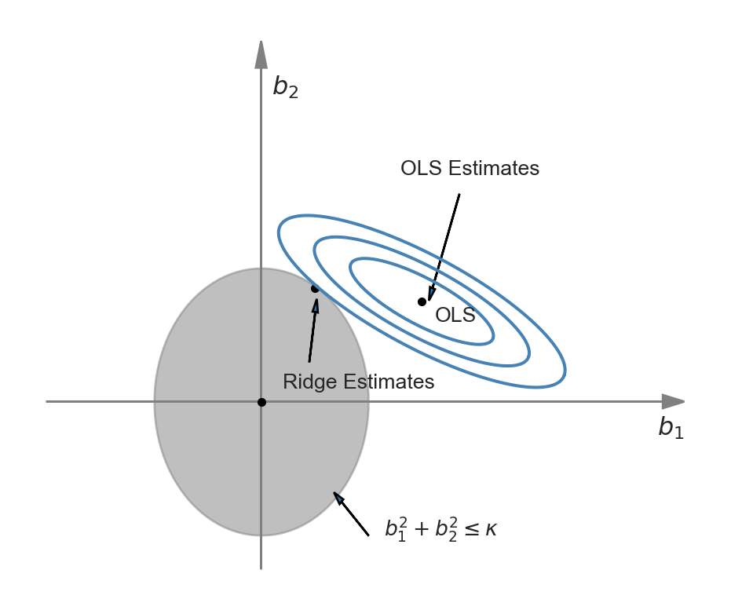
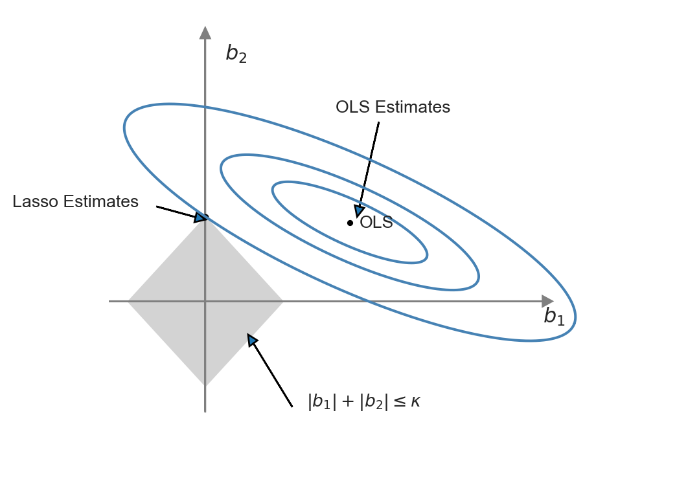
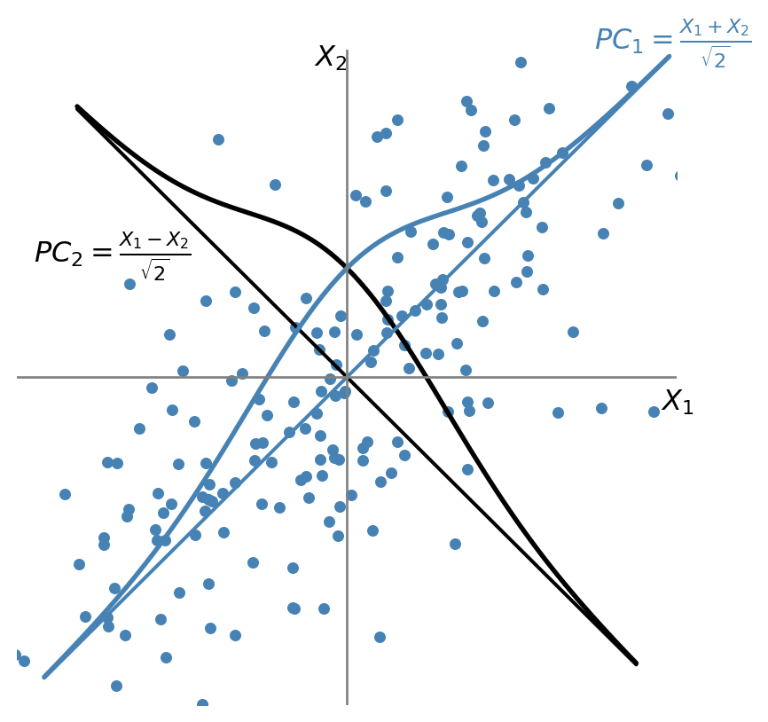

# Prediction with Many Regressors and Big Data {#sec-chapter21}

```{r}
#| warning: false
#| message: false
# Load necessary libraries
library(stargazer)
library(readxl)
library(MASS)
library(glmnet)
library(pls)
library(haven)
library(tidyverse)
library(caret)
library(modelsummary)
library(knitr)
```


## Introduction
A prediction exercise involves calculation of the values of an outcome variable using a prediction rule and data on the regressors (predictors). For the prediction rule, machine learning provides several competing methods.

:::{#def-def21-1}
## Machine Learning
**Machine learning** generally refers to methods and algorithms primarily used in prediction tasks. 
:::

These methods and algorithms are designed to handle large sample sizes, numerous variables, and unknown functional forms. Typically, these approaches do not focus on statistical modeling of the data, and as a result, there may be very few (or no) assumptions about the data generation process. The aim is to identify patterns and structures to improve the prediction of outcomes for new observations. Thus, in prediction exercises:

- We aim to generate accurate out-of-sample predictions.
- We do not distinguish between variables of interest and control variables; we consider all as predictors.
- We generally do not have *causal* interpretations for the estimated parameters.

In machine learning applications, the process of fitting a model or algorithm to data is often called **training**. Depending on the type of data used for training, machine learning applications can be classified into two types:

- Supervised learning (e.g., regression)
    - Data include feature variables (regressors) and a response variable, meaning the data is already labeled.
    - Applications are trained with labelled data, and the training can therefore be viewed as supervised machine learning.
- Unsupervised learning (e.g., classification)
    - Applications are trained with raw data that are not labeled or otherwise manually prepared.
    - The task is to group unsorted raw data according to similarities, patterns, and differences without any prior training on the data.
    - Final categories are not known in advance, and the training data therefore cannot be labeled accordingly.

**Big data** often refer to the large number of observations in the dataset used in an empirical application. **High-dimensional data** refer to situations where datasets contain many predictors relative to the number of observations. **Feature extraction** refers to the preprocessing stage of data and involves creating feature variables (i.e., numerical embeddings) and corresponding feature matrices. This is especially relevant for text- or image- based machine learning problems. See, for example, Chapter 11 in @Victor2024.

In this chapter, we will see that when the prediction problem is high-dimensional, the OLS estimator can produce poor out-of-sample predictions, and it becomes unfeasible to use when the number of predictors exceeds the number of observations. For high-dimensional prediction exercises, the **family of shrinkage estimators** tends to provide better out-of-sample performance. These estimators are biased, but they exploit the bias-variance trade-off in such a way that the gain in precision (relative to the increase in squared bias) can lead to relatively better out-of-sample predictions.

:::{#def-def21-2}
## Dimension Reduction/Regularization/Shrinkage
**Dimension reduction/regularization/shrinkage** (or feature selection) refers to methods for finding the most relevant variables in high-dimensional prediction exercises. 
:::

Some examples of dimension reduction methods include Lasso, elastic net, ridge regression, and principal components regression. In high-dimensional prediction exercises, there can be many variables that do not significantly contribute to the predictive performance of the model. A model that includes many irrelevant variables is often referred to as a **sparse model**. 

In this chapter, we study the ridge, Lasso, elastic net, and principal components regressions for handling high-dimensional data. There are many other machine learning methods that can be used for prediction exercises, such as random forests, support vector machines, and neural networks. For these methods, see, for example, @james2021introduction and @Victor2024.

## Prediction problem

To evaluate the predictive performance of competing estimators (predictors), we resort to the mean squared prediction error (MSPE) or simply the mean squared error (MSE). Let $m(X)$ be a predictor for the random variable $Y$ based on $X$. Then, the MSPE is given by
$$
\begin{align*}
\text{MSPE} = \E[\left(Y - m(X)\right)^2].
\end{align*}
$$

We want to show that $\text{MSPE}$ is minimized when $m(X) = \E(Y|X)$. Let us first express $\text{MSPE}$ as

$$
\begin{align*}
\text{MSPE} &= \E[\left(Y - \E(Y|X) + \E(Y|X) - m(X)\right)^2]\\
&= \E[\left(Y - \E(Y|X)\right)^2] + \E[\left(\E(Y|X) - m(X)\right)^2] \\
&+ 2\E[\left(Y - \E(Y|X)\right)\left(\E(Y|X) - m(X)\right)].
\end{align*}    
$$
The last term is zero by the law of iterated expectations. Therefore, we have
$$
\text{MSPE} = \E[\left(Y - \E(Y|X)\right)^2] + \E[\left(\E(Y|X) - m(X)\right)^2],
$$
which is minimized when $m(X) = \E(Y|X)$. Therefore, the best predictor (the oracle predictor) is the conditional mean of $Y$ given $X$, i.e., $\E(Y|X)$.

Often, the prediction we will be made for observations in the out-of-sample. Suppose there are $k$ predictors and let us denote the observations in the out-of-sample by $(X_{1i}^{oos},...,X_{ki}^{oos},Y_i^{oos})$. We assume the following assumption for the out-of-sample observations.

::: {.callout-important icon=false}
## The first least squares assumption for prediction
The out-of-sample observations $(X_{1i}^{oos},...,X_{ki}^{oos},Y_i^{oos})$ for $i > n$ are randomly drawn from the same population distribution as the estimation sample $(X_{1i},...,X_{ki},Y_i)$ for  $i = 1,..., n$.
:::

We can call this assumption the *external validity assumption*, because it suggests that we can generalize the in-sample model to the out-of-sample observations. Under this assumption, the best predictor (the oracle predictor) $\E(Y|X)$ is for both in-and out-of-sample observations.

If the best predictor were known, then the out-of-sample prediction would be trivial. However, since the best predictor is unknown, it must first be estimated. Therefore, the error in estimating $\text{MSPE} = \E\left(Y_i^{oos} - \E(Y_i^{oos}|X_i^{oos})\right)^2$ for the out-of-sample observations involves two parts:

- the error in predicting $Y_i^{oos}$, which is $Y_i^{oos}-\E(Y_i^{oos}|X_i^{oos})$, and
- the error in estimating the oracle predictor $\E\left(Y_i^{oos}|X_i^{oos}\right)$.

The obvious starting point for estimating the best predictor is using a linear regression model with the OLS estimator. However, the OLS estimator can produce poor predictions when $k$ is large. We will consider alternative estimators that can produce better out-of-sample predictions than the OLS estimator.

## The Predictive Regression Model with Standardized Regressors
In this section, we introduce the **standardized predictive regression model**. 
Let $(X^*_{1i},\dots,X^*_{ki},Y^{*}_i)$ for $i=1,\dots,n$ be the raw data and consider the following model:
$$
Y^*_i = \beta_0 + \beta^*_1 X^*_{1i}+\beta^*_2 X^*_{2i}+\cdots+\beta^*_k X^*_{ki}+u_i.
$$ {#eq-eq21-5}

Let the population mean of $Y^{*}_i$ be $\mu_{Y^{*}}$, and let $\mu_{X^{*}_j}$ and $\sigma_{X^{*}_j}$ denote respectively the population mean and standard deviation of $X_{ji}$ for $j=1,2,...,k$. Suppose that $\E(u_i|X^*_{1i},...,X^*_{ki})=0$ and $\E(u_i^2|X^*_{1i},...,X^*_{ki})=\sigma_u^2$. Hence, the best predictor for $Y^*_i$ is given by 
$$
\E(Y^*_i|X^*_{1i},...,X^*_{ki}) = \beta_0 + \beta^*_1 X^*_{1i}+\beta^*_2 X^*_{2i}+\cdots+\beta^*_k X^*_{ki}.
$$

By the law of iterated expectations, we obtain
$$
\begin{align*}
&\E(\E(Y^*_i|X^*_{1i},...,X^*_{ki})) = \beta_0 + \beta^*_1 \E(X^*_{1i})+\beta^*_2 \E(X^*_{2i})+\cdots+\beta^*_k \E(X^*_{ki})\\
&\implies\mu_{Y^{*}} = \beta_0 + \beta^*_1 \mu_{X^{*}_1}+\beta^*_2 \mu_{X^{*}_2}+\cdots+\beta^*_k \mu_{X^{*}_k}.
\end{align*}
$$

Then, subtracting $\mu_{Y^{*}}$ from $Y^*_i$, we obtain
$$
\begin{align}
Y^*_i-\mu_{Y^{*}} &= \beta^{*}_1(X^{*}_{1i}-\mu_{X^{*}_1})+\cdots+\beta^{*}_k(X^*_{ki}-\mu_{X^{*}_k})+u_i\\
&=\beta^{*}_1\sigma_{X^{*}_1}\frac{(X^{*}_{1i}-\mu_{X^{*}_1})}{\sigma_{X^{*}_1}}+\cdots+\beta^{*}_k\sigma_{X^{*}_k}\frac{(X^*_{ki}-\mu_{X^{*}_k})}{\sigma_{X^{*}_k}}+u_i.
\end{align}
$$ {#eq-eq21-6}

Let the standardized regressors be $X_{ji}=(X^{*}_{ji}-\mu_{X^{*}_j})/\sigma_{X^{*}_j}$ for $j=1,2,...,k$ and the demeaned dependent variable be $Y_i=Y^{*}_i-\mu_{Y^{*}}$. Also, denote $\beta_j=\beta^{*}_j\sigma_{X^{*}_j}$ for $j=1,\dots,k$. Then, the **standardized predictive regression model** is given by
$$
Y_i = \beta_1X_{1i}+\beta_2X_{2i}+\cdots+\beta_kX_{ki}+u_i.
$$ {#eq-eq21-4}

Comparing @eq-eq21-4 with @eq-eq21-5, we have $\beta_j=\beta^{*}_j\sigma_{X^{*}_j}$ for $j=1,\dots,k$. Therefore, $\beta_j$ coefficient in @eq-eq21-4 can be interpreted as follows: if $X^{*}_j$ increases by one standard deviation, then $Y$ increases by $\beta_j$ standard deviations, holding the other regressors constant.  

In empirical applications, to demean outcome variable and to standardize the regressors, the unknown terms $\mu_{Y^{*}}$, $\mu_{X^{*}_j}$ and $\sigma_{X^{*}_j}$ can be replaced with their sample counterparts.

## The MSPE in the standardized predictive regression model

Let $\bs{X}_i$ denote $(X_{1i},...,X_{ki})$. Under the zero conditional mean assumption, i.e., $\E(u_i|\bs{X}_i)=0$, we obtain
$$
\E\left(Y_i|\bs{X}_i\right) = \beta_1 X_{1i} + \beta_2 X_{2i} + \cdots + \beta_k X_{ki}
$$ 

for any $i$ from @eq-eq21-4. Using the estimates of $\beta_1,...,\beta_k$, we can formulate the prediction for the out-of-sample for the $i$th observation as

$$
\widehat{Y}_i(\bs{X}_i^{oos})= \widehat{\beta}_1 X_{1i}^{oos} + \widehat{\beta}_2 X_{2i}^{oos} + \cdots + \widehat{\beta}_k X_{ki}^{oos}.
$$

Thus, we can use $\widehat{Y}_i(\bs{X}_i^{oos})$ as an estimator of $\E(Y_i^{oos}|\bs{X}_i^{oos})$. Then, the prediction error is given by

$$
Y_i^{oos}-\widehat{Y}_i(\bs{X}_i^{oos}) =u_i^{oos} - \left((\widehat{\beta}_1-\beta_1)X_{1i}^{oos}+(\widehat{\beta}_2-\beta_2)X_{2i}^{oos}+\cdots+(\widehat{\beta}_k-\beta_k)X_{ki}^{oos}\right).
$$

Under the first least squares assumption for prediction above, we know that $u_i^{oos}$ is independent of the in-sample data used to estimate the coefficients. Also, the zero conditional mean assumption would imply $u_i^{oos}$ is uncorrelated with $\bs{X}_i^{oos}$. In that case, we can express $\text{MSPE} = \E\left(Y_i^{oos} - \widehat{Y}_i(\bs{X}_i^{oos})\right)^2$ as

$$
\text{MSPE} = \sigma_{u}^2 + \E\left(\left( (\widehat{\beta}_1-\beta_1)X_{1i}^{oos}+(\widehat{\beta}_2-\beta_2)X_{2i}^{oos}+\cdots+(\widehat{\beta}_k-\beta_k)X_{ki}^{oos}\right)^2\right).
$$

The first term represents the the prediction error made using the true (unknown) conditional mean, i.e., it arises from $\E\left(Y_i^{oos}-\E(Y_i^{oos}|\bs{X}_i^{oos})\right)^2=\text{var}(u_i^{oos})=\sigma^2_u$.  The second term is the contribution to the prediction error arising from the estimated regression coefficients. This expression suggests that we should choose an estimator that minimizes the second term. Since the second term is the sum of the squared bias and the variance of the estimator, its minimization entails a trade-off between bias and variance.

We know from the Gauss-Markov theorem that within the class of linear unbiased estimators, the OLS estimator has the smallest variance under homoskedasticity. Therefore, in this class, the OLS estimator yields the smallest value for the second term in the MSPE. But note that there may be biased estimators that can yield smaller values for the second term in the MSPE. If the gain from reducing variance outweighs the loss from squared bias, these estimators may perform better in terms of MSPE.

In the special case where the regression error is homoskedastic, it can be shown that the MSPE of the OLS estimator is $\text{MSPE}_{\text{OLS}}\approx\sigma_{u}^2(1+\frac{k}{n})$. We provide the proof of this result in @sec-OLS_MSPE. In the empirical application in this chapter, we will consider a regression with $n=1966$ and $k=38$. Then, $k/n = 38/1966 = 0.02$, so using the OLS method entails only a $2\%$ loss in MSPE relative to the oracle prediction. 

Now, suppose we include these regressors as polynomials up to third order, along with their interactions, so that $k=817$. Then, $k/n=817/1966 \approx 0.40$, meaning a $40\%$ deterioration in MSPE, which is large enough to warrant investigating estimators with lower MSPE than the OLS estimator. 

The bias-variance trade-off can be used to formulate alternative estimators that have relatively lower MSPE than the OLS estimator. The idea is to intentionally introduce bias to the OLS estimator in such a way that the reduction in variance more than compensates for the increase in squared bias. The family of **shrinkage estimators** achieves this by shrinking the OLS estimator toward a specific value (usually zero), thereby reducing the variance of the estimator.

:::{#def-def21-3}
## Shrinkage Estimators
A **shrinkage estimator** is a biased estimator that shrinks the OLS estimator toward a specific value (usually zero), thereby achieving a relatively lower variance than the OLS estimator. 
:::


## Estimation of the MSPE

The MSPE is an unknown constant, so we need to estimate it in order to assess the predictive performance of competing estimators. One way to estimate MSPE is by splitting the dataset into two parts: training and testing subsamples. Using the training subsample, we can obtain the estimates of the model coefficients. Then, using the testing subsample, we can estimate the prediction errors. Then, the **split-sample estimator of MSPE** is given by
$$
\widehat{\text{MSPE}}_{\text{split-sample}}=\frac{1}{n_{valid}}\sum_{i=1}^{n_{valid}}(Y_i^{oos}-\widehat{Y}_i^{oos})^2,
$$
where $n_{valid}$ denotes the number of observations in the validation subsample. The split-sample MSPE is also referred to as the out-of-sample MSPE.


Another way to obtain an estimate of MSPE is through *m-fold cross-validation*. In this approach, we first divide the sample into $m$ randomly chosen subsamples of approximately equal size. Then, we use the combined sub-samples $2,3,...,m$ to obtain the estimates for the model coefficients. The training sample size is roughly $n - \lceil n/m\rceil$. Then, using the observations in subsample $1$, we can compute
$$
\widehat{\text{MSPE}}_1=\frac{1}{n_1}\sum_{i=1}^{n_1}\left(Y_i^{oos,1}-\widehat{Y}_i^{oos,1}\right)^2,
$$
where $n_{1}$ denotes the number of observations in subsample $1$. We repeat this procedure for all remaining subsamples. Then, the **$m$-fold cross-validation estimator of MSPE** is given by
$$
\widehat{\text{MSPE}}_{\text{m-fold}}=\frac{1}{m}\sum_{i=1}^{m}\left(\frac{n_i}{n/m}\right)\widehat{\text{MSPE}}_i,
$$
where $n_i$ is the number of observations in subsample $i$.

A larger value of $m$ produces more efficient estimators of the coefficients because more observations are used each time the coefficients are estimated. From this perspective, the ideal scenario would be to use the so-called *leave-one-out cross-validation estimator*, for which $m = n - 1$. However, a larger value of $m$ means that the coefficients must be estimated $m$ times. In applications where $k$ is large (in the hundreds or more), leave-one-out cross validation may take considerable computer time. Therefore, the choice of $m$ must be made taking into account practical constraints. 

::: {.callout-note icon=false}
## Key Concept 21.1: The $m-$fold cross validation estimator of MSPE 
The $m-$fold cross validation estimator of MSPE can be computed in the following way:

1. Divide the estimation sample into randomly chosen, equal-sized subsamples $1,2,\dots,m$.
2. Use the observations in subsamples $2,3,\dots,m$ to estimate @eq-eq21-4.
3. Use the estimated model to compute 
$$
\widehat{\text{MSPE}}_1=\frac{1}{n_1}\sum_{i=1}^{n_1}\left(Y_i^{oos,1}-\widehat{Y}_i^{oos,1}\right)^2,
$$
where $n_{1}$ denotes the number of observations in subsample $1$.
4. Repeat Steps 2 and 3 for the observations in subsample $2,3,\dots,m$, and compute  $\widehat{\text{MSPE}}_i$ for $i=2,\dots,m$.
5. Compute the $m-$fold cross validation estimator of MSPE by
$$
\widehat{\text{MSPE}}_{\text{m-fold}}=\frac{1}{m}\sum_{i=1}^{m}\left(\frac{n_i}{n/m}\right)\widehat{\text{MSPE}}_i,
$$
where $n_i$ is the number of observations in subsample $i$.
::: 

## Penalized Regression Methods

### Ridge Regression
The ridge estimator shrinks the estimated parameters toward zero by adding a penalty to the sum of squared residuals, which increases with the square of the estimated parameters. By minimizing the sum of these two terms (i.e., the penalized sum of squared residuals), the ridge estimator introduces bias but achieves a relatively smaller variance. Let $SSR(b)$ denote the sum of the squared residuals, i.e., $SSR(b) = \sum_{i=1}^n\left(Y_i - b_1X_{1i} - b_2X_{2i} - \cdots-b_kX_{ki}\right)^2$. The ridge regression estimator is defined as
$$
\widehat{\beta}_R = \argmin_{b} \left(SSR(b) + \lambda_R \sum_{j=1}^kb_j^2\right),
$${#eq-eq21-1}
where $\lambda_R > 0$ is called the *shrinkage* parameter. The second term is a penalty term because it penalizes the estimator for selecting large values for the coefficients, shrinking the ridge regression estimator toward zero. Thus, the ridge estimator produces estimates that are closer to 0 than those produced by the OLS estimator. 

To understand why the ridge estimator shrinks the OLS estimator, we can alternatively express the ridge minimization problem as a constrained minimization problem: 
$$
\widehat{\beta}_R=\argmin_{b:\sum_{j=1}^kb_j^2\le \kappa} SSR(b),
$${#eq-eq21-2}
for some constraint parameter $\kappa>0$.  Then, the Lagrangian for the constrained minimization yields
$$
\widehat{\beta}_R=\argmin_{b} \left(SSR(b) + \lambda_R\left(\sum_{j=1}^kb_j^2 - \kappa\right)\right),
$$
where $\lambda_R$ is the Lagrangian multiplier. 

The difference between @eq-eq21-1 and @eq-eq21-2 is that in the first problem we need to specify the shrinkage parameter, while in the second problem we need to specify the constraint parameter. The representation of the ridge minimization problem in @eq-eq21-2 is useful to produce a graphical representation for further insight. Following @Hansen2022, we illustrate the ridge minimization problem when there are two regressors so that the constraint set is $\{(b_1,b_2): b^2_1+b^2_2<\kappa\}$.  In @fig-f23-1, the constraint set $\{(b_1,b_2): b^2_1+b^2_2<\kappa\}$ is represented by the ball around the origin, and the contour sets of $SSR(b)$  are depicted as ellipses. In this illustration, the OLS estimates correspond to the point at the center of the ellipses, whereas the ridge estimates are represented by the point on the circle where the outer-contour is tangent. This illustration shows that the ridge estimator effectively shrinks the OLS estimate $b_1$ toward zero. 

{#fig-f23-1 width=500px}

We can use calculus to get a closed-form expression for the ridge estimator. See @sec-RidgeOLSconnect for the derivation details. When the regressors are uncorrelated, we can derive the ridge estimator as
$$
\widehat{\beta}_{R,j} = \left(1+\lambda_R/\sum_{i=1}^n X_{ji}^2\right)^{-1}\widehat{\beta}_{OLS,j},
$$
where $\widehat{\beta}_{R,j}$ is the $j$th element of $\widehat{\beta}_R$, and $\widehat{\beta}_{OLS,j}$ is the OLS estimator $\beta_j$. Since the regressors are standardized,  we can further express $\widehat{\beta}_{R,j}$ as
$$
\widehat{\beta}_{R,j} = \left(1+\lambda_R/(n-1)\right)^{-1}\widehat{\beta}_{OLS,j}.
$$

Thus, with uncorrelated standardized regressors, the ridge regression estimator shrinks the OLS estimator toward 0 by the factor $\left(1+\lambda_R/(n-1)\right)^{-1}$. In cases where the regressors are correlated, the ridge estimator can produce some estimates that are larger than those from the OLS estimator. It is important to note that when there is perfect multicollinearity, such as when $k > n$, the ridge estimator can still be computed, whereas the OLS estimator cannot.


To compute the ridge estimator, we need to choose the shrinkage parameter $\lambda_R$. Since our goal is to improve out-of-sample prediction (i.e., achieve a lower MSPE), we select a value for $\lambda_R$ that minimizes the estimated MSPE. This can be accomplished using the $m$-fold cross-validation estimator of the MSPE. For a fixed $m$, we can repeat $m$-fold cross-validation for multiple values of $\lambda_R$ and record the corresponding MSPEs. We then choose the value of $\lambda_R$ that yields the minimum MSPE estimate.  


### Lasso

In some sparse models, the coefficients of many predictors are zero. For this type of model, the Lasso (least absolute shrinkage and selection operator) is especially useful, as it effectively estimates the coefficients of predictors with non-zero parameters. Like the ridge estimator, the Lasso estimator also shrinks estimated coefficients toward zero. However, unlike the ridge estimator, the Lasso estimator may set many of the estimated coefficients exactly to zero, effectively dropping those regressors from the model.

The Lasso estimator is defined as 
$$
\widehat{\beta}(\lambda_L) = \argmin_{b} \left(SSR(b) +  \lambda_L \sum_{j=1}^k|b_j|\right),
$$
where $\lambda_L > 0$ is the Lasso shrinkage parameter. The penalty term is $\lambda_L \sum_{j=1}^k|b_j|$, which increases with the sum of the *absolute values* of the coefficients. This term penalizes large coefficient values, thereby shrinking the Lasso estimates toward zero. The first part of the Lasso name, least absolute shrinkage, reflects this penalty nature. The second part, selection operator, indicates that the Lasso sets many coefficients exactly to zero, effectively selecting a subset of predictors.

The Lasso estimator can be equivalently obtained through the following constrained minimization problem: 
$$
\argmin_{b:\sum_{j=1}^k|b_j|\le \kappa} SSR(b),
$$
for some constraint parameter $\kappa>0$. Then, using the Lagrangian for this constrained minimization problem, we can define the Lasso estimator as
$$
\min_{b} \left(SSR(b) + \lambda_L\left(\sum_{j=1}^k|b_j| - \kappa\right)\right),
$$
where $\lambda_L$ is the Lagrangian multiplier. 

This representation of the Lasso minimization problem is useful to produce a graphical representation for further insight. We illustrate the constrained minimization problem through @fig-fig23-2. In this figure, the constraint set $\{(b_1,b_2):|b_1|+|b_2|<\kappa\}$ is represented by the diamond-shaped area centered on the origin, while the contour sets of $SSR(b)$  are depicted as ellipses. In this illustration, the OLS estimates correspond to the point at the center of the ellipses, whereas the Lasso estimates are represented by the point at the intersection of the constraint set and the outer-contour. This demonstrates that the Lasso estimator effectively set the estimate of $b_1$ to zero.

{#fig-fig23-2 width=500px}

The ridge and Lasso estimators exhibit different behaviors when the OLS estimates are large. For large coefficient values, the ridge penalty surpasses the Lasso penalty. Consequently, when the OLS estimate is large, the Lasso estimator shrinks it less than the ridge estimator. Conversely, when the OLS estimate is small, the Lasso estimator can shrink it more than the ridge estimator, and in some cases, even to 0. 

Unlike the OLS and ridge estimators, we cannot derive a closed form expression for the Lasso estimator when $k>1$; therefore, we must use numerical methods to solve the Lasso minimization problem. An algorithm for this can be found in Chapter 29 of @Hansen2022. 

Similar to the ridge regression, the Lasso shrinkage parameter $\lambda_L$ can be selected using $m$-fold cross-validation. For a fixed $m$, repeat the $m$-fold cross-validation for multiple values of $\lambda_L$ and save the corresponding MSPEs. Finally, choose the value of $\lambda_L$ that results in the minimum MSPE estimate. Additionally, recent literature has suggested some plug-in values for $\lambda_L$ that ensure certain desirable properties for the Lasso estimator; see Chapter 3 in @Victor2024 for more details.

### Elastic Net

The elastic net method uses a convex combination of the ridge and Lasso penalties. This estimator is defined as the solution of the following minimization problem:
$$
\widehat{\beta}_{EN} = \argmin_{b} \left(SSR(b) + \lambda_e\left(\sum_{j=1}^k\left(\alpha b_j^2 + (1-\alpha)|b_j|\right)\right)\right),
$$
where $\alpha\in[0,1]$. Hence, the elastic net method nests the ridge regression ($\alpha=1$) and the Lasso ($\alpha=0$) as special cases.


## Principal Components Regression

The general idea behind the principal components (PC) method is to reduce the high dimensionality of the estimation problem by generating linear combinations of the original regressors that are uncorrelated. Let $\bs{X}$ denote the $n\times k$ matrix of the standardized regressors. A principal component of $\bs{X}$ is defined as a weighted linear combination of the column vectors, with weights chosen to maximize its variance while ensuring it remains uncorrelated with the other principal components. Thus, the principal components of $\bs{X}$ are mutually uncorrelated and sequentially capture as much information as possible from  $\bs{X}$. The construction of principal components proceeds as follows:

- The linear combination weights for the first principal component are selected to maximize its variance, subject to the constraint that the sum of squared weights equals one. This approach aims to capture the maximum variation in $\bs{X}$. 
- The linear combination weights for the second principal component are chosen to maximize its variance under the constraints that it is uncorrelated with the first principal component and that its sum of squared weights is one.
- The linear combination weights for the third principal component are chosen to maximize its variance, under the constraint that it is uncorrelated with the first two principal components and that its sum of squared weights equals one.
- The linear combination weights for the remaining principal components are chosen in the same manner.

Suppose that $\bs{X} = (X_1, X_2)$, where $X_1 \sim N(0,1)$, $X_2 \sim N(0,1)$, and $\rho=\corr(X_1, X_2) = 0.7$. The first principal component is the weighted average $PC_1 = w_1X_1 + w_2X_2$, with maximum variance, where $w_1$ and $w_2$ are the principal component weights that satisfy $w_1^2 + w_2^2 = 1$. As illustrated in @fig-fig23-3, the first principal component lies along the $45^\circ$ line because the spread of both variables is largest in that direction. Thus, the weights of the first principal component are equal: $w_1 = w_2 = 1/\sqrt{2}$, and $PC_1 = (X_1 + X_2)/\sqrt{2}$.

The weights for the second principal component are either $w_1 = 1/\sqrt{2}$ and $w_2 = -1/\sqrt{2}$ or $w_1 = -1/\sqrt{2}$ and $w_2 = 1/\sqrt{2}$. In either case, $\cov(PC_1, PC_2) = 0$. Suppose $PC_2 = (X_1 - X_2)/\sqrt{2}$ as illustrated in @fig-fig23-3.

Using these weights and the fact that $\var(PC_1) = w_1^2 \var(X_1) + w_2^2 \var(X_2) + 2\rho w_1 w_2$, the variances of the two principal components are $\var(PC_1) = 1 + \rho$ and $\var(PC_2) = 1 - \rho$. Hence, we have the following equality: $\var(PC_1) + \var(PC_2) = \var(X_1) + \var(X_2)$.

This provides an $R^2$ interpretation of principal components. The fraction of the total variance explained by the first principal component is $\var(PC_1)/[\var(X_1) + \var(X_2)]$, while the fraction explained by the second principal component is $\var(PC_2)/[\var(X_1) + \var(X_2)]$. Since $\rho=0.7$, the first principal component explains $(1 + \rho)/2 = 85\%$ of the variance of $\bs{X}$, while the second principal component explains the remaining $(1 - \rho)/2 = 15\%$ of the variance of $\bs{X}$. 

{#fig-fig23-3 width=500px}

When $k>2$, we can resort to the linear algebra methods to derive principal components. Let $PC_j$ be the $j$th principal component and let $\bs{w}_j$ denote the corresponding $k\times 1$ vector of weights, i.e., $PC_j = \bs{X}\bs{w}_j=\sum_{i=1}^kw_iX_i$. The variance of the $j$th principal component is $PC_j^{'}PC_j=\bs{w}_j^{'}\bs{X}^{'}\bs{X}\bs{w}_j$ and the sum of the squared weights is $\bs{w}_j^{'}\bs{w}_j$. Note also that $\bs{X}$ is standardized (with mean zero), $PC_j^{'}PC_j/(n-1)$ is the sample variance of the $j$th principal component.

It can be shown that the vector of weights $\bs{w}_1$ for the first principal component is the eigenvector corresponding to the largest eigenvalue ($\lambda_1$) of $\bs{X}^{'}\bs{X}$. The vector of weights $\bs{w}_2$ for the second principal component is the eigenvector corresponding to the second-largest eigenvalue ($\lambda_2$) of $\bs{X}^{'}\bs{X}$. Proceeding in this manner, the vector of weights $\bs{w}_j$ for the $j$-th principal component is the eigenvector corresponding to the $j$-th largest eigenvalue ($\lambda_j$) of $\bs{X}^{'}\bs{X}$. See @sec-PCderive for the derivation details. If $k < n$, only the first $k$ eigenvalues of $\bs{X}^{'}\bs{X}$ are non-zero, so the total number of principal components is $\min(k, n)$.


The first $p$ principal components can be obtained as $\bs{X}\bs{W}$, where $\bs{W}=\left(\bs{w}_1,\bs{w}_2,...,\bs{w}_p\right)$ is the $k\times p$ matrix of eigenvectors corresponding to the largest first $p$ eigenvalues of $\bs{X}^{'}\bs{X}$ and $1\le p\le\min(k,n)$. Note also that since trace of a matrix is the sum of its eigenvalues, we have
$$
\tr(\bs{X}^{'}\bs{X})=\sum_{j=1}^{\min(k,n)}\lambda_j=\sum_{j=1}^{\min(k,n)}PC_j^{'}PC_j.
$$

Dividing both sides of this equality by $(n-1)$, the diagonals of the left hand-side matrix is the variances of regressors. Therefore, we have $\sum_{j=1}^{k}\var(X_j) = \sum_{j=1}^{\min(k,n)}\var(PC_j)$.  The ratio $\var(PC_j)/\sum_{j=1}^{k}\var(X_j)$ represents the fraction of the total variance of the regressors explained by the $j$th principal component. These values can be used to generate a useful graph, known as a **scree plot**, which allows us to observe the fraction of the sample variance of the regressors explained by any particular principal component. 

Once the weight vectors $\bs{w}_j$'s are obtained, we can construct the $PC_j$s and use them in the prediction exercise with the OLS estimator. Let $\gamma_1,\dots,\gamma_p$ denote the coefficients in the regression of $Y$ on the first $p$ principal components:
$$
Y = \gamma_1PC_{1}+\gamma_2PC_{2}+\cdots+\gamma_p PC_{p}+\nu,
$${#eq-eq21-pc}

where $\nu$ is the error term. We can determine the number of principal components to include in this regression by minimizing the MSPE, which is estimated using the $m$-fold cross-validation method. In the case of principal component (PC) regression, the out-of-sample values of the principal components must also be computed by applying the weights ($\bs{w}$’s) estimated from the in-sample data. In the next section, we show how to compute the the out-of-sample predictions.

Recall our original standardized predictive regression model:
$$
\begin{align}
Y=\beta_1X_{1}+\dots+\beta_kX_{k}+u=\sum_{l=1}^k\beta_lX_{l}+u.
\end{align}
$$

We want to see how the coefficients of this model are related to those of the principal components regression in @eq-eq21-pc.  Since $PC_{j}=\sum_{l=1}^kw_{lj}X_{l}$, where $w_{lj}$'s are the elements of $\bs{w}_j$, we have 
$$
\begin{align}
Y&=\sum_{j=1}^p\gamma_jPC_{j}+\nu=\sum_{j=1}^p\gamma_j\sum_{l=1}^kw_{lj}X_{l}+\nu\nonumber\\
&=\sum_{l=1}^k\sum_{j=1}^p\gamma_jw_{lj}X_{l}+\nu.
\end{align}
$$

This last equation suggests that
$$ 
\begin{align}
\beta_l=\sum_{j=1}^p\gamma_jw_{lj},\quad l=1,2,\dots,k.
\end{align}
$$ {#eq-eq21-pc1}

Hence, the principal component regression in @eq-eq21-pc is a special case of our standardized predictive regression model in which the parameters satisfy @eq-eq21-pc1. 


::: {.callout-note icon=false}
## Key Concept 21.2: The principal components of $\bs{X}$ 
The principal components are linear combinations of $X_1,\dots,X_k$. They satisfy the following properties:

1. The sum of squared linear combination weights is one.
2. The linear combination weights for the first principal component are selected to maximize its variance, subject to the constraint that the sum of squared weights equals one. 
3. The linear combination weights for the second principal component are chosen to maximize its variance under the constraints that it is uncorrelated with the first principal component and that its sum of squared weights is one.
4. The linear combination weights for the remaining principal components are chosen in the same manner.
5. The number of principal components is $\min(k,n)$.
6.  $\sum_{j=1}^{\min(k,n)}\var(PC_j)=\sum_{j=1}^{k}\var(X_j)$.
7.  The ratio $\var(PC_j)/\sum_{j=1}^{k}\var(X_j)$ represents the fraction of the total variance of the regressors explained by the $j$th principal component.
8. A scree plot is the plot of $\var(PC_j)/\sum_{j=1}^{k}\var(X_j)$ against the number of the principal components.
::: 


## Computation of the out-of-sample predictions

In the case of OLS, ridge, lasso, and elastic net, the out-of-sample predictions  can be computed as follows.

- Compute the demeaned $Y$ and standardized $X$'s for the in-sample data.
- Obtain the parameter estimates for the standardized predictive regression model using the in-sample data.
- Standardize the $X^{oos}$'s using the respective in-sample mean and standard deviation. 
- Compute the predicted value for the out-of-sample observation as $\widehat{Y}^{oos}=\bar{Y}^{in} + \sum_{j=1}^k \widehat{\beta}_j X_j^{oos}$, where $\bar{Y}^{in}$ is the in-sample mean of $Y$.

Note that the in-sample means and variances are used to standardize the regressors, and the in-sample mean is used to demean the dependent variable. In the case of the PC regression, the predictions for the observations in the out-of-sample can be done as follows.

- Compute the demeaned $Y$ and standardized $X$'s for the in-sample data.
- Compute the in-sample principal components of $X$'s: $PC_1,PC_2,...,PC_{\min(k,n)}$.
- For a given value $p$, estimate the regression in @eq-eq21-pc by the OLS estimator and obtain the parameter estimates $\hat{\gamma}_1,\hat{\gamma}_2,...,\hat{\gamma}_p$.
- Standardize the $X^{oos}$'s using the respective in-sample mean and standard deviation. 
- Compute the principal components for the out-of-sample observations using the in-sample weights: $PC_1^{oos},PC_2^{oos},...,PC_p^{oos}$.
- Compute the predicted value for the out-of-sample observation as $\widehat{Y}^{oos}=\bar{Y}^{in} + \sum_{j=1}^p \hat{\gamma}_j PC_j^{oos}$, where $\bar{Y}^{in}$ is the in-sample mean of $Y$.

Note that we again use the in-sample means and standard deviations to standardize $X^{oos}$'s. Also, we use the in-sample weights to compute $PC_1^{oos},PC_2^{oos},...,PC_p^{oos}$.

## Empirical Application

In this application, we replicate the results from the empirical application in Chapter 14 of @Stock2020. We use the school-level data on California school districts, which is the disaggregated version of the school district-level data heavily used in @Stock2020. In the dataset, the total number of observations is 3932 and the unit of observation is an elementary school in California in 2013.  We use fifty percent of the observations for estimation (training) and the remaining fifty percent for prediction (testing).

The outcome variable is the average fifth-grade test score at the school-level (`testscore`). There are 38 distinct predictors (features) relating to school and community characteristics. In this application, we consider three cases: (i) the small case with k=4, (ii) the large case with k=817, and (iii) the very large case with k=2065. For the large and very large cases, we generate additional regressors from the original variables through transformations. For example, in the large case, the 817 predictors are generated as follows: 38 from the original variables, 38 from their squares, 38 from their cubes, and 703 from interactions among the original variables.

## The small case

The regressors for the small case include the student-teacher ratio (`str_s`), the median income of the local population (`med_income_z`), the average years of experience of teachers (`te_avgyr_s`), and the instructional expenditures per student (`exp_1000_1999_d`). 

::: {style="font-size: 80%"}
| **Original variables** |
|:--------|:--------|
|Student–teacher ratio (`str_s`)|Median income of the local population (`med_income_z`)|
|Teachers’ average years of experience (`te_avgyr_s`)|Instructional expenditures per student (`exp_1000_1999_d`)|
: The small case {#tbl-SmallCase .striped .hover}
:::

The in-sample (training sample) and out-of-sample (testing sample) data are contained in the files `ca_school_testscore_insample.dta` and  `ca_school_testscore_outofsample.dta`, respectively.  In the following code chunk, we import the data and then construct standardized variables. The standardized variables are stored in `pred_sx`. 


```{r}
# Small case: data preparation
insample <- read_dta("data/ca_school_testscore_insample.dta")
outofsample <- read_dta("data/ca_school_testscore_outofsample.dta")
data <- bind_rows(insample, outofsample)

# In-sample and out-of-sample indicators
data$insample <- (1:nrow(data) <= 1966)
data$outofsample <- (1:nrow(data) > 1966)

# Convert to data frame
data <- as.data.frame(data)

# Regressors in the small case
pred_columns <- c("str_s", "med_income_z", "te_avgyr_s", "exp_1000_1999_d")

# Standardize regressors using in-sample means and standard deviations
for (i in seq_along(pred_columns)) {
    mean_val <- mean(data[data$insample, pred_columns[i]], na.rm = TRUE)
    std_val <- sd(data[data$insample, pred_columns[i]], na.rm = TRUE)
    data[[paste0("s_x_", i)]] <- (data[[pred_columns[i]]] - mean_val) / std_val
}

# Demean testscore
mean_testscore <- mean(data[data$insample, "testscore"], na.rm = TRUE)
data$testscore_dm <- data$testscore - mean_testscore

# Prepare predictors for regression
pred_sx <- c("s_x_1", "s_x_2", "s_x_3", "s_x_4")

# OLS estimation using the in-sample data
model_std <- lm(testscore_dm ~ .,
    data = data[data$insample, c("testscore_dm", pred_sx)]
)
```

In @tbl-OLSsmall, we present the OLS estimation results for the small case. 

```{r}
#| tbl-cap: "The OLS estimation results for the small case"
#| label: tbl-OLSsmall
# Print the OLS estimation results
modelsummary(model_std,
    stars = TRUE,
    fmt = 3,
    gof_omit = "AIC|BIC|Log.Lik"
)
```

In the following code chunk, we first generate the in-sample and out-of-sample predicted values and then compute the prediction errors. The in-sample and out-of-sample predictions are stored in `testscore_ols`, and the prediction errors are stored in `e_ols`. Lastly, we compute the split-sample estimate of the RMSPE (the out-of-sample RMSPE estimate).


```{r}
# Compute the in-sample and out-of-sample predictions and RMSPEs
data$testscore_ols <- mean_testscore + predict(model_std, newdata = data[pred_sx])
data$e_ols <- data$testscore - data$testscore_ols
data$e_ols2 <- (data$e_ols)^2
small_rmse_in_ols <- sqrt(mean(data$e_ols2[data$insample]))
small_rmse_oos_ols <- sqrt(mean(data$e_ols2[data$outofsample]))

# Create a data frame to store the results
results <- data.frame(
  Case = "Small",
  Model = "OLS",
  In_sample_RMSPE = round(small_rmse_in_ols, 1),
  Out_of_sample_RMSPE = round(small_rmse_oos_ols, 1)
)

# Column names for the results table
colnames(results) <- c("Case", "Model", "In-sample RMSPE", "Out-of-sample RMSPE")
```

In @tbl-OLSsmallRMSPE, we present the RMSPE results for the small case. As expected, the in-sample RMSPE is smaller than the out-of-sample RMSPE.

```{r}
#| tbl-cap: "The RMSPE of the OLS estimator for the small case"
#| label: tbl-OLSsmallRMSPE
# RMSPE results for the small case
kable(results)
```

In the following code chunk, we compute the 10-fold cross-validation estimate of the RMSPE using the `train` function from the `caret` package, which provides a more efficient way to perform cross-validation. The `trainControl` function is used to specify the type of cross-validation and the number of folds. The `train` function then fits the model and computes the RMSPE for each fold, returning the average RMSPE across all folds.

```{r}
# Compute RMSPE by the 10-fold cross-validation
X_train <- data[data$insample, pred_sx]
y_train <- data[data$insample, 'testscore_dm']

train_control <- trainControl(method = "cv", number = 10)
model <- train(X_train, y_train, method = "lm", trControl = train_control, metric = "RMSE")

small_rmse_cv_in_ols <- model$results$RMSE
results$RMSPE_CV <- round(small_rmse_cv_in_ols, 1)
```

```{r}
#| tbl-cap: "The RMSPE of the OLS estimator for the small case"
#| label: tbl-OLSsmallRMSPEcv
# RMSPE results for the small case with 10-fold cross-validation
kable(results)
```


```{r}
# Remove data
rm(data)
```

## The large case
In the large case (k=817), the main variables additionally include the following: 

* the fraction of students eligible for free or reduced-price lunch, 
* ethnicity variables (8), 
* the fraction of students eligible for free lunch, 
* the number of teachers, 
* the fraction of English learners, 
* the fraction of first-year teachers, 
* the fraction of second-year teachers, 
* the part-time ratio (number of teachers divided by teacher full-time equivalents), 
* per-student expenditure by category at the district level (7), 
* per-student expenditure by type at the district level (5), 
* the number of enrolled students, 
* per-student revenues by revenue source at the district level (4), 
* the fraction of English-language proficient students, 
* the ethnic diversity index, and 
* per-student revenues by revenue source at the district level (4). 

These variables are provided in @tbl-LargeCase. In the last panel of @tbl-LargeCase, we show how k=817 predictors are generated from the main variables. 

::: {style="font-size: 80%"}
| **Original variables** |
|:--------|:--------|
| Fraction of students eligible for free or reduced-price lunch | Ethnicity variables (8) fraction of students who are American Indian, Asian, Black, Filipino, Hispanic, Hawaiian, two or more, none reported  |
| Fraction of students eligible for free lunch   | Number of teachers   |
| Fraction of English learners | Fraction of first-year teachers   |
|Teachers’ average years of experience|Part-time ratio (number of teachers divided by teacher full-time equivalents)|
|Instructional expenditures per student|Per-student expenditure by category, district level (7)|
|Median income of the local population|Per-student expenditure by type, district level (5)|
|Student–teacher ratio|Per-student revenues by revenue source, district level (4)|
|Number of enrolled students|Fraction of English-language proficient students|
|Ethnic diversity index||
| <span style="color:steelblue">**Technical (constructed) regressors**</span> |
|Squares of main variables (38)|Cubes of main variables (38) |
|All interactions of main variables: (38*37)/2 = 703|Total number of predictors: k = 38 + 38 + 38 + 703 = 817 |
: The large case {#tbl-LargeCase .striped .hover}
:::

In the following code chunk, the `pred_columns` vector includes the names of the original variables given in @tbl-LargeCase.


```{r}
# Large case: data preparation
data <- bind_rows(insample, outofsample)

# In-sample and out-of-sample indicators
data$insample <- (1:nrow(data) <= 1966)
data$outofsample <- (1:nrow(data) > 1966)

# Convert to data frame
data <- as.data.frame(data)

# Define predictors
pred_columns <- c(
    "str_s", "med_income_z", "te_avgyr_s", "exp_1000_1999_d", "frpm_frac_s", 
    "ell_frac_s", "freem_frac_s", "enrollment_s", "fep_frac_s", "edi_s", 
    "re_aian_frac_s", "re_asian_frac_s", "re_baa_frac_s", "re_fil_frac_s", 
    "re_hl_frac_s", "re_hpi_frac_s", "re_tom_frac_s", "re_nr_frac_s", 
    "te_fte_s", "te_1yr_frac_s", "te_2yr_frac_s", "te_tot_fte_rat_s", 
    "exp_2000_2999_d", "exp_3000_3999_d", "exp_4000_4999_d", "exp_5000_5999_d", 
    "exp_6000_6999_d", "exp_7000_7999_d", "exp_8000_8999_d", "expoc_1000_1999_d", 
    "expoc_2000_2999_d", "expoc_3000_3999_d", "expoc_4000_4999_d", 
    "expoc_5000_5999_d", "revoc_8010_8099_d", "revoc_8100_8299_d", 
    "revoc_8300_8599_d", "revoc_8600_8799_d"
)
```

In addition to the 38 variables in the `pred_columns` vector, we also consider their squares, cubes, and interactions, resulting in 816 distinct predictors. In the following code chunk, we generate these variables along with their standardized versions.

```{r}
# Standardize
for (i in seq_along(pred_columns)) {
    mean_val <- mean(data[data$insample, pred_columns[i]], na.rm = TRUE)
    std_val <- sd(data[data$insample, pred_columns[i]], na.rm = TRUE)
    data[[paste0('sS_x_', i)]] <- (data[[pred_columns[i]]] - mean_val) / std_val
}
	
# Create interactions and squared terms
for (i in seq_along(pred_columns)) {
    for (j in i:length(pred_columns)) {
        tmp <- data[[pred_columns[i]]] * data[[pred_columns[j]]]
        mean_val <- mean(tmp[data$insample], na.rm = TRUE)
        std_val <- sd(tmp[data$insample], na.rm = TRUE)
        data[[paste0('sS_xx_', i, '_', j)]] <- (tmp - mean_val) / std_val
    }
}

# Create cubes
for (i in seq_along(pred_columns)) {
    tmp <- data[[pred_columns[i]]] ^ 3
    mean_val <- mean(tmp[data$insample], na.rm = TRUE)
    std_val <- sd(tmp[data$insample], na.rm = TRUE)
    data[[paste0('sS_xxx_', i)]] <- (tmp - mean_val) / std_val
}

# Demeaned testscore
mean_testscore <- mean(data[data$insample, 'testscore'], na.rm = TRUE)
data$testscore_dm <- data$testscore - mean_testscore

# Drop collinear variables
data$sS_xx_1_19 <- NULL

# Prepare data for regression
X_train <- data[data$insample, grep('sS_x', names(data))]
y_train <- data$testscore_dm[data$insample]
```

### OLS regression
In the following code chunk, we perform the OLS estimation and compute the split-sample estimate of the RMSPE (the in-sample and out-of-sample RMSPE estimates).

```{r}
# Select the in-sample data and the relevant columns for OLS estimation
df_std <- data[data$insample, ]
df_std <- df_std[, c("testscore_dm", grep("^sS_x", names(df_std), value = TRUE))]

model_std <- lm(testscore_dm ~ ., data = df_std)

data$testscore_ols <- mean_testscore + predict(model_std, newdata = data[grep('sS_x', names(data))])

# Compute the in-sample and out-of-sample errors and RMSPEs
data$e_ols <- data$testscore - data$testscore_ols
data$e_ols2 <- data$e_ols ^ 2
large_rmse_in_ols <- sqrt(mean(data$e_ols2[data$insample]))
large_rmse_oos_ols <- sqrt(mean(data$e_ols2[data$outofsample]))
```

Next, we compute the 10-fold cross-validation estimate of the RMSPE in the following code chunk.

```{r}
# Compute 10-fold CV estimate of the RMSPE using caret package
train_control <- trainControl(method = "cv", number = 10)
model <- train(X_train, y_train, method = "lm", trControl = train_control, metric = "RMSE")
large_rmse_cv_in_ols <- model$results$RMSE
```

In @tbl-OLSlargeRMSPE, we present the RMSPE results for the large case. As expected, the in-sample RMSPE is smaller than both the out-of-sample RMSPE and the 10-fold cross-validation RMSPE. These results suggest that the OLS estimator is overfitting the in-sample data, which leads to a large out-of-sample RMSPE estimate. 

```{r}
# Collect results in a data frame
results_large <- data.frame(
  Case = "Large",
  Model = "OLS",
  In_sample_RMSPE = round(large_rmse_in_ols, 1),
  Out_of_sample_RMSPE = round(large_rmse_oos_ols, 1),
  RMSPE_CV = round(large_rmse_cv_in_ols, 1)
)
# Column names for the results table
colnames(results_large) <- c("Case", "Model", "In-sample RMSPE", "Out-of-sample RMSPE", "RMSPE-CV")
```

```{r}
#| tbl-cap: "The RMSPE of the OLS estimator for the large case"
#| label: tbl-OLSlargeRMSPE
# RMSPE results for the large case
kable(results_large)
```


### Ridge regression

We use the `glmnet` package for estimating the ridge and lasso regressions (see [glmnet - vignette](https://glmnet.stanford.edu/)). The main estimation function in this package is the `glmnet` function. This function has slightly different syntax from the `lm` function. In particular, we cannot use the syntax `y~x` to specify the estimation equation. Also, `y` should be a vector and `x` should be a matrix. The function has the `alpha` argument for specifying the penalty functions:

  - In the `glmnet` and `cv.glmnet` functions, the penalty term is $\lambda \times \left[\alpha \left(\sum_{j=1}^k |b_j|\right) + (1-\alpha)\left(\sum_{j=1}^k b_j^2\right)\right]$
  - For the ridge regression, we need to set `alpha=0`.
  - For the lasso regression, we need to set `alpha=1`.

The following code can be used to estimate a ridge regression for a grid of $\lambda$ values.

```{r}
large_ridge_mod <- glmnet(X_train,
                    y_train,
                    alpha = 0, 
                    nlambda = 100,
                    standardize = FALSE,
                    intercept = FALSE)
```

The `glmnet` function estimates the model over a sequence of $\lambda$ values. The argument `nlambda = 100` shows the length of the sequence. We can also supply a user defined sequence (grid) for $\lambda$. For example, we can set `grid = 10^seq(10, -2, length = 100)` and use the argument `lambda=grid` in the `glmnet` function. In this way, we can estimate the ridge regression over a grid of $\lambda$ values ranging from  $\lambda=10^{10}$ to $\lambda=10^{-2}$. 

Associated with each value of $\lambda$, we have a vector of ridge regression coefficients, stored in a matrix that can be accessed by the `coef` function. In this case, it is a  $817\times100$ matrix, with $817$ rows (one for each predictor, plus an intercept) and $100$ columns (one for each value of  $\lambda$). The first $5$ coefficients corresponding to the first five $\lambda$ values can be returned in the following way.


```{r}
# Dimensions of the coefficient matrix
dim(coef(large_ridge_mod))

# First 5 coefficients for the first 5 lambda values
coef(large_ridge_mod)[1:5, 1:5]
```

The `s0-s4` denotes the lambda values. We can plot the estimated coefficients by using the `plot` function. @fig-chapter23-f4 shows the estimated coefficients against the $\log(\lambda)$ values. As expected, the estimated coefficients approach zero as $\log(\lambda)$ increases. 

```{r}
#| fig-width: 8
#| fig-height: 8
#| label: fig-chapter23-f4
#| fig-cap: Estimated coefficients against logarithm of lambda
plot(large_ridge_mod,
     xvar = "lambda") 
```

As in the case of the `lm` function, we can use the `predict` function to get the coefficients for any given value of $\lambda$. The following code returns the first five estimated coefficients when $\lambda=50$.

```{r}
predict(large_ridge_mod, s = 50, type = "coefficients")[1:5, ]
```


We can determine the optimal $\lambda$ value by using the m-fold cross-validation method. We can do this using the built-in cross-validation function `cv.glmnet`. By default, the function performs 10-fold cross-validation, though this can be changed using the argument `folds`. Note that we set a random seed first so our results will be reproducible, since the choice of the cross-validation folds is random.

```{r}
#| eval: false
set.seed(17)
large_cv_ridge <- cv.glmnet(as.matrix(X_train),
                    as.matrix(y_train),
                    alpha = 0, 
                    nfolds = 10,
                    type.measure = "mse")

# Save the model to a file
saveRDS(large_cv_ridge, file = 'large_cv_ridge.rds')
```

```{r}
# Load the large_cv_ridge result
filename <- 'large_cv_ridge.rds'
large_cv_ridge <- readRDS(filename)

# Best lambda value
best_lambda <- large_cv_ridge$lambda.min
best_lambda

# Average log(lambda)
mean(log(large_cv_ridge$lambda))
```


The optimal $\lambda$ value `r round(best_lambda, 3)` yields the smallest m-fold cross validation MSPE. We can also plot the m-fold cross validation MSPE as a function of $\lambda$. @fig-chapter23-f5 shows the plot of 10-fold cross validation MSPE against $log(\lambda)$. 

```{r}
#| fig-width: 8
#| fig-height: 5
#| label: fig-chapter23-f5
#| fig-cap: Plot of MSPE against logarithm of lambda
plot(large_cv_ridge)
abline(v = log(best_lambda),
       col = "blue",
       lwd = 2)
```

Finally, we compute the in-sample and out-of-sample RMSPE values for the ridge regression.

```{r}
# Predictions
large_ridge_pred <-  predict(large_ridge_mod, s = best_lambda, newx = as.matrix(data[, grep('sS_x', names(data))]))

# In-sample RMSPE
large_rmse_in_ridge <- sqrt(mean((as.matrix(data[data$insample, "testscore_dm"]) - large_ridge_pred[data$insample])^2))

# Out-of-sample RMSPE
large_rmse_oos_ridge <- sqrt(mean((as.matrix(data[data$outofsample, "testscore_dm"]) - large_ridge_pred[data$outofsample])^2))

# Collect results in a data frame
results_large <- data.frame(
  Case = "Large",
  Model = "Ridge",
  In_sample_RMSPE = round(large_rmse_in_ridge, 1),
  Out_of_sample_RMSPE = round(large_rmse_oos_ridge, 1),
  RMSPE_CV = round(sqrt(large_cv_ridge$cvm[large_cv_ridge$lambda == best_lambda]), 1)
)
```

In @tbl-RidgelargeRMSPE, we present the RMSPE results for the ridge regression in the large case. As expected, the in-sample RMSPE is smaller than both the out-of-sample RMSPE and the 10-fold cross-validation RMSPE. The out-of-sample RMSPE is smaller than the OLS out-of-sample RMSPE, which suggests that the ridge regression has better out-of-sample prediction performance than the OLS estimator in this case.

```{r}
#| tbl-cap: "The RMSPE of the Ridge regression for the large case"
#| label: tbl-RidgelargeRMSPE
# RMSPE results for the ridge regression in the large case
kable(results_large)
```


### Lasso regression

To estimate the lasso regression, we need to set `alpha=1` in the `glmnet` function.

```{r}
large_lasso_mod <- glmnet(X_train,
                    y_train,
                    alpha = 1, 
                    nlambda = 100, 
                    intercept = FALSE)
```

As in the case of the ridge regression, the `glmnet` function generates estimated coefficients for 100 $\lambda$ values. The `coef` function can be used to access the estimated coefficients. Again, the estimated coefficients are stored in a $817\times100$ matrix, with $817$ rows (one for each predictor, plus an intercept) and $100$ columns (one for each value of $\lambda$). The following code returns the estimated first ten coefficients corresponding to the first ten $\lambda$ values. As can be seen, the Lasso estimator sets all of estimates to zero. 

```{r}
coef(large_lasso_mod)[1:10, 1:10]
```

The `plot` function can be used to plot all estimated coefficients against the $\log(\lambda)$ values. @fig-chapter23-f6 shows that the Lasso estimates converge to zero as $\log(\lambda)$ gets larger values. 

```{r}
#| fig-width: 8
#| fig-height: 6
#| label: fig-chapter23-f6
#| fig-cap: Plot of Estimated Coefficients against logarithm of lambda
plot(large_lasso_mod,
     xvar = "lambda") # each curve corresponds to a variable
```

Next, we use the `cv.glmnet` function to perform the m-fold cross-validation for obtaining the optimal $\lambda$ value.

```{r}
#| eval: false
set.seed(17)
large_cv_lasso <- cv.glmnet(as.matrix(X_train),
                    as.matrix(y_train),
                    alpha = 1, # alpha=1 is the lasso penalty, and alpha=0 is the ridge penalty
                    nfolds = 10)

# Save the model to a file
saveRDS(large_cv_lasso, file = 'large_cv_lasso.rds')
```

```{r}
# Load the model results
filename <- 'large_cv_lasso.rds'
large_cv_lasso <- readRDS(filename)

# Best lambda value
best_lambda <- large_cv_lasso$lambda.min
best_lambda
```

The best $\lambda$ value that yields the smallest 10-fold cross validation MSPE is `r round(best_lambda, 2)`. @fig-chapter23-f7 shows the plot of the 10-fold cross validation MSPE against $\log(\lambda)$.

```{r}
#| fig-width: 8
#| fig-height: 8
#| label: fig-chapter23-f7
#| fig-cap: Plot of MSPE against logarithm of lambda
plot(large_cv_lasso)
abline(v = log(best_lambda),
       col = "blue",
       lwd = 2)
```

Finally, we compute the in-sample and out-of-sample RMSPE values for the lasso regression.

```{r}
# Predictions
large_lasso_pred <-  predict(large_lasso_mod, s = best_lambda, newx = as.matrix(data[, grep('sS_x', names(data))]))

# In-sample RMSPE
large_rmse_in_lasso <- sqrt(mean((as.matrix(data[data$insample, "testscore_dm"]) - large_lasso_pred[data$insample])^2))

# Out-of-sample RMSPE
large_rmse_oos_lasso <- sqrt(mean((as.matrix(data[data$outofsample, "testscore_dm"]) - large_lasso_pred[data$outofsample])^2))

# Collect results in a data frame
results_large <- data.frame(
  Case = "Large",
  Model = "Lasso",
  In_sample_RMSPE = round(large_rmse_in_lasso, 1),
  Out_of_sample_RMSPE = round(large_rmse_oos_lasso, 1),
  RMSPE_CV = round(sqrt(large_cv_lasso$cvm[large_cv_lasso$lambda == best_lambda]), 1)
)
```

The RMSPE results for the lasso regression in the large case are presented in @tbl-LassolargeRMSPE. The out-of-sample RMSPE is smaller than the OLS out-of-sample RMSPE, which suggests that the lasso regression has better out-of-sample prediction performance than the OLS estimator in this case. 

```{r}
#| tbl-cap: "The RMSPE of the Lasso regression for the large case"
#| label: tbl-LassolargeRMSPE
# RMSPE results for the lasso regression in the large case
kable(results_large)
```

### Principal Component Analysis

The principal components analysis can be performed using the `pcr` function from the `pls` package (see [vignette - pls](https://cran.r-project.org/web/packages/pls/index.html) for the details). The `pls` package has a formula interface that works like the formula interface for the standard `lm` function. The argument `scale=TRUE` has the effect of standardizing each predictor prior to generating the principal components. The argument `validation="CV"` allows for computing the 10-fold cross-validation MSPE for each possible value of `p`, the number of principal components used.


```{r}
#| eval: false
set.seed(1234)
InData <- data[data$insample, grep('_dm|sS_x', names(data))]
large_pc_mod <- pcr(testscore_dm ~ .,
                    data = InData,
                    scale = FALSE, 
                    validation = "CV")
# Save results              
saveRDS(large_pc_mod, file = 'large_pc_mod.rds')
```

The plot of m-fold cross-validation MSPE against number of components is given in @fig-chapter23-f8. We can use the `MSEP(pc_mod)` to obtain the 10-fold cross-validation MSPE values.

```{r}
# Load data
filename <- 'large_pc_mod.rds'
large_pc_mod <- readRDS(filename)
```

```{r}
#| fig-width: 8
#| fig-height: 5
#| label: fig-chapter23-f8
#| fig-cap: The m-fold cross-validation MSPE and the number of components
plot(MSEP(large_pc_mod),
     legendpos = "topleft")
```

In @fig-chapter23-f8, there are two cross-validation estimates: `CV` is the ordinary CV estimate, and `adjCV` is a bias-corrected CV estimate. The `legendpos = "topleft"` argument adds a legend at the indicated position.

Recall that a scree plot shows what percentage of the total sample variance of data can be explained by each principal component. The `explvar` function can be used to get these percentages. The scree plot can be obtained in the following way. 

```{r}
#| fig-width: 8
#| fig-height: 5
#| label: fig-chapter23-f9
#| fig-cap: The scree plot
barplot(explvar(large_pc_mod)[1:50],
        ylim = c(0, 20),
        names.arg = 1:50,
        col = "steelblue")
```

@fig-chapter23-f9 shows the first $50$ principal components. According to the plot, the first principal component explains $18$ percent of the total variance of the $817$ $X$'s. The flattening in figure after the first few principal components is typical of many data sets in which the variables are highly correlated, as they are in the $817$-variable school test score data set. 

Next, we will consider the problem of choosing the number of components. The `pls` package provides two approaches through its `selectNcomp` function. The first is based on the so-called **one-sigma heuristic** and consists of choosing the model with fewest components that is still less than one standard error away from the overall best model. The second strategy employs a **permutation approach**, and basically tests whether adding a new component is beneficial at all.

```{r}
#| fig-width: 10
#| fig-height: 8
#| label: fig-chapter23-f10
#| fig-cap: RMSPE versus Number of Components
# One-sigma heuristic
ncomp.onesigma <- selectNcomp(large_pc_mod,
                              method = "onesigma",
                              plot = TRUE)

# Print the number of components selected by the one-sigma heuristic
ncomp.onesigma
```


```{r}
#| fig-width: 8
#| fig-height: 5
#| label: fig-chapter23-f11
#| fig-cap: RMSPE versus Number of Components
# Permutation approach
ncomp.permut <- selectNcomp(large_pc_mod,
                            method = "randomization",
                            plot = TRUE)
# Print the number of components selected by the permutation approach
ncomp.permut 
```

Finally, we compute the in-sample and out-of-sample RMSPE values for the principal component regression.

```{r}
# In-sample RMSPE
InData <- data[data$insample, grep('_dm|sS_x', names(data))]
pcr_pred_train <- predict(large_pc_mod,
                          newdata = InData,
                          ncomp = 23)
large_rmse_in_pc <- sqrt(mean((InData[['testscore_dm']] - pcr_pred_train)^2))

# Out-of-sample RMSPE
OutData <- data[data$outofsample, grep('_dm|sS_x', names(data))]
pcr_pred_train <- predict(large_pc_mod,
                          newdata = OutData,
                          ncomp = 23)
large_rmse_oos_pc <- sqrt(mean((OutData[['testscore_dm']] - pcr_pred_train)^2))

# Collect results in a data frame
results_large <- data.frame(
  Case = "Large",
  Model = "PCR",
  In_sample_RMSPE = round(large_rmse_in_pc, 1),
  Out_of_sample_RMSPE = round(large_rmse_oos_pc, 1),
  RMSPE_CV = round(sqrt(MSEP(large_pc_mod)$val[23]), 1)
)

```

The RMSPE results for the PCR in the large case are presented in @tbl-PCRlargeRMSPE. 

```{r}
#| tbl-cap: "The RMSPE of the PCR for the large case"
#| label: tbl-PCRlargeRMSPE
# RMSPE results for the PCR in the large case
kable(results_large)
```

The `summary` function provides the percentage of variance explained in the predictors and in the response variable using different numbers of components. 

```{r}
#| eval: false
summary(large_pc_mod)
```


Consider the following standard linear regression model with $k$ predictors and the principal components regression model with $p$ principal components:
$$
\begin{align}\label{eq4}
Y_i=\beta_1X_{1i}+\ldots+\beta_kX_{ki}+u_i=\sum_{l=1}^k\beta_lX_{li}+u_i.
\end{align}
$$
$$
\begin{align}\label{eq5}
\qquad Y_i=\gamma_1PC_{1i}+\ldots+\gamma_pPC_{pi}+\nu_i=\sum_{j=1}^p\gamma_jPC_{ji}+\nu_i.
\end{align}
$$

In Section 23.7, we showed that the OLS coefficients can be expressed in the following way:
$$
\begin{align}\label{eq7}
\beta_l=\sum_{j=1}^p\gamma_jw_{lj},\quad l=1,2,\ldots,k.
\end{align}
$$
We can use `coef(large_pc_mod, ncomp = 23)` to extract the estimated $\beta_l$'s. The following chunk shows the first 10 estimated coefficients.

```{r}
coef(large_pc_mod, ncomp = 23)[1:10]
```

```{r}
# Remove data
rm(data)
```


## The very large case
The OLS approach is not feasible in this case because the number of predictors (k=2065) exceeds the number of observations (n=1966). In this case, we will only consider the ridge regression, lasso regression, and principal component regression. In the very large case (k=2065), the main variables include the following variables in addition to the 38 variables in the large case:

* population, 
* immigration status variables (4), 
* age distribution variables in local population (8), 
* charter school indicator, 
* fraction of males in the local population, 
* indicator for the full-year school calendar, 
* marital status in the local population (3), 
* unified school district indicator, 
* educational level variables for the local population (4), 
* indicator for the LA schools, 
* fraction of local housing that is owner occupied, and 
* indicator for the San Diego schools.  

We use these additional variables and the variables given in @tbl-LargeCase to construct technical variables as shown @tbl-VeryLargeCase.

::: {style="font-size: 80%"}
| **Original variables** |
|:--------|:--------|
| 38 original variables in @tbl-LargeCase | Population |
| Immigration status variables (4)   | Age distribution variables in local population (8)  |
| Charter school (binary) | Fraction of local population that is male   |
|School has full-year calendar (binary)|Local population marital status variables (3)|
|School is in a unified school district (large city) (binary)|Local population educational level variables (4)|
|School is in Los Angeles (binary)|Fraction of local housing that is owner occupied|
|School is in San Diego (binary)||
| <span style="color:steelblue">**Technical (constructed) regressors**</span>|
|Squares and cubes of the 60 nonbinary variables (60 + 60)|All interactions of the nonbinary variables (60*59/2=1770) |
|All interactions between the binary variables and the nonbinary demographic variables (5*22=110)|Total number of variables = 65 + 60 + 60 + 1770 + 110 = 2065 |
: The very large case {#tbl-VeryLargeCase .striped .hover}
:::

In the following code chunk, we create the standardized variables. 

```{r}
#| warning: false
#| message: false
# Very large case
data <- bind_rows(insample, outofsample)

# In-sample and out-of-sample indicators
data$insample <- (1:nrow(data) <= 1966)
data$outofsample <- (1:nrow(data) > 1966)

# Convert to data frame
data <- as.data.frame(data)

# Define predictors
pred_columns <- c(
    "str_s", "te_avgyr_s", "exp_1000_1999_d", "med_income_z", "frpm_frac_s",
    "ell_frac_s", "freem_frac_s", "enrollment_s", "fep_frac_s", "edi_s",
    "re_aian_frac_s", "re_asian_frac_s", "re_baa_frac_s", "re_fil_frac_s",
    "re_hl_frac_s", "re_hpi_frac_s", "re_tom_frac_s", "re_nr_frac_s",
    "te_fte_s", "te_1yr_frac_s", "te_2yr_frac_s", "te_tot_fte_rat_s",
    "exp_2000_2999_d", "exp_3000_3999_d", "exp_4000_4999_d", "exp_5000_5999_d",
    "exp_6000_6999_d", "exp_7000_7999_d", "exp_8000_8999_d", "expoc_1000_1999_d",
    "expoc_2000_2999_d", "expoc_3000_3999_d", "expoc_4000_4999_d",
    "expoc_5000_5999_d", "revoc_8010_8099_d", "revoc_8100_8299_d",
    "revoc_8300_8599_d", "revoc_8600_8799_d", "age_frac_5_17_z", 
    "age_frac_18_24_z", "age_frac_25_34_z", "age_frac_35_44_z", 
    "age_frac_45_54_z", "age_frac_55_64_z", "age_frac_65_74_z", 
    "age_frac_75_older_z", "pop_1_older_z", "sex_frac_male_z", 
    "ms_frac_now_married_z", "ms_frac_now_divorced_z", 
    "ms_frac_now_widowed_z", "ed_frac_hs_z", "ed_frac_sc_z", 
    "ed_frac_ba_z", "ed_frac_grd_z", "hs_frac_own_z", 
    "moved_frac_samecounty_z", "moved_frac_difcounty_z", 
    "moved_frac_difstate_z", "moved_frac_abroad_z"
)

pred_binary <- c(
    "charter_s", "yrcal_s", "unified_d", "la_unified_d", "sd_unified_d"
)

pred_school <- c(
    "str_s", "te_avgyr_s", "exp_1000_1999_d", "frpm_frac_s", "ell_frac_s",
    "freem_frac_s", "enrollment_s", "fep_frac_s", "edi_s", 
    "re_aian_frac_s", "re_asian_frac_s", "re_baa_frac_s", "re_fil_frac_s",
    "re_hl_frac_s", "re_hpi_frac_s", "re_tom_frac_s", "re_nr_frac_s",
    "te_fte_s", "te_1yr_frac_s", "te_2yr_frac_s", "te_tot_fte_rat_s"
)

# Standardize continuous variables
for (i in seq_along(pred_columns)) {
    mean_val <- mean(data[data$insample, pred_columns[i]], na.rm = TRUE)
    std_val <- sd(data[data$insample, pred_columns[i]], na.rm = TRUE)
    data[[paste0('sS_x_', i)]] <- (data[[pred_columns[i]]] - mean_val) / std_val
}

# Create interactions and squared terms
for (i in seq_along(pred_columns)) {
    for (j in i:length(pred_columns)) {
        tmp <- data[[pred_columns[i]]] * data[[pred_columns[j]]]
        mean_val <- mean(tmp[data$insample], na.rm = TRUE)
        std_val <- sd(tmp[data$insample], na.rm = TRUE)
        data[[paste0('sS_xx_', i, '_', j)]] <- (tmp - mean_val) / std_val
    }
}

# Create cubes
for (i in seq_along(pred_columns)) {
    tmp <- data[[pred_columns[i]]] ^ 3
    mean_val <- mean(tmp[data$insample], na.rm = TRUE)
    std_val <- sd(tmp[data$insample], na.rm = TRUE)
    data[[paste0('sS_xxx_', i)]] <- (tmp - mean_val) / std_val
}

# Standardize binary variables
for (i in seq_along(pred_binary)) {
    mean_val <- mean(data[data$insample, pred_binary[i]], na.rm = TRUE)
    std_val <- sd(data[data$insample, pred_binary[i]], na.rm = TRUE)
    data[[paste0('sS_xb_', i)]] <- (data[[pred_binary[i]]] - mean_val) / std_val
}

# Create interactions between pred_binary and pred_school
for (i in seq_along(pred_binary)) {
    for (j in seq_along(pred_school)) {
        tmp <- data[[pred_binary[i]]] * data[[pred_school[j]]]
        mean_val <- mean(tmp[data$insample], na.rm = TRUE)
        std_val <- sd(tmp[data$insample], na.rm = TRUE)
        data[[paste0('sS_xyb_', i, '_', j)]] <- (tmp - mean_val) / std_val
    }
}

# Demean testscore
mean_testscore <- mean(data[data$insample, 'testscore'], na.rm = TRUE)
data$testscore_dm <- data$testscore - mean_testscore

# Drop collinear variables
data$sS_xx_1_19 <- NULL

# Prepare for regression
X_train <- data[data$insample, grep('sS_x', names(data))]
y_train <- data$testscore_dm[data$insample]
```


### Ridge regression

The following code gives the ridge regression estimates for a grid of $\lambda$ values.

```{r}
vlarge_ridge_mod <- glmnet(X_train,
                    y_train,
                    alpha = 0, # alpha=1 is the lasso penalty, and alpha=0 is the ridge penalty
                    nlambda = 100, # the number of lambda values
                    standardize = FALSE,
                    intercept = FALSE)
```


We can determine the optimal $\lambda$ value by using the m-fold cross-validation method. 

```{r}
#| eval: false
set.seed(17)
vlarge_cv_ridge <- cv.glmnet(as.matrix(X_train),
                    as.matrix(y_train),
                    alpha = 0, # alpha=1 is the lasso penalty, and alpha=0 is the ridge penalty
                    nfolds = 10,
                    type.measure = "mse")

# Save the model to a file
saveRDS(vlarge_cv_ridge, file = 'vlarge_cv_ridge.rds')
```

```{r}
# Load the large_cv_ridge result
filename <- 'vlarge_cv_ridge.rds'
vlarge_cv_ridge <- readRDS(filename)

# Best lambda value
best_lambda <- vlarge_cv_ridge$lambda.min
best_lambda
```

The optimal $\lambda$ value `r round(best_lambda, 3)` yields the smallest m-fold cross validation MSPE. @fig-chapter23-f12 shows the plot of 10-fold cross validation MSPE against $log(\lambda)$. 
```{r}
#| fig-width: 8
#| fig-height: 5
#| label: fig-chapter23-f12
#| fig-cap: Plot of MSPE against logarithm of lambda
plot(vlarge_cv_ridge)
abline(v = log(best_lambda),
       col = "blue",
       lwd = 2)
```

In the following code chunk, we compute the in-sample and out-of-sample RMSPE values for the ridge regression.

```{r}
# Predictions
vlarge_ridge_pred <-  predict(vlarge_ridge_mod, s = best_lambda, newx = as.matrix(data[, grep('sS_x', names(data))]))

# In-sample RMSPE and out-of-sample RMSPE
vlarge_rmse_in_ridge <- sqrt(mean((as.matrix(data[data$insample, "testscore_dm"]) - vlarge_ridge_pred[data$insample])^2))

vlarge_rmse_oos_ridge <- sqrt(mean((as.matrix(data[data$outofsample, "testscore_dm"]) - vlarge_ridge_pred[data$outofsample])^2))

# Collect results in a data frame
results_vlarge <- data.frame(
  Case = "Very Large",
  Model = "Ridge",
  In_sample_RMSPE = round(vlarge_rmse_in_ridge, 1),
  Out_of_sample_RMSPE = round(vlarge_rmse_oos_ridge, 1),
  RMSPE_CV = round(sqrt(vlarge_cv_ridge$cvm[vlarge_cv_ridge$lambda == best_lambda]), 1)
)
```

```{r}
#| tbl-cap: "The RMSPE of the Ridge regression for the very large case"
#| label: tbl-RidgevlargeRMSPE
# RMSPE results for the ridge regression in the very large case
kable(results_vlarge)
```

### Lasso regression

The following code gives the lasso regression estimates for a grid of $\lambda$ values.

```{r}
vlarge_lasso_mod <- glmnet(X_train,
                    y_train,
                    alpha = 1, 
                    nlambda = 100, # the number of lambda values
                    intercept = FALSE)
```

The `coef` function can be used to access the estimated coefficients. Next, we use the `cv.glmnet` function to perform the m-fold cross-validation for obtaining the optimal $\lambda$ value.

```{r}
#| eval: false
set.seed(17)
vlarge_cv_lasso <- cv.glmnet(as.matrix(X_train),
                    as.matrix(y_train),
                    alpha = 1, 
                    nfolds = 10)

# Save the model to a file
saveRDS(vlarge_cv_lasso, file = 'vlarge_cv_lasso.rds')
```

```{r}
# Load the model results
filename <- 'vlarge_cv_lasso.rds'
vlarge_cv_lasso <- readRDS(filename)

# Best lambda value
best_lambda <- vlarge_cv_lasso$lambda.min
best_lambda
```


The best $\lambda$ value that yields the smallest the smallest 10-fold cross validation MSPE is `r round(best_lambda, 2)`. @fig-chapter23-f13 shows the plot of the 10-fold cross validation MSPE against $\log(\lambda)$.

```{r}
#| fig-width: 8
#| fig-height: 8
#| label: fig-chapter23-f13
#| fig-cap: Plot of MSPE against logarithm of lambda
plot(vlarge_cv_lasso)
abline(v = log(best_lambda),
       col = "blue",
       lwd = 2)
```

Finally, we compute the in-sample and out-of-sample RMSPE values for the lasso regression.

```{r}
# Predictions
vlarge_lasso_pred <-  predict(vlarge_lasso_mod, s = best_lambda, newx = as.matrix(data[, grep('sS_x', names(data))]))

# In-sample RMSPE and out-of-sample RMSPE
vlarge_rmse_in_lasso <- sqrt(mean((as.matrix(data[data$insample, "testscore_dm"]) - vlarge_lasso_pred[data$insample])^2))

vlarge_rmse_oos_lasso <- sqrt(mean((as.matrix(data[data$outofsample, "testscore_dm"]) - vlarge_lasso_pred[data$outofsample])^2))

# Collect results in a data frame
results_vlarge <- data.frame(
    Case = "Very Large",
    Model = "Lasso",
    In_sample_RMSPE = round(vlarge_rmse_in_lasso, 1),
    Out_of_sample_RMSPE = round(vlarge_rmse_oos_lasso, 1),
    RMSPE_CV = round(sqrt(vlarge_cv_lasso$cvm[vlarge_cv_lasso$lambda == best_lambda]), 1)
    )
```

```{r}
#| tbl-cap: "The RMSPE of the Lasso regression for the very large case"
#| label: tbl-LassovlargeRMSPE
# RMSPE results for the lasso regression in the very large case
kable(results_vlarge)
```


### Principal Component Analysis

The following code gives the principal component regression estimates for different numbers of components. 

```{r}
#| eval: false
set.seed(1234)
InData <- data[data$insample, grep('_dm|sS_x', names(data))]
vlarge_pc_mod <- pcr(testscore_dm ~ .,
              data = InData,
              scale = FALSE,
              validation = "CV")

# Save results              
saveRDS(vlarge_pc_mod, file = 'vlarge_pc_mod.rds')
```

We can use the `MSEP(pc_mod)` to obtain the 10-fold cross-validation MSPE values. @fig-chapter23-f14 plots the estimated MSEPs as functions of the number of components. 

```{r}
# Load vlarge_pc_mod
filename <- 'vlarge_pc_mod.rds'
vlarge_pc_mod <- readRDS(filename)
```

```{r}
#| fig-width: 8
#| fig-height: 5
#| label: fig-chapter23-f14
#| fig-cap: The m-fold cross-validation MSPE and the number of components
plot(MSEP(vlarge_pc_mod),
     legendpos = "topright")
```

In @fig-chapter23-f15, we present the scree plot for the first $50$ principal components. 

```{r}
#| fig-width: 8
#| fig-height: 5
#| label: fig-chapter23-f15
#| fig-cap: The scree plot
barplot(explvar(vlarge_pc_mod)[1:50],
        ylim = c(0, 20),
        names.arg = 1:50,
        col = "steelblue")
```


Next, we use the **one-sigma heuristic** and the **permutation approach** for choosing the optimal number of components. 


```{r}
#| fig-width: 10
#| fig-height: 8
#| label: fig-chapter23-f16
#| fig-cap: RMSPE versus Number of Components
# One-sigma heuristic
ncomp.onesigma <- selectNcomp(vlarge_pc_mod,
                              method = "onesigma",
                              plot = TRUE)

# Print the number of components selected by the one-sigma heuristic
ncomp.onesigma
```


```{r}
#| fig-width: 8
#| fig-height: 5
#| label: fig-chapter23-f17
#| fig-cap: RMSPE versus Number of Components
# Permutation approach
ncomp.permut <- selectNcomp(vlarge_pc_mod,
                            method = "randomization",
                            plot = TRUE)
# Print the number of components selected by the permutation approach
ncomp.permut 
```

Finally, we compute the in-sample and out-of-sample RMSPE values for the principal component regression. The RMSPE results are presented in @tbl-PCRvlargeRMSPE.

```{r}
# In-sample RMSPE
InData <- data[data$insample, grep('_dm|sS_x', names(data))]
pcr_pred_train <- predict(vlarge_pc_mod,
                          newdata = InData,
                          ncomp = 37)
vlarge_rmse_in_pc <- sqrt(mean((InData[['testscore_dm']] - pcr_pred_train)^2))

# Out-of-sample RMSPE
OutData <- data[data$outofsample, grep('_dm|sS_x', names(data))]
pcr_pred_train <- predict(vlarge_pc_mod,
                          newdata = OutData,
                          ncomp = 37)
vlarge_rmse_oos_pc <- sqrt(mean((OutData[['testscore_dm']] - pcr_pred_train)^2))

# Collect results in a data frame
results_vlarge <- data.frame(
  Case = "Very Large",
  Model = "PCR",
  In_sample_RMSPE = round(vlarge_rmse_in_pc, 1),
  Out_of_sample_RMSPE = round(vlarge_rmse_oos_pc, 1),
  RMSPE_CV = round(sqrt(MSEP(vlarge_pc_mod)$val[37]), 1)
)
```

```{r}
#| tbl-cap: "The RMSPE of the PCR for the very large case"
#| label: tbl-PCRvlargeRMSPE
# RMSPE results for the PCR in the very large case
kable(results_vlarge)
```

```{r}
# Remove data
rm(data)
```


## Estimation results
In this section, we compare the estimation results in terms of the in-sample and out-of-sample MSPE estimates. The estimation results are presented in @tbl-t23-t14. All of these estimates are the split-sample estimates, and the in-sample estimates are computed from the training data, while the out-of-sample estimates are computed from the test data.

* In general, the in-sample RMSPE values are smaller than the out-of-sample RMSPE values for all models (except in the small-sample case), which is consistent with the fact that the models are estimated using the training data and may not perform as well on the test data.
* The out-of-sample RMSPE for OLS increases roughly by 21% when $k$ increases from 4 to 817.
* The out-of-sample RMSPE for OLS is about 35% larger relative to those reported by Ridge, Lasso, and PC regression when $k = 817$.
* The out-of-sample root MSPE for Ridge, Lasso, and PC regression is similar when $k = 817$ or $k = 2065$.
* Ridge, Lasso, and PC regression report roughly the same out-of-sample RMSPE when $k$ increases from 817 to 2065.
* Overall, ridge regression yields the smallest out-of-sample RMSPE in the large-sample case, indicating that it has a slight edge over the other methods.


```{r}
# Create a data frame with the results
results <- data.frame(
    Predictor_Set = c(
        'Small(k=4)', 'Estimated lambda or p', 'In-sample RMSPE', 'Out-of-sample RMSPE', ' ',
        'Large(k=817)', 'Estimated lambda or p', 'In-sample RMSPE', 'Out-of-sample RMSPE', ' ',
        'Very_large(k=2065)', 'Estimated lambda or p', 'In-sample RMSPE', 'Out-of-sample RMSPE'
    ),
    OLS = c(
        ' ', '-', round(small_rmse_in_ols,2), round(small_rmse_oos_ols,2), ' ',
        ' ', '-', round(large_rmse_in_ols,2), round(large_rmse_oos_ols,2), ' ',
        ' ', '-', '-', '-'
    ),
    Ridge = c(
        ' ', '-', '-', '-', ' ',
        ' ', round(large_cv_ridge$lambda.min,2), round(large_rmse_in_ridge,2), round(large_rmse_oos_ridge,2), ' ',
        ' ', round(vlarge_cv_ridge$lambda.min,2), round(vlarge_rmse_in_ridge,2), round(vlarge_rmse_oos_ridge,2)
    ),
    Lasso = c(
        ' ', '-', '-', '-', ' ',
        ' ', round(large_cv_lasso$lambda.min,2), round(large_rmse_in_lasso,2), round(large_rmse_oos_lasso,2), ' ',
        ' ', round(vlarge_cv_lasso$lambda.min,2), round(vlarge_rmse_in_lasso,2), round(vlarge_rmse_oos_lasso,2)
    ),
    PCs = c(
        ' ', '-', '-', '-', ' ',
        ' ', '23', round(large_rmse_in_pc,2), round(large_rmse_oos_pc,2), ' ',
        ' ', '37', round(vlarge_rmse_in_pc,2), round(vlarge_rmse_oos_pc,2)
    )
)

```

```{r}
#| tbl-cap: Out-of-sample performance of predictive models for test scores
#| label: tbl-t23-t14
# Print table
kable(
  results,
  row.names = FALSE
)
```

