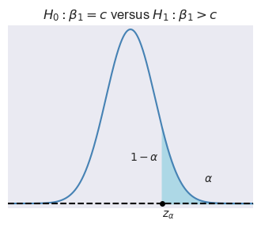
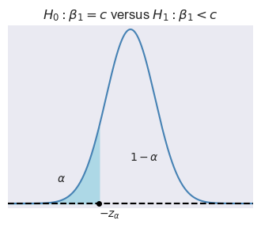
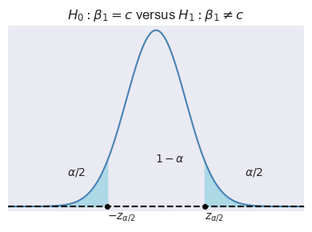

# Regression with a Single Regressor: Hypothesis Tests and Confidence Intervals {#sec-inference1}


```{r}
#| warning: false
#| message: false
# Load necessary libraries
library(tidyverse)
library(modelsummary)
library(readxl)
library(sandwich)
options("modelsummary_factory_default" = "gt")
```

## Testing hypotheses about one of the regression parameters
A hypothesis is a claim about the true value of a parameter. We are interested in formulating hypotheses about the slope parameter $\beta_1$ in the simple linear regression model. The **null hypothesis** states our claim about $\beta_1$ and is denoted by $H_0$. For example, the null hypothesis: $H_0: \beta_{1} = c$ states that $\beta_1$ is equal to the hypothesized value $c$. The **alternative hypothesis** states the scenario in which the null hypothesis does not hold. There are three types of alternative hypotheses:

* Two-sided alternative hypothesis: $H_1: \beta_{1} \ne c$, 
* Left-sided alternative hypothesis: $H_1: \beta_{1} < c$, and
* Right-sided alternative hypothesis: $H_1: \beta_{1} > c$. 

We use the $t$-statistic to test $H_0$:
$$
\begin{align}
t=\frac{\text{estimator-hypothesized value}}{\text{standard error of the estimator}}.
\end{align}
$$
Thus, the $t$-statistic for testing $H_0:\beta_1=c$ takes the following form: 
$$
\begin{align}
t = \frac{\hat{\beta}_{1} - c}{\SE(\hat{\beta}_1)},
\end{align}
$$ {#eq-eq12-1}

where $\SE(\hat{\beta}_1)$ is the square root of the variance of $\hat{\beta}_1$. Note that the test statistic $t$ is formulated under the assumption that $H_0$ holds. 

To compute the $t$-statistic in @eq-eq12-1, we need to determine $\SE(\hat{\beta}_1)$.  In @sec-lrmone, we show that 
$$
\begin{align*}
&\hat{\beta}_1 \stackrel{A}{\sim} N\left(\beta_1, \sigma^2_{\hat{\beta}_1}\right),\,\text{where}\quad\sigma^2_{\hat{\beta}_1} = \frac{1}{n}\frac{\var\left((X_i - \mu_X)u_i\right)}{\left(\sigma^2_X\right)^2},\\
&\hat{\beta}_0 \stackrel{A}{\sim} N\left(\beta_0, \sigma^2_{\hat{\beta}_0}\right),\, \text{where}\quad\sigma^2_{\hat{\beta}_0} = \frac{1}{n}\frac{\var\left(H_i u_i\right)}{\left(\E(H_i^2)\right)^2}\,\,\text{and}\,\, H_i = 1 - \frac{\mu_X}{\E(X_i^2)}X_i.
\end{align*}
$$

We can estimate the variance terms by replacing the unknown terms in $\sigma^2_{\hat{\beta}_1}$ and $\sigma^2_{\hat{\beta}_0}$ by their sample counterparts:
$$
\begin{align}
&\hat{\sigma}^2_{\hat{\beta}_1} = \frac{1}{n}\frac{\frac{1}{n-2}\sum_{i=1}^n(X_i - \bar{X})^2\hat{u}_i^2}{\left(\frac{1}{n}\sum_{i=1}^n(X_i - \bar{X})^2\right)^2},\\
&\hat{\sigma}^2_{\hat{\beta}_0} = \frac{1}{n}\frac{\frac{1}{n-2}\sum_{i=1}^n\hat{H}^2\hat{u}_i^2}{\left(\frac{1}{n}\sum_{i=1}^n\hat{H}_i^2\right)^2}\quad\text{and}\quad  \hat{H}_i = 1 - \frac{\bar{X}}{\frac{1}{n}\sum_{i=1}^nX_i^2}X_i.
\end{align}
$$

Then, $\SE(\hat{\beta}_{1})$ in @eq-eq12-1 can be computed by $\SE(\hat{\beta}_{1})=\sqrt{\hat{\sigma}^2_{\hat{\beta}_1}}$. Also, when the sample size is large, the central limit theorem ensures that
$$
\begin{align}
\hat{\beta}_1 \stackrel{A}{\sim} N\left(\beta_1, \sigma^2_{\hat{\beta}_1}\right)
\implies
\frac{\hat{\beta}_1 - \beta_1}{\sigma_{\hat{\beta}_1}}\stackrel{A}{\sim} N(0,1).
\end{align}
$$

Thus, if $H_0$ is true, then the sampling distribution of the $t$-statistic in @eq-eq12-1 can be approximated by $N(0,1)$ in large samples, i.e., 
$$
t\stackrel{A}{\sim} N(0,1).
$$

Let $\alpha$ be the significance level, i.e., the probability of Type-I error. We can use the asymptotic distribution of $t$, $\alpha$ and the type of the alternative hypothesis to determine the critical values. In @fig-critical_points, depending on the type of alternative hypothesis, we determine the critical values as $z_{\alpha}$, $-z_{\alpha}$, $z_{\alpha/2}$, and $-z_{\alpha/2}$. These values suggest the following rejection regions:

1. $\{z:z>z_{\alpha}\}$ when $H_1:\beta_1>c$, 
2. $\{z:z<-z_{\alpha}\}$ when $H_1:\beta_1<c$, and 
3. $\{z:|z|>z_{\alpha/2}\}$ when $H_1:\beta_1\ne c$. 
 
If the realized value of $t$ falls within a rejection region, then we reject the null hypothesis at the $\alpha\%$ significance level; otherwise, we fail to reject the null hypothesis.

::: {#fig-critical_points layout="[[1,1], [1]]"}

{#fig-f12c1 width=3in}

{#fig-f12c2 width=3in}

{#fig-f12c3 width=3in}

Rejection regions and critical points
:::

:::{#exm-exm12-1}
Assume that $\alpha=5\%$ and $H_1:\beta_1\ne c$. Then, the critical value on the left tail is the $2.5$th percentile of $N(0,1)$, which is $-z_{\alpha/2}=-1.96$, and the critical value on the right tail is the $97.5$th percentile of $N(0,1)$, which is $z_{\alpha/2}=1.96$. In R, we can compute these critical values as follows:

```{r}
left_critical  <- qnorm(0.025, mean = 0, sd = 1)
right_critical <- qnorm(0.975, mean = 0, sd = 1)

cat("Left critical value:", round(left_critical, 2))
cat("Right critical value:", round(right_critical, 2))

```
:::

Alternatively, we can compute  the $p$-value to decide between $H_0$ and $H_1$. The **$p$-value** is the probability of obtaining a test statistic value that is more extreme than the actual one when $H_0$ is correct. Let $t_{\text{calc}}$ be the realized value of the $t$-statistic from @eq-eq12-1. Then, depending on the type of alternative hypothesis, we can determine the $p$-value as 
$$
\begin{align}
\text{$p$-value}=
\begin{cases}
P_{H_0}\left(t > |t_{\text{calc}}|\right)=1-\Phi(|t_{\text{calc}}|)\,\,\text{for}\,\,H_1:\beta_1>c,\\
P_{H_0}\left(t <-|t_{\text{calc}}|\right)=\Phi(-|t_{\text{calc}}|)\,\,\text{for}\,\,H_1:\beta_1<c,\\
P_{H_0}\left(|t| > |t_{\text{calc}}|\right)=2\times\Phi(-|t_{\text{calc}}|)\,\,\text{for}\,H_1:\beta_1\ne c.
\end{cases}
\end{align}
$$

We reject $H_0$ at the $\alpha\%$ significance level if the $p$-value is less than $\alpha$; otherwise, we fail to reject $H_0$.

:::{#exm-exm12-2}
Assume that $\alpha=0.05$ and the realized value of the $t$-statistic is $t_{\text{calc}}=-2.5$. Then, the $p$-value for the two-sided alternative hypothesis is
$$
\begin{align}
\text{$p$-value} = 2\times\Phi(-|-2.5|) = 2\times\Phi(-2.5).
\end{align}
$$

We can compute the $p$-value in R as follows:
```{r}
# Compute p-value
t_calc <- -2.5
p_value <- 2 * pnorm(-abs(t_calc), mean = 0, sd = 1)
cat("p-value:", round(p_value, 4))
```

Since $p\text{-value} < 0.05$, we reject $H_0$ at the $5\%$ significance level.
:::

::: {.callout-note icon=false}
## Key Concept 12.1: Testing $H_0:\beta_1= c$ versus $H_1:\beta_1\ne c$
- Compute the standard error of $\hat{\beta}_1$, $\SE(\hat{\beta}_{1})=\sqrt{\hat{\sigma}^2_{\hat{\beta}_1}}$.
- Compute the $t$-statistic given in @eq-eq12-1 under $H_0$. Reject the nul hypothesis at the $5\%$ significance level if $|t|>1.96$.
- Compute $p$-value from $2\times\Phi(-|t_{\text{calc}}|)$, where $t_{\text{calc}}$ is the actual test statistic computed in the second step. Reject the null hypothesis at the $5\%$ significance level, if the $p$-value is less than $0.05$.
:::

## Application to the test score example
We use the data set contained in the `caschool.xlsx` file to estimate the following model:
$$
\begin{align}
\text{TestScore}_i = \beta_0 + \beta_1 \text{STR}_i + u_i,
\end{align}
$$

In the data set, the test scores are denoted by `testscr` and the student-teacher ratio by `str`. 

```{r}
# Import data
CAschool = read_excel("data/caschool.xlsx")
# Column names
colnames(CAschool)
```

Consider $H_0: \beta_1 = 0$ against $H_1: \beta_1 \neq 0$. We use the `lm` function to estimate the model.

```{r}
# Specify the model
model1 <- lm(testscr ~ str, data = CAschool)
# Use the fit method to obtain parameter estimates
result1 = summary(model1)
# Print the estimation results
print(result1)
```

Using the estimation results, we can compute $t$-statistic as
$$
\begin{align}
t = \frac{\hat{\beta}_1-0}{SE(\hat{\beta}_1)} \approx \frac{-2.28}{0.48} \approx -4.75
\end{align}
$$

Note that the `summary` function also returns the $t$-statistics. The column named `t value` in the output includes the $t$-statistics. Also note that we can return $t$-statistics through `result1$coefficients`:

```{r}
# t-statistics
result1$coefficients[, "t value"]
```

Assume that the significance level is $\alpha = 0.05$. Then, the corresponding critical value can be determined in the following way.

```{r}
# Critical value for 5 percent significance level
critical = qnorm(0.975, mean = 0, sd = 1)
round(critical, 2)
```

Since $|t| = |-4.75| = 4.75 > 1.96$, we reject $H_0$ at the $5\%$ significance level. Thus, the estimated effect of class size on test scores is statistically significant at the $5\%$ significance level.

The $p$-value for the two-sided alternative hypothesis is
$$
\begin{align}
\text{p-value} = \text{Pr}_{H_0}\left(|t| > |t_{\text{calc}}|\right) = 2 \times \Phi(-|t_{\text{calc}}|),
\end{align}
$$

where $t_{\text{calc}}$ is the actual $t$-statistic computed, which is $t\approx -4.75$. Then, we can compute the $p$-value in the following way:

```{r}
# p-value for the two-sided alternative hypothesis
t = result1$coefficients["str", "t value"]
2 * pnorm(-abs(t), mean = 0, sd = 1)
```

Alternatively, we can extract $p$-values from `result1$coefficients`:

```{r}
# p-values
result1$coefficients[, "Pr(>|t|)"]
```

Note that this value is slightly different from the one that we computed above by `2 * pnorm(-abs(t), mean = 0, sd = 1)`. By default, the `lm` function uses the $t$ distribution for the computation. Thus, we need to use the t distribution to get the same result:

```{r}
t = result1$coefficients["str", "t value"]
p_value = 2 * pt(-abs(t), df=418)
p_value
```

Again, since $p\text{-value} < 0.05$, we reject $H_0$ at the $5\%$ significance level.

## Confidence intervals for a regression parameter
Recall that the $95\%$ two-sided confidence interval can be equivalently defined in the following ways:

* It is the set of points that cannot be rejected in a two-sided hypothesis testing problem with the $5\%$ significance level.
* It is a set-valued function of the data (an interval that is a function of the data) that contains the true parameter value $95\%$ of the time in repeated samples.

Then, the $95\%$ two-sided confidence interval for $\beta_1$ refers to the set of values for $\beta_1$ such that $P\left(\left\{\beta_1:\left|\frac{\hat{\beta}_1-\beta_1}{SE(\hat{\beta}_1)}\right|\le 1.96\right\}\right) = 0.95$. We can express the set $\left\{\beta_1:\left|\frac{\hat{\beta}_1-\beta_1}{SE(\hat{\beta}_1)}\right|\le 1.96\right\}$ in a more convenient way:
$$
\begin{align*}
&\left\{\beta_1:\left|\frac{\hat{\beta}_1-\beta_1}{\SE(\hat{\beta}_1)}\right|\le 1.96\right\}=\left\{\beta_1:-1.96\le \frac{\hat{\beta}_1-\beta_1}{\SE(\hat{\beta}_1)}\le 1.96\right\}\\
&=\left\{\beta_1:-\hat{\beta}_1-1.96\, \SE(\hat{\beta}_1)\le -\beta_1\le -\hat{\beta}_1+1.96\, \SE(\hat{\beta}_1)\right\}\\
&=\left\{\beta_1:\hat{\beta}_1 + 1.96 \, \SE(\hat{\beta}_1)\ge \beta_1\ge \hat{\beta}_1 -1.96\, \SE(\hat{\beta}_1)\right\}\\
&=\left\{\beta_1:\hat{\beta}_1 - 1.96 \, \SE(\hat{\beta}_1)\le \beta_1\le \hat{\beta}_1 +1.96\, \SE(\hat{\beta}_1)\right\}.
\end{align*}
$$

In our test score example, the $95\%$ confidence interval is computed in the following way:

```{r}
# Confidence interval for beta_1
lower_bound = result1$coefficients["str", "Estimate"] - critical*result1$coefficients["str", "Std. Error"]
upper_bound = result1$coefficients["str", "Estimate"] + critical*result1$coefficients["str", "Std. Error"]
round(c(lower_bound, upper_bound), 6)
```
Alternatively, we can use the `confint` function to compute the confidence interval:

```{r}
# Confidence interval
confint(model1, level = 0.95)
```


Again note that these values are slightly different from the ones that we computed above by `lower_bound` and `upper_bound`. By default, the `lm` function uses the critical value from the $t$ distribution for the computation. Finally, note that the $95\%$ two-sided confidence interval does not include the hypothesized value in $H_0:\beta_1=0$, and therefore, we reject $H_0$ at the $5\%$ significance level.

::: {.callout-note icon=false}
## Key Concept 12.2: Confidence Intervals for $\beta_1$
The $95\%$ two-sided confidence interval for $\beta_1$ is an interval that includes $\beta_1$ in $95\%$ of all possible random samples. When the sample size is large, the two-sided confidence intervals are as follows:

- The $90\%$ two-sided confidence interval for $\beta_1$ is $\{\beta_1: \hat{\beta}_1 \pm 1.64 \times \text{SE}(\hat{\beta}_1)\}$.
- The $95\%$ two-sided confidence interval for $\beta_1$ is $\{\beta_1: \hat{\beta}_1 \pm 1.96 \times \text{SE}(\hat{\beta}_1)\}$.
- The $99\%$ two-sided confidence interval for $\beta_1$ is $\{\beta_1: \hat{\beta}_1 \pm 2.58\times \text{SE}(\hat{\beta}_1)\}$.
:::

## Regression when $X$ is a binary variable

In this section, we consider the following regression model:
$$
\begin{align}
Y_i &= \beta_0 + \beta_1 D_i + u_i, \quad i = 1,2,\dots,n,
\end{align}
$$

where $D_i$ is a dummy variable defined as
$$
\begin{align*}
D_i &= \left\{\begin{array}{ll}
1, &\text{STR}_i < 20,\\
0, &\text{STR}_i \geq 20.
\end{array}\right.
\end{align*}
$$

Under the least squares assumptions, if the student-teacher ratio is high, i.e., $D_i = 0$, then $\E(Y_i|D_i = 0) = \beta_0$. However, if the student-teacher ratio is low, i.e., $D_i = 1$, then $\E(Y_i|D_i = 1) = \beta_0 + \beta_1$. Hence,
$$
\begin{align*}
\E(Y_i|D_i = 1) - \E(Y_i|D_i = 0) &= \beta_0 + \beta_1 - \beta_0 = \beta_1.
\end{align*}
$$

That is, $\beta_1$ gives the difference between the mean test score in districts with low student-teacher ratios and the mean test score in districts with high student-teacher ratios.

The dummy variable can be created by using a logical operator. The command `mydata$str < 20` will return $1$ if $STR < 20$, otherwise $0$. 

```{r}
# Create the dummy variable D
CAschool$D <- CAschool$str < 20

# Display first rows of selected columns
head(CAschool[, c("testscr", "str", "D")])
```

@fig-fig12-2 shows the scatter plot of `TestScore` and `D`. Since `D` takes only two values, namely $0$ and $1$, we observe that the data points are clustered at `x=0` and `x=1`. 

```{r}
#| fig-cap: Scatterplot of D and Test Score.
#| label: fig-fig12-2
#| fig-width: 5
#| fig-height: 3
# Scatterplot without jitter
ggplot(CAschool, aes(x = D, y = testscr)) +
  geom_point(color = "steelblue", size = 0.5) +
  labs(x = "D", y = "Test Score")
```

In @fig-fig12-3, we create a jittered version of `D` by adding some random noise: `jittered_D = CAschool['D'] + np.random.normal(0, 0.02, size=len(CAschool['D']))`, and construct a scatter plot between `TestScore` and `jittered_D`.

```{r}
#| fig-cap: Scatterplot of D and Test Score.
#| label: fig-fig12-3
#| fig-width: 5
#| fig-height: 3
# Scatterplot with jitter
ggplot(CAschool, aes(x = D, y = testscr)) +
  geom_jitter(
    width = 0.02,   # jitter scale (matches np.random.normal(0, 0.02))
    size = 1,
    color = "steelblue"
  ) +
  labs(x = "D", y = "Test Score")
```

As in the case of a continuous regressor, we can use the `lm` function to estimate a dummy variable regression model. 
```{r}
# Specify the model
model2 <- lm(testscr ~ D, data = CAschool)

# Obtain parameter estimates
result2 <- summary(model2)

# Print the estimation results
print(result2)
```

The estimated regression function is
$$
\begin{align}
\widehat{\text{TestScore}}_i = 649.98 + 7.38 D_i. 
\end{align}
$$

The estimate of $\beta_1$ is $7.38$, which indicates that students in the districts with `STR < 20` have on average $7.38$ more points than students in other districts. 

@fig-fig12-4 shows the scatter plot along with the estimated regression function. Since $\beta_1=7.38$, the estimated regression line is upward sloping, which indicates that the test scores are higher in districts with low student-teacher ratios. 

```{r}
#| fig-cap: The dummy variable regression model
#| label: fig-fig12-4
#| fig-width: 5
#| fig-height: 3
#| warning: false
#| message: false
# Dummy variable regression plot
ggplot(CAschool, aes(x = as.numeric(D), y = testscr)) +
  geom_jitter(width = 0.02, size = 0.8, color = "steelblue") +
  geom_smooth(method = "lm", se = FALSE, color = "black", linewidth = 0.6) +
  labs(
    x = "D",
    y = "Test Score"
  )
```

## Heteroskedasticity versus Homoskedasticity

In the least squares assumptions introduced in @sec-lrmone, we only assume the zero-conditional mean assumption about the error terms. Other than this assumption, we do not impose any structure on the error term $u_i$. In this section, we introduce two concepts about the conditional variance of the error term $u_i$ given $X_i$: homoskedasticity and heteroskedasticity. We say that the error term $u_i$ is **homoskedastic** if the variance of $u_i$ given $X_i$ is constant for all $i = 1,2,\dots,n$. In particular, this means that the variance does not depend on $X_i$. On the other hand, if the variance does depend on $X_i$, we say that the error term $u_i$ is **heteroskedastic**.

Homoskedasticity and heteroskedasticity do not affect the unbiasedness and consistency of the OLS estimators of $\beta_0$ and $\beta_1$. However, they do affect the variance formulas of the OLS estimators as shown in @sec-lrmone. Under homoskedasticity, let $\var(u_i|X_i)=\sigma^2_u$, where $\sigma^2_u$ is an unknown scalar parameter. Then, the variance formulas of $\hat{\beta}_1$ and $\hat{\beta}_0$ simplify to
$$
\begin{align*}
&\sigma^2_{\widehat{\beta}_1} = \frac{1}{n}\frac{\var\left((X_i - \mu_X)u_i\right)}{\left(\var(X_i)\right)^2} = \frac{\sigma^2_u}{n\var(X_i)},\\
&\sigma^2_{\hat{\beta}_0} = \frac{1}{n}\frac{\var\left(H_i u_i\right)}{\left(\E(H_i^2)\right)^2} = \frac{\E(X^2_i)\sigma^2_u}{n\sigma^2_X}.
\end{align*}
$$

These variances are called the **homoskedasticity-only variances**. They can be estimated as
$$
\begin{align*}
&\hat{\sigma}^2_{\hat{\beta}_1} = \frac{\frac{1}{n-2}\sum_{i=1}^n \hat{u}_i^2}{\sum_{i=1}^n(X_i - \bar{X})^2},\\
&\hat{\sigma}^2_{\hat{\beta}_0}=\frac{\left(\frac{1}{n}\sum_{i=1}^nX^2_i\right)\left(\frac{1}{n-2}\sum_{i=1}^n \hat{u}_i^2\right)}{\frac{1}{n}\sum_{i=1}^n(X_i - \bar{X})^2}.
\end{align*}
$$

The `lm` function uses these formulas to compute the standard errors, i.e., it only reports the homoskedasticity-only standard errors. To get heteroskedasticity-robust standard errors, we use the `vcovHC` function from the `sandwich` package.

```{r}
result3 <- lm(testscr ~ str,
         data = CAschool)
vcov <- vcovHC(result3, type = "HC1")
robust_se <- sqrt(diag(vcov))
```

In the following, we use the `modelsummary` function to present results side by side. Note that we use the `vcov = list(NULL, robust_se)` option to specify the standard errors for each model. Alternatively, we can also use `vcov=c("classical", "HC1")` to obtain the same result. Note that in this alternative approach, we do not need to compute the robust standard errors manually through the `vcovHC` function. The estimation results are presented in @tbl-t12-1. The estimation results in this table indicate that the heteroskedasticity-robust standard errors are relatively large.

```{r}
#| tbl-cap: "The estimation results for the test scores regressions"
#| label: tbl-t12-1
modelsummary(
  list(
    "Homoskedastic"   = result3,
    "Heteroskedastic" = result3
  ),
  vcov = list(NULL, robust_se),
  stars = TRUE
)
```

::: {.callout-note icon=false}
## Key Concept 12.3: Heteroskedasticity and Homoskedasticity
* The error terms are said to be heteroskedastic if $\var(u_i|X_i)$ depends on $X_i$. 
* If $\var(u_i|X_i)$ is constant, then the error terms are aid to be homoskedastic. 
* Regardless of whether the errors are homoskedastic or heteroskedastic, the OLS estimators of $\beta_0$ and $\beta_1$ remain unbiased, consistent, and asymptotically normal. 
* Heteroskedasticity and homoskedasticity only affect the variance formulas of the OLS estimators.
:::

In practice, which standard errors should we use? @Stock2020 write that "At a general level, economic theory rarely gives any reason to believe that the errors are homoskedastic. It therefore is prudent to assume that the errors might be heteroskedastic unless you have compelling reasons to believe otherwise." Therefore, we recommend using heteroskedasticity-robust standard errors in practice.

## The theoretical foundation of the ordinary least squares method

In this section, we consider the OLS estimator of $\beta_1$ under the following assumptions.

::: {.callout-important icon=false}
## The Gauss–Markov Assumptions
1. The zero-conditional mean assumption: $\E(u_i |X_i) = 0$. 
2. The random sampling assumption: $(X_i, Y_i):\, i =1,2,\dots,n$ are independently and identically distributed (i.i.d.) across observations.
3. The no large outliers assumption: $\E(X_i^4)<\infty$ and $\E(Y_i^4)<\infty$.
4. The homoskedasticity assumption: $\var(u_i|X_i)$ is constant for $i =1,2,\dots,n$.
:::

Under these extended assumptions, the following theorem justifies the use of the OLS method.

::: {#thm-thm12.1}
## The Gauss-Markov Theorem for $\hat{\beta}_1$
Under Gauss–Markov Assumption, the OLS estimator of $\beta_1$ is the best (most efficient) linear conditionally unbiased estimator (BLUE).
:::

The proof of this theorem is given in @Stock2020. The Gauss-Markov theorem states that the OLS estimator $\hat{\beta}_1$ has the smallest conditional variance among all conditionally unbiased estimators that are linear functions of $Y_1,\dots,Y_n$. There are two limitations to this theorem. First, it requires the strong assumption that error terms are homoskedastic, which mostly does not hold in empirical applications. Second, there exist conditionally biased and non-linear estimators that are more efficient than the OLS estimator. We discuss such estimators in @sec-chapter21. 

In the next chapter, we introduce the multiple linear regression model. In @sec-chapter26, we extend the Gauss-Markov theorem to the multiple linear regression model.
